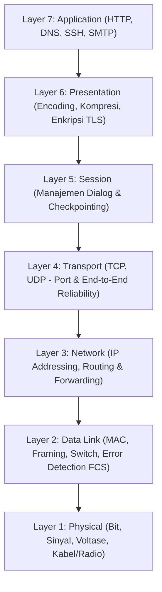
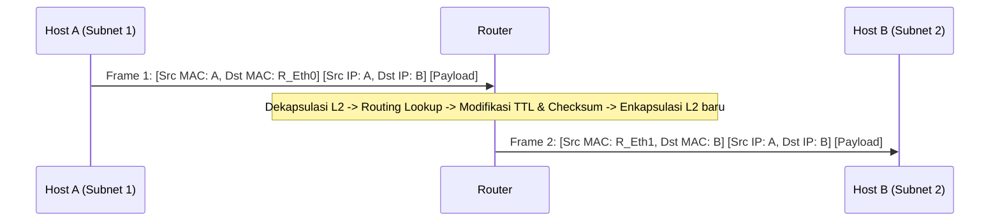
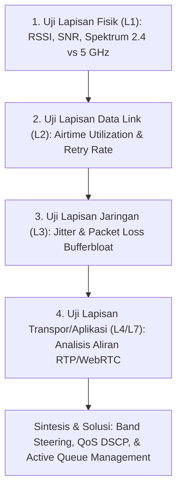
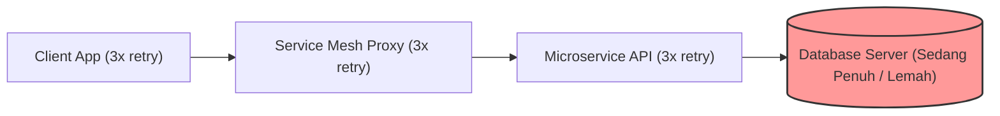
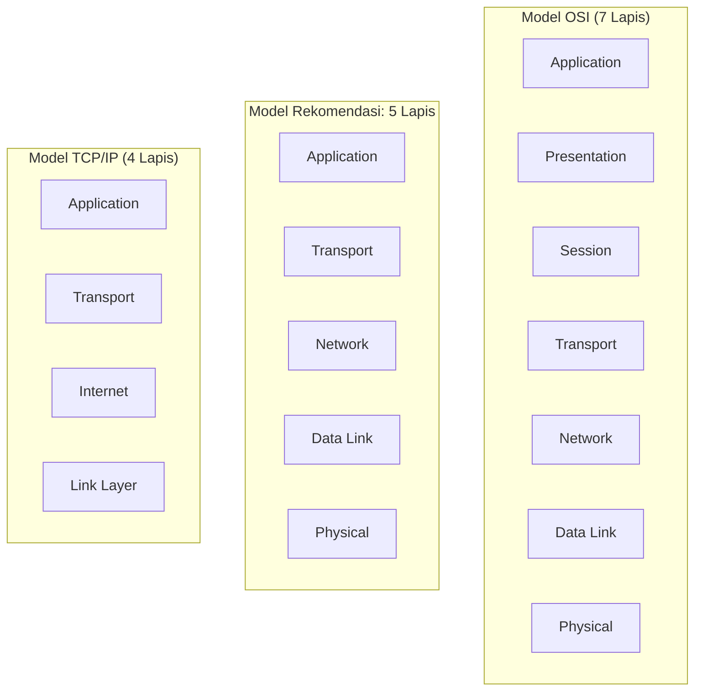

# TUGAS KONSEP JARINGAN
## TUGAS KE – 2: Model Berlapis OSI dan TCP/IP (Bab 2 Bagian A, B, dan C)

| Informasi | Keterangan |
| :--- | :--- |
| **Nama** | Shevanka Bagus Dwiyudi Kurniawan |
| **NRP** | 3125600044 |
| **Dosen Pengajar** | Dr. Ferry Astika Saputra, ST, M.Sc |
| **Program Studi** | D4 Teknik Informatika |
| **Institusi** | Politeknik Elektronika Negeri Surabaya (PENS) |
| **Tahun** | 2026 |

---

## Daftar Isi Soal

- [Level A — Ingatan dan Pemahaman (No. 1 – 10)](#level-a--ingatan-dan-pemahaman)
- [Level B — Penerapan dan Analisis (No. 11 – 20)](#level-b--penerapan-dan-analisis)
- [Level C — Evaluasi dan Sintesis (No. 21 – 30)](#level-c--evaluasi-dan-sintesis)

---

## Level A — Ingatan dan Pemahaman

### 1. Alasan Komunikasi Jaringan Disusun Berlapis
Komunikasi jaringan modern sangat kompleks karena melibatkan transmisi fisik sinyal elektronika/fotonik, deteksi kesalahan transmisi, perutean dinamis melintasi benua, penanganan keandalan transport, hingga pemrosesan logika aplikasi. Komunikasi jaringan disusun berlapis (*layered architecture*) karena alasan-alasan fundamental berikut:
1. **Modularitas dan Pembagian Tugas (*Separation of Concerns*):** Memecah kompleksitas sistem komunikasi menjadi subsistem-subsistem yang lebih kecil, independen, dan terkelola dengan baik. Setiap lapisan berfokus menyelesaikan satu kelompok masalah spesifik tanpa perlu mengetahui kompleksitas implementasi lapisan lainnya.
2. **Standardisasi dan Interoperabilitas Multi-Vendor:** Menyediakan antarmuka komunikasi baku yang memungkinkan perangkat keras dan perangkat lunak dari vendor yang berbeda (misalnya kartu jaringan Intel, switch Cisco, server Linux, dan router MikroTik) dapat saling bertukar data secara mulus.
3. **Fleksibilitas dan Kemudahan Evolusi Teknologi:** Perubahan teknologi pada suatu lapisan tidak akan merusak lapisan lainnya (*independent evolution*). Sebagai contoh, beralihnya media transmisi dari kabel tembaga (Ethernet) ke gelombang radio (Wi-Fi 7) atau serat optik tidak mengharuskan aplikasi peramban web (HTTP/HTTPS) atau protokol transport (TCP/UDP) ditulis ulang.
4. **Kemudahan Analisis dan Penelusuran Masalah (*Structured Troubleshooting*):** Memungkinkan teknisi jaringan mengisolasi dan mendiagnosis gangguan secara bertahap dan sistematis, baik menggunakan metode *bottom-up* (dari lapisan fisik ke aplikasi) maupun *top-down*.

---

### 2. Perbedaan Layanan, Antarmuka, dan Protokol
Konsep dasar arsitektur berlapis membedakan dengan tegas tiga elemen berikut:

| Elemen | Definisi Formal | Karakteristik Operasional | Contoh Nyata |
| :--- | :--- | :--- | :--- |
| **Layanan (*Service*)** | Himpunan kapabilitas, fungsi, atau operasi yang disediakan oleh lapisan $(N)$ kepada entitas pada lapisan di atasnya $(N+1)$. | Menjelaskan **apa** (*what*) yang disediakan oleh lapisan tersebut, bukan bagaimana cara kerjanya. | Layanan transfer data andal (*reliable stream delivery*), layanan datagram tanpa koneksi. |
| **Antarmuka (*Interface / SAP*)** | Titik temu (*Service Access Point*) atau mekanisme lokal tempat lapisan $(N+1)$ meminta dan mengakses layanan dari lapisan $(N)$ dalam satu host yang sama. | Bersifat lokal pada satu mesin; mendefinisikan parameter fungsi dan panggilan sistem (*syscall*). | BSD Socket API (`socket()`, `connect()`, `send()`, `recv()`), fungsi NDIS pada sistem operasi Windows. |
| **Protokol (*Protocol*)** | Kumpulan aturan formal, format sintaksis pesan, semantik arti field, serta sinkronisasi urutan pertukaran data antara dua entitas sejawat (*peer entities*). | Beroperasi secara horizontal melintasi jaringan antar dua perangkat yang berkomunikasi. | Protokol IPv4 (RFC 791), TCP (RFC 9293), HTTP/2 (RFC 9113), BGP (RFC 4271). |

---

### 3. Tujuh Lapisan Model OSI (Bawah ke Atas) dan Fungsi Utamanya
Model OSI (*Open Systems Interconnection*, ISO/IEC 7498-1) mendefinisikan tujuh tingkatan abstraksi komunikasi:



1. **Layer 1 — Lapisan Fisik (*Physical Layer*):**
   Bertanggung jawab mentransmisikan bit mentah (*raw bitstream*) melalui media transmisi fisik. Mengatur karakteristik mekanis kabel, spesifikasi elektrik (tegangan listrik, pulsa fotonik, modulasi radio frekuensi), laju transfer bit (*bit rate*), dan sinkronisasi bit clock.
2. **Layer 2 — Lapisan Tautan Data (*Data Link Layer*):**
   Mengatur pengiriman data antar perangkat dalam satu domain tautan lokal (*link domain*). Mengelompokkan bit menjadi **Frame**, mengelola pengalamatan fisik (*Hardware/MAC Address*), mengatur kendali akses media transmisi bersama (*Medium Access Control* seperti CSMA/CD atau CSMA/CA), serta melakukan deteksi kesalahan transmisi menggunakan *Frame Check Sequence* (FCS/CRC).
3. **Layer 3 — Lapisan Jaringan (*Network Layer*):**
   Bertanggung jawab merutekan paket data melintasi beberapa jaringan yang berbeda (*internetworking*). Mengelola pengalamatan logis global (*Logical IP Address*), pemilihan jalur terbaik (*routing path determination* via protokol OSPF, BGP), penerusan (*forwarding*), serta fragmentasi paket jika ukuran melampaui MTU.
4. **Layer 4 — Lapisan Transpor (*Transport Layer*):**
   Menyediakan komunikasi logis ujung-ke-ujung (*end-to-end*) antar-proses aplikasi pada host yang berbeda. Mengatur segmentasi dan perakitan kembali data (*reassembly*), *multiplexing/demultiplexing* menggunakan nomor port, kendali aliran data (*flow control*), kendali kongesti jaringan (*congestion control*), serta jaminan pengiriman data andal (*reliability* via ACK dan retransmisi).
5. **Layer 5 — Lapisan Sesi (*Session Layer*):**
   Mengelola pembentukan (*establishment*), pemeliharaan, sinkronisasi (*checkpointing/recovery*), dan penutupan sesi dialog komunikasi antar aplikasi. Mengatur mekanisme percakapan *simplex*, *half-duplex*, atau *full-duplex*.
6. **Layer 6 — Lapisan Presentasi (*Presentation Layer*):**
   Menangani sintaksis dan semantik data yang dikirimkan. Bertanggung jawab atas transformasi format data (*data translation/formatting* seperti ASCII, EBCDIC, UTF-8, JSON, ASN.1), kompresi data untuk efisiensi kapasitas, serta enkripsi dan dekripsi data demi keamanan komunikasi.
7. **Layer 7 — Lapisan Aplikasi (*Application Layer*):**
   Lapisan teratas yang berinteraksi langsung dengan aplikasi pengguna akhir (*user-space software*). Menyediakan protokol layanan jaringan tingkat tinggi seperti penelusuran web (HTTP/HTTPS), resolusi nama domain (DNS), transfer berkas (FTP/SFTP), surat elektronik (SMTP/IMAP), dan akses terminal jarak jauh (SSH).

---

### 4. Empat Lapisan Model TCP/IP (RFC 1122)
Sesuai dokumen standar arsitektur Internet resmi **RFC 1122** (*Requirements for Internet Hosts*), model arsitektur protokol Internet TCP/IP terdiri dari 4 lapisan:
1. **Link Layer (Network Interface Layer):** Lapisan antarmuka perangkat keras dan protokol tautan lokal (menggabungkan fungsi fisik dan data link, contoh: Ethernet IEEE 802.3, Wi-Fi IEEE 802.11, ARP, PPP).
2. **Internet Layer:** Lapisan perutean paket melintasi batasan jaringan menggunakan protokol *Internet Protocol* (IPv4 dan IPv6), didukung oleh ICMP dan IGMP.
3. **Transport Layer:** Lapisan komunikasi ujung-ke-ujung antar-proses aplikasi, menyediakan mode transmisi andal berorientasi koneksi (*TCP*) atau transmisi cepat nir-koneksi (*UDP*).
4. **Application Layer:** Lapisan seluruh protokol aplikasi tingkat tinggi, mencakup fungsi representasi data dan dialog sesi secara terpadu (HTTP, DNS, SSH, SMTP, DHCP, TLS).

---

### 5. Alasan Model TCP/IP Kadang Disajikan Sebagai Lima Lapisan
Dalam literatur akademik jaringan modern (seperti buku teks karya *Andrew S. Tanenbaum* dan *James F. Kurose*), model TCP/IP sering kali disajikan dalam **lima lapisan** (*Five-Layer Hybrid Model*):
1. **Application Layer**
2. **Transport Layer**
3. **Network (Internet) Layer**
4. **Data Link Layer**
5. **Physical Layer**

**Alasan Pedagogis & Teknis:**
Model 4-lapisan RFC 1122 menggabungkan seluruh fungsi perangkat keras jaringan ke dalam satu lapisan *Link Layer*. Padahal, secara prinsip rekayasa telekomunikasi, mekanisme transmisi bit fisik (sinyal voltase, serat optik, modulasi RF Wi-Fi pada *Physical Layer*) memiliki landasan teori, sifat error, dan karakteristik perangkat keras yang sangat berbeda dibandingkan mekanisme pembingkaian frame, pengalamatan MAC, deteksi kesalahan CRC, dan pensakelar switch (*Data Link Layer*). Pemisahan menjadi lima lapisan memudahkan mahasiswa memahami perbedaan antara infrastruktur kabel/gelombang dengan logika switching lokal.

---

### 6. Perbedaan Frame, IP Packet, TCP Segment, dan UDP Datagram

| PDU (*Protocol Data Unit*) | Lapisan (*Layer*) | Header Utama | Karakteristik & Fungsi |
| :--- | :--- | :--- | :--- |
| **Frame** | Data Link (Layer 2) | MAC Sumber, MAC Tujuan, EtherType, VLAN Tag (opsional), FCS/CRC (Trailer). | Unit data yang ditransmisikan pada tautan fisik lokal. Dibuang dan dibungkus ulang di setiap hop router. |
| **IP Packet (Datagram)** | Network / Internet (Layer 3) | IP Sumber, IP Tujuan, Version, IHL/Length, TTL/Hop Limit, Protocol ID, Checksum (IPv4). | Unit data perutean global independen (*end-to-end*). Melewati berbagai hop router tanpa mengubah IP asal/tujuan (kecuali ada NAT). |
| **TCP Segment** | Transport (Layer 4) | Port Sumber, Port Tujuan, Sequence Number, Ack Number, Flags (SYN, ACK, FIN, RST), Window Size. | Unit data berorientasi koneksi (*connection-oriented*). Memiliki mekanisme penomoran byte terurut, jaminan keandalan, dan kontrol aliran data. |
| **UDP Datagram** | Transport (Layer 4) | Port Sumber, Port Tujuan, Length, Checksum (hanya 8 byte total). | Unit data nir-koneksi (*connectionless*). Berorientasi pesan (*message-oriented*), ringan, cepat, tanpa jaminan urutan maupun retransmisi bawaan. |

---

### 7. Definisi Header, Trailer, dan Payload
- **Header:** Blok informasi metadata kendali yang disisipkan di **bagian depan (awal)** dari unit data protokol (PDU). Header berisi instruksi yang dibutuhkan oleh entitas protokol pada lapisan yang sama di perangkat penerima, seperti alamat asal/tujuan, panjang paket, nomor urut, kode verifikasi, dan identitas protokol lapisan di atasnya.
- **Trailer:** Blok informasi kendali yang disisipkan di **bagian belakang (ekor)** dari unit data protokol. Trailer terutama ditemukan pada *Data Link Layer* (Layer 2) dan enkripsi paket (seperti IPsec ESP), yang umumnya memuat nilai redundansi pemeriksaan integritas data seperti *Frame Check Sequence* (FCS) berbasis *Cyclic Redundancy Check* (CRC-32) untuk mendeteksi *bit error* selama propagasi fisik.
- **Payload:** Muatan data aktual bersih yang dibawa oleh suatu PDU. Payload merupakan unit data dari lapisan di atasnya (*Service Data Unit* / SDU) yang belum dibubuhi oleh header lapisan saat ini.

---

### 8. Enkapsulasi dan Dekapsulasi
- **Enkapsulasi (*Encapsulation*):** Proses sistematis pada host pengirim di mana data bergerak **turun** dari lapisan atas ke lapisan bawah (*top-down*). Setiap lapisan memperlakukan data dari lapisan atas sebagai muatan mentah (*payload*), lalu membungkusnya dengan menambahkan *header* miliknya sendiri (serta *trailer* pada Layer 2).
  Contoh: Data Aplikasi $\rightarrow$ dibungkus Header TCP menjadi *Segment* $\rightarrow$ dibungkus Header IP menjadi *Packet* $\rightarrow$ dibungkus Header & Trailer Ethernet menjadi *Frame* $\rightarrow$ diubah menjadi sinyal bit pada *Physical Layer*.
- **Dekapsulasi (*Decapsulation*):** Proses kebalikannya pada host penerima di mana data bergerak **naik** dari lapisan terbawah ke lapisan teratas (*bottom-up*). Setiap lapisan membaca dan memvalidasi header miliknya, mengeksekusi fungsi protokol (memeriksa error, mencocokkan alamat), melepas (*strip*) header tersebut, lalu meneruskan sisa payload murninya ke entitas protokol yang tepat pada lapisan di atasnya.

---

### 9. Fungsi Multiplexing dan Demultiplexing
- **Multiplexing (pada Pengirim):** Kemampuan suatu lapisan protokol untuk mengumpulkan data dari banyak proses aplikasi atau entitas protokol yang berbeda pada lapisan atas, lalu mengalirkan seluruh data tersebut melalui satu saluran atau protokol bersama pada lapisan di bawahnya. Hal ini memungkinkan satu antarmuka fisik tunggal (misal satu kartu jaringan/NIC) dan satu alamat IP dipakai bersamaan oleh ratusan proses aplikasi (web browsing, streaming musik, download game, chat) secara bersamaan.
- **Demultiplexing (pada Penerima):** Proses penguraian aliran data gabungan yang diterima oleh lapisan bawah, untuk kemudian diarahkan secara tepat ke proses aplikasi atau entitas protokol yang berhak menerima pada lapisan di atasnya, berdasarkan **field pengenal demultiplexing** (*demultiplexing keys* seperti EtherType, Protocol ID, dan Port Number).

---

### 10. Mengapa OSI Tidak Boleh Dianggap Sebagai Spesifikasi Implementasi
Model referensi OSI (ISO/IEC 7498) adalah sebuah **kerangka acuan konseptual abstrak**, bukan dokumen spesifikasi teknis implementasi perangkat lunak atau kode program nyata (*reference model vs implementation specification*).
1. **Tingkat Abstraksi:** OSI mendefinisikan *apa* fungsi yang secara ideal harus ada pada setiap lapisan hierarki komunikasi, tetapi secara sengaja tidak mendikte bagaimana struktur data di memori kernel, format panggilan API, atau algoritma penjadwalan CPU diimplementasikan.
2. **Ketidaksesuaian Protokol Nyata:** Standar tumpukan protokol resmi buatan OSI (seperti FTAM, X.400, TP4, CLNP) terbukti sangat birokratis, boros komputasi (*high overhead*), sulit diimplementasikan, dan gagal bersaing di pasar industri nyata.
3. **Kemenangan Prinsip Praktis TCP/IP:** Internet sukses berkembang bukan karena protokol ISO/OSI, melainkan berkat filosofi rekayasa IETF: *"rough consensus and running code"*. Oleh karena itu, OSI diposisikan sebagai pedoman konseptual dan terminologi pedagogis universal, bukan spesifikasi pembuatan driver atau tumpukan jaringan operasional.

---

## Level B — Penerapan dan Analisis

### 11. Pemetaan Protokol ke Model TCP/IP

| Protokol | Lapisan Model TCP/IP | Status Pemetaan & Penjelasan Teknis Khusus |
| :--- | :--- | :--- |
| **HTTP** | Application | Standar protokol transfer hiperteks di tingkat aplikasi. |
| **DNS** | Application | Layanan resolusi nama basis data terdistribusi di tingkat aplikasi (menggunakan port UDP/TCP 53). |
| **TLS** | Application / Antara Transport & Application | ⚠️ **Perlu Penjelasan:** Sering dikategorikan sebagai *Presentation Layer* di OSI. Di TCP/IP, TLS berjalan di atas TCP (Layer 4) tetapi berada di bawah protokol aplikasi (HTTP), mengenkripsi payload aplikasi sebelum diserahkan ke socket transport. |
| **TCP** | Transport | Protokol transport andal berorientasi koneksi standar. |
| **UDP** | Transport | Protokol transport ringan nir-koneksi standar. |
| **QUIC** | Transport | ⚠️ **Perlu Penjelasan:** Berjalan secara teknis di dalam payload UDP (port 443), namun secara fungsional menyediakan layanan transport penuh (koneksi, loss recovery, enkripsi bawaan, multiplexing stream) untuk menggantikan peran TCP + TLS. |
| **IPv6** | Internet / Network | Protokol pengalamatan logis dan perutean global generasi penerus (128-bit). |
| **ICMP** | Internet / Network | ⚠️ **Perlu Penjelasan:** Paket ICMP dibungkus (*encapsulated*) di dalam payload IP seperti halnya protokol transport (Protocol ID 1 untuk IPv4 / 58 untuk IPv6), namun fungsionalitasnya murni untuk kendali, kesalahan, dan diagnostik pada Internet Layer. |
| **Ethernet** | Link (Data Link & Physical) | Standar IEEE 802.3 yang mencakup fungsi framing MAC (Data Link) dan modulasi tembaga/optik (Physical). |
| **Wi-Fi** | Link (Data Link & Physical) | Standar IEEE 802.11 yang mencakup fungsi CSMA/CA MAC (Data Link) dan spektrum radio RF (Physical). |

---

### 12. Enkapsulasi Permintaan DNS (UDP, IPv4, Ethernet) dan Kunci Demultiplexing

```text
+-----------------------+---------------------+-------------------+---------------------+-----------------------+
| Ethernet Header (14B) | IPv4 Header (20B)   | UDP Header (8B)   | DNS Query Payload   | Ethernet FCS/CRC (4B) |
+-----------------------+---------------------+-------------------+---------------------+-----------------------+
                        ^                     ^                   ^
                        |                     |                   |
            EtherType = 0x0800       Protocol ID = 17       Dest Port = 53
```

**Pengenal Batas (*Demultiplexing Identifiers*):**
1. **Batas Data Link ke Network (Ethernet $\rightarrow$ IPv4):**  
   Field **EtherType** pada header Ethernet bernilai `0x0800`. Nilai ini memberi tahu kartu jaringan penerima bahwa payload frame harus diserahkan ke subsistem modul IPv4 kernel.
2. **Batas Network ke Transport (IPv4 $\rightarrow$ UDP):**  
   Field **Protocol** pada header IPv4 bernilai `17` (heksadesimal `0x11`). Nilai ini menginstruksikan stack IP untuk meneruskan paket ke modul protokol UDP.
3. **Batas Transport ke Application (UDP $\rightarrow$ DNS):**  
   Field **Destination Port Number** pada header UDP bernilai `53`. Sistem operasi menggunakan nomor port 53 untuk meneruskan pesan ke proses daemon DNS (seperti BIND, Unbound, atau CoreDNS).

---

### 13. Enkapsulasi HTTP/3 melalui QUIC dan Alasan QUIC Berstatus Lapisan Transpor
**Struktur Enkapsulasi:**
```text
+-----------------------+---------------------+------------------+-----------------------+------------------------+-----------------+
| Ethernet Header (14B) | IP Header (v4/v6)   | UDP Header (8B)  | QUIC Header & Frames  | HTTP/3 Payload Data    | Ethernet FCS    |
+-----------------------+---------------------+------------------+-----------------------+------------------------+-----------------+
                        ^                     ^                  ^                       ^
                   EtherType               Proto 17           Port 443              Stream ID / Frames
```

**Mengapa QUIC Tetap Dianggap Protokol Transport Meskipun Menggunakan UDP:**
1. **Menghindari Kebekuan Middlebox (*Middlebox Ossification*):** Router, firewall, dan NAT komersial di Internet telah terprogram secara kaku untuk hanya mengenali paket TCP (Protocol 6) atau UDP (Protocol 17). Jika IETF menciptakan protokol layer 3/4 baru di header IP mentah, mayoritas perangkat jaringan akan membuangnya (*drop*). Oleh karena itu, QUIC sengaja dibungkus di dalam datagram UDP sebagai "tumpangan transport".
2. **Menyediakan Layanan Transport Penuh:** QUIC mengimplementasikan sendiri fungsi-fungsi klasik transport layer secara independen:
   - Pembentukan koneksi cepat (*1-RTT / 0-RTT Connection Establishment*).
   - Penomoran paket (*Packet Numbering*) dan mekanisme *ACK-based Loss Recovery*.
   - Algoritma kendali aliran (*Flow Control*) per-koneksi dan per-stream.
   - Kendali kongesti adaptif (*Congestion Control* seperti CUBIC atau BBR).
3. **Solusi *Head-of-Line Blocking*:** Pada TCP, kehilangan satu paket akan membekukan seluruh stream data. QUIC membagi koneksi menjadi banyak stream independen secara native pada lapisan transport, sehingga hilangnya paket pada satu stream tidak mengganggu transmisi stream lainnya.

---

### 14. Analisis Perubahan Header Saat Melewati Router (Subnet Berbeda, Tanpa NAT)
Ketika sebuah paket bergerak dari Host A di Subnet 1 menuju Host B di Subnet 2 melalui satu router hop perantara:



1. **Header yang TETAP Konstan (*End-to-End*):**
   - **IP Sumber (*Source IP*):** Tetap alamat IP milik Host A.
   - **IP Tujuan (*Destination IP*):** Tetap alamat IP milik Host B.
   - **Header Transport & Payload:** Seluruh header L4 (TCP/UDP Port, Sequence Number, Window) dan payload aplikasi tidak mengalami perubahan sama sekali.
2. **Header yang BERUBAH (*Hop-by-Hop*):**
   - **Header Ethernet (Layer 2):** Dibuang sepenuhnya di antarmuka masuk router dan dibuat baru di antarmuka keluar router:
     - *MAC Sumber Baru:* MAC address antarmuka keluar router.
     - *MAC Tujuan Baru:* MAC address milik Host B (diperoleh via tabel ARP).
   - **Field Header IP (Layer 3):**
     - *TTL (Time to Live):* Dikurangi 1 oleh router ($TTL_{baru} = TTL_{lama} - 1$).
     - *Header Checksum:* Dihitung ulang (*recomputed*) oleh router karena nilai field TTL telah berubah.

---

### 15. Perubahan Analisis Jika Router Mengaktifkan NAT/PAT (*Network Address Translation*)
Jika router perantara melakukan mekanisme NAT/PAT (seperti pada router gateway rumah/kantor):
1. **Perubahan Header IP (Layer 3):**
   - **IP Sumber (*Source IP*):** Alamat IP privat Host A diubah menjadi **IP publik** antarmuka keluar router.
   - **TTL & Checksum:** Nilai TTL berkurang 1, dan IP Header Checksum dihitung ulang secara menyeluruh karena IP sumber telah berubah.
2. **Perubahan Header Transport (Layer 4):**
   - **Port Sumber (*Source Port*):** Router PAT memodifikasi nomor port sumber TCP/UDP milik Host A menjadi port acak baru yang dialokasikan dari tabel state translasi router (*NAT Translation Table*), guna membedakan koneksi antar-host lokal.
   - **TCP/UDP Checksum:** Harus dihitung ulang oleh router, karena kalkulasi *checksum* TCP dan UDP menyertakan *IPv4 Pseudo-Header* (yang memuat IP Sumber dan IP Tujuan).

---

### 16. Diagnosis Checksum TCP Salah pada Paket Keluar (*NIC Checksum Offload*)
- **Fenomena:** Penganalisis paket (seperti Wireshark) menampilkan peringatan *"TCP Checksum Incorrect"* pada paket yang dikirim (*outbound packets*), tetapi komunikasi jaringan berjalan lancar tanpa error atau retransmisi.
- **Hipotesis dan Penyebab Teknis:**
  Fenomena ini disebabkan oleh fitur hardware **TCP Checksum Offload (Tx Checksum Offload)** pada kartu jaringan (NIC).
  1. Untuk menghemat siklus komputasi prosesor utama (CPU), sistem operasi mendelegasikan tugas perhitungan checksum matematis TCP ke prosesor khusus pada chip kartu jaringan (*Network Interface Card*).
  2. Perangkat lunak penangkap paket (WinPcap, Npcap, atau libpcap) menyadap paket pada lapisan kernel sistem operasi **sebelum** paket tersebut diserahkan ke kartu jaringan fisik. Pada titik intersepsi tersebut, sistem operasi hanya mengisi field checksum dengan nilai dummy (biasanya `0x0000` atau nilai sampah memori).
  3. Ketika paket kemudian ditransmisikan keluar melalui kartu jaringan, chip NIC secara otomatis menghitung nilai checksum yang benar secara *on-the-fly* pada tingkat hardware dan memasukkannya ke header TCP sebelum bit dipancarkan ke media kabel/radio.
  4. Oleh karena itu, host penerima menerima paket dengan checksum yang 100% valid.

---

### 17. Diagnosis Berbasis Model Lapisan: Web Dapat Dibuka via Alamat IP Tetapi Gagal via Nama Domain
- **Observasi:** Pengguna dapat membuka `http://203.0.113.10` secara normal, namun gagal saat membuka `http://portal.kampus.ac.id`.
- **Analisis Diagnostik Berlapis:**
  - **Lapisan Physical & Data Link (L1–L2):** Berfungsi normal (kabel/Wi-Fi terhubung, lampu indikator menyala, frame dapat ditransmisikan).
  - **Lapisan Network (L3):** Berfungsi normal (rute IP menuju server valid, paket dapat dirutekan hingga tujuan).
  - **Lapisan Transport (L4):** Berfungsi normal (koneksi TCP Three-Way Handshake pada port 80/443 berhasil terbentuk dengan server tujuan).
  - **Lapisan Aplikasi - Layanan Pendukung (L7 - DNS): Mengalami Kegagalan.**
    Penyebab kegagalan terisolasi secara spesifik pada subsistem resolusi nama:
    1. *IP DNS Resolver Salah/Unreachable:* Konfigurasi DNS client mengarah ke alamat IP server DNS lokal yang sedang down atau mati.
    2. *Port 53 Diblokir:* Firewall perantara memblokir paket UDP/TCP port 53 sehingga query DNS tidak pernah mendapat balasan.
    3. *DNS Cache Korup:* Cache lokal resolver pada komputer klien menyimpan record lama yang salah (*stale cache*).
    4. *Authoritative DNS Record Bermasalah:* Record tipe `A` atau `AAAA` untuk domain `portal.kampus.ac.id` belum dibuat atau salah konfigurasi di server DNS pengelola domain.

---

### 18. Enam Hipotesis Kegagalan Akses HTTPS Ketika Ping ke Server Berhasil
Ketika utilitas `ping` (protokol ICMP) berhasil mendapatkan reply, namun akses HTTPS (`https://server.domain.com`) gagal, susunan enam hipotesis dari lapisan Transport hingga Application adalah:

1. **Firewall Memblokir Port 443 (*Transport Layer - L4*):** Firewall jaringan atau aturan IPTables/Windows Firewall pada server mengizinkan lalu lintas ICMP Echo, tetapi memblokir paket `TCP SYN` pada port 443 (HTTPS).
2. **Layanan Web Server Mati (*Transport / Application Layer - L4/L7*):** Daemon web server (Nginx, Apache, IIS) pada host tujuan tidak berjalan (*crashed*) atau tidak dikonfigurasi untuk mendengarkan (*listening*) pada port 443. Server merespons dengan paket `TCP RST`.
3. **Ketidakcocokan Versi TLS / Cipher Suite (*Presentation Layer - L6 OSI / TLS*):** Negosiasi *TLS Handshake* gagal karena tidak ada algoritma sandi enkripsi yang kompatibel antara browser client dengan server (*no shared cipher suite*), atau server mewajibkan TLS 1.3 sedangkan client hanya mendukung TLS 1.1/1.2 lama.
4. **Sertifikat Digital SSL/TLS Tidak Valid (*Presentation / Application Layer*):** Masa berlaku sertifikat telah kedaluwarsa (*expired*), sertifikat dikeluarkan oleh entitas yang tidak dipercaya (*untrusted CA / self-signed*), atau nama domain yang diakses tidak cocok dengan *Subject Alternative Name* (SAN) pada sertifikat.
5. **Path MTU Discovery Black Hole (*Transport / Network Interaction*):** Paket ICMP berukuran kecil (32–64 byte) berhasil lewat, namun paket TLS Server Hello / Certificate yang berukuran besar (>1.500 byte) di-drop oleh router di tengah jalan karena MTU link lebih kecil dan router tersebut memblokir pesan `ICMP Fragmentation Needed (Type 3 Code 4)`.
6. **Kesalahan Konfigurasi Reverse Proxy / Backend (*Application Layer - L7*):** Sesi TLS berhasil terbentuk dengan sempurna, namun server proxy mengembalikan status kode HTTP `502 Bad Gateway` atau `504 Gateway Timeout` karena server aplikasi internal di belakang proxy tidak merespons.

---

### 19. Perbandingan Sesi Aplikasi dengan Koneksi TCP
- **Koneksi TCP (Layer 4):** Hubungan tingkat transpor yang bersifat fana (*ephemeral*), berorientasi transmisi bit/byte, dan diidentifikasi secara ketat oleh kombinasi 4-tuple: `(IP Sumber, Port Sumber, IP Tujuan, Port Tujuan)`. Jika konektivitas jaringan fisik terputus sesaat atau alamat IP perangkat berubah, status state machine TCP akan runtuh (koneksi terputus/reset).
- **Sesi Aplikasi (Layer 7 / Layer 5 OSI):** Hubungan kontekstual logis tingkat aplikasi jangka panjang antara pengguna dengan sistem layanan (contoh: status login akun, isi keranjang belanja, sesi perbankan). Sesi aplikasi dilacak menggunakan token abstrak seperti *Cookie, Session ID, atau JSON Web Token (JWT)* di tingkat aplikasi.
- **Contoh Sesi Bertahan Saat Koneksi Berubah:**
  Ketika seorang pengguna sedang memutar musik di aplikasi Spotify atau melakukan transaksi e-banking pada ponsel pintarnya di dalam rumah (terhubung koneksi Wi-Fi dengan IP lokal `192.168.1.50`), kemudian pengguna berjalan keluar rumah sehingga sinyal Wi-Fi terputus dan ponsel otomatis beralih menggunakan koneksi data seluler 5G (mendapatkan IP publik operator seluler baru).
  Secara teknis, **seluruh koneksi TCP lama terputus seketika**. Namun, **sesi aplikasi tetap bertahan utuh**; aplikasi membentuk koneksi TCP baru ke server dan mengirimkan kembali *session token* yang tersimpan di memori perangkat, sehingga lagu tetap berputar tanpa henti dan pengguna tidak dipaksa melakukan login ulang.

---

### 20. Alasan Enkripsi Tidak Dapat Selalu Ditempatkan Secara Mutlak pada Presentation Layer
Dalam arsitektur sistem keamanan jaringan, enkripsi diterapkan untuk memenuhi **model ancaman (*threat model*)** dan cakupan kepercayaan yang berbeda. Menempatkan enkripsi hanya pada satu lapisan (Presentation Layer) adalah keterbatasan arsitektural yang berbahaya karena:
1. **Perlindungan Tautan Fisik (Layer 2 - misal MACsec / WPA3):** Jika organisasi ingin mencegah penyadapan kabel antar-switch di gedung kampus (*wiretapping*), enkripsi harus diterapkan pada tingkat frame fisik Data Link layer. Presentation layer tidak mampu menyembunyikan alamat MAC atau topologi lokal.
2. **Perlindungan Terowongan Antar-Jaringan (Layer 3 - misal IPsec VPN):** Untuk menghubungkan dua kantor cabang secara transparan melalui Internet publik, seluruh paket IP (termasuk header TCP/UDP dan nomor port) harus dienkripsi menggunakan IPsec Tunnel Mode. Lapisan presentasi tidak dapat mengenkripsi header IP.
3. **Perlindungan Transport Independen Aplikasi (Layer 4/5 - misal TLS / QUIC):** Digunakan untuk mengamankan komunikasi web secara universal tanpa mengubah kode logika bisnis aplikasi.
4. **Enkripsi Ujung-ke-Ujung Mutlak (Layer 7 - misal PGP / Signal Protocol):** Jika pengguna tidak mempercayai server perantara atau penyedia layanan cloud (seperti server WhatsApp atau server email), pesan harus dienkripsi langsung di aplikasi sebelum diserahkan ke sistem operasi. Jika enkripsi berada di Presentation layer standar, server perantara masih berpotensi membedah isi data di memorinya.

---

## Level C — Evaluasi dan Sintesis

### 21. Evaluasi: “Model OSI Tidak Lagi Relevan Karena Internet Menggunakan TCP/IP”
Pernyataan tersebut **keliru dan mencerminkan kesalahpahaman akademik** mengenai perbedaan mendasar antara model referensi pedagogis dengan protokol implementasi industri.

**Argumen Akademik:**
1. **Pembedaan Model Konseptual vs Standar Protokol:** Model OSI (ISO 7498) adalah sebuah *meta-model* konseptual yang merumuskan prinsip pembagian tanggung jawab arsitektural. Kegagalan komersial protokol ISO (seperti CLNP atau TP4) sama sekali tidak menghilangkan validitas kerangka berpikir OSI sebagai alat bantu analisis abstraksi sistem rekayasa.
2. **Standar Terminologi Industri yang Mengakar Kuat:** Seluruh ekosistem industri jaringan komputer dunia hingga hari ini menggunakan terminologi lapisan OSI untuk mengklasifikasikan perangkat keras dan solusi keamanan:
   - *"Layer 2 Switch"* (beroperasi berbasis frame MAC 802.3/802.1Q).
   - *"Layer 3 Routing / L3 Switch"* (beroperasi berbasis pengalamatan IP).
   - *"Layer 4 Load Balancer"* (penyeimbang beban berbasis port TCP/UDP).
   - *"Layer 7 Web Application Firewall (WAF)"* (inspeksi konten payload HTTP/JSON).
3. **Kelebihan Pedagogis OSI:** Dalam proses pembelajaran, dekomposisi 7-lapisan OSI jauh lebih unggul dalam melatih mahasiswa memahami batas-batas pemrosesan data (seperti memisahkan pemformatan data/enkripsi pada Presentation layer dan dialog state pada Session layer) daripada model TCP/IP 4-lapis yang menumpuk seluruh fungsi tingkat tinggi ke dalam kotak tunggal "Application".

---

### 22. Analisis *Strict Layering* vs *Cross-Layer Information*
- **Keuntungan *Strict Layering*:**
  - **Modularitas dan Pemeliharaan Tinggi:** Setiap lapisan dapat dimodifikasi atau diganti (misal pembaruan algoritma kompresi atau penggantian driver kartu jaringan) tanpa memicu efek samping pada lapisan lain (*no ripple effects*).
  - **Standardisasi:** Mengizinkan ekosistem terbuka di mana vendor perangkat keras dan pengembang aplikasi dapat bekerja secara independen berdasarkan kontrak antarmuka yang disepakati.
- **Kerugian *Strict Layering*:**
  - **Penurunan Efisiensi Performa (*Overhead*):** Terjadi pemborosan komputasi karena fungsi yang sama diulang di beberapa lapisan (contoh: CRC di Layer 2, Checksum di Layer 3, Checksum di Layer 4, dan verifikasi hash di Layer 7).
  - **Kebutaan Kondisi Saluran (*Channel Blindness*):** Lapisan atas tidak dapat mengetahui status riil lapisan di bawahnya.
- **Kapan *Cross-Layer Information* Membantu:**
  Pada jaringan nirkabel modern (*5G/6G*, jaringan satelit LEO, dan ad-hoc/VANET). Pada media nirkabel, hilangnya paket (*packet drop*) sering kali diakibatkan oleh pelemahan sinyal radio atau cuaca buruk, bukan karena kongesti router. Pada arsitektur *strict layering*, TCP menganggap setiap packet drop sebagai tanda kongesti jaringan, sehingga langsung memotong laju transmisi (*congestion window*) hingga 50%. Dengan mengizinkan *cross-layer feedback* dari Layer 2 ke Layer 4, TCP mengetahui bahwa saluran radio sedang mengalami gangguan fisis sesaat, sehingga TCP tidak menurunkan kecepatan secara drastis.
- **Kapan *Cross-Layer Information* Merusak:**
  Ketika desain *cross-layer* menciptakan ketergantungan yang terlalu erat (*tight coupling / spaghetti design*). Hal ini membuat kode program sulit diuji (*unmaintainable*), rentan terhadap *bug* tersembunyi yang sulit diisolasi, serta menghancurkan portabilitas perangkat lunak (contoh: aplikasi tidak dapat berjalan jika jenis kartu jaringan diganti).

---

### 23. Prosedur Troubleshooting Video Konferensi Tersendat pada Wi-Fi Kampus saat Jam Sibuk
Masalah: Aplikasi Zoom/Teams mengalami *stuttering*, audio patah-patah, dan video membeku (*freezing*) hanya saat jam sibuk perkuliahan.



**Prosedur Pengumpulan Bukti Terstruktur Empat Lapisan:**
1. **Lapisan 1 (Physical Layer):**
   - *Bukti:* Gunakan penganalisis spektrum nirkabel (*Wi-Fi Analyzer*). Ukur nilai *Received Signal Strength Indicator* (RSSI) dan *Signal-to-Noise Ratio* (SNR). Pada jam sibuk, teramati peningkatan drastis lantai *noise floor* (-80 dBm) akibat interferensi kanal tumpang-tindih pada pita 2,4 GHz dari ratusan smartphone mahasiswa.
2. **Lapisan 2 (Data Link Layer):**
   - *Bukti:* Tarik telemetri dari kontroler Access Point (AP). Periksa metrik *Channel Airtime Utilization* dan tingkat frame retransmisi (*802.11 Retry Rate*). Bukti menunjukkan airtime mencapai >90% dan collision rate melonjak akibat mekanisme perebutan media transmisi *CSMA/CA*.
3. **Lapisan 3 (Network Layer):**
   - *Bukti:* Lakukan uji `ping` kontinu dan `mtr` menuju default gateway kampus. Teramati fluktuasi latensi ekstrem (*jitter* dari normal 3 ms melonjak hingga >250 ms) serta fenomena *bufferbloat* pada router switch lantai saat antrean paket penuh.
4. **Lapisan 4 & 7 (Transport & Application Layer):**
   - *Bukti:* Tangkap paket aplikasi WebRTC/UDP menggunakan Wireshark. Teramati fenomena *jitter buffer underrun* dan hilangnya paket berkala (*packet loss* >8%), memaksa algoritma adaptif video konferensi menurunkan resolusi video ke tingkat terendah dan memicu *freeze* pada audio codec (Opus).

**Solusi Sintesis:** Nonaktifkan pita 2,4 GHz untuk klien umum, aktifkan fitur *band steering* ke pita 5 GHz/6 GHz (Wi-Fi 6E), terapkan *Quality of Service* (QoS) berbasis pemetaan tag DSCP (prioritas EF untuk paket suara dan AF41 untuk video), serta terapkan algoritma antrean modern *FQ-CoDel* pada switch/router gateway.

---

### 24. Desain Skenario Laboratorium Perekaman Paket yang Aman dan Komprehensif
- **Tujuan Praktikum:** Menampilkan seluruh proses enkapsulasi berlapis (Ethernet, IPv4, TCP/UDP, TLS 1.3, dan HTTP/DNS) dalam satu sesi penangkapan paket (*packet capture*) terkontrol tanpa mengumpulkan atau membocorkan data sensitif pengguna.
- **Topologi Jaringan Terisolasi:**
  - 1 unit Client PC Mahasiswa.
  - 1 unit Switch Layer 2 yang mendukung *Port Mirroring* (SPAN).
  - 1 unit Server Laboratorium Lokal (IP: `192.168.10.100`) menjalankan Nginx dengan sertifikat TLS internal khusus praktikum.
- **Konfigurasi Kontrol Privasi & Keamanan:**
  1. Jaringan praktikum diputus (*air-gapped*) atau diisolasi penuh dari Internet publik menggunakan VLAN laboratorium terpisah.
  2. Server lab hanya mempublikasikan berkas teks dummy publik: `http://192.168.10.100/sample.txt` (tanpa formulir otentikasi, tanpa password, dan tanpa database pengguna).
  3. Menggunakan sertifikat TLS *self-signed* atau sertifikat yang diterbitkan oleh *Internal Lab CA* di mana kunci privat (*private key*) hanya tersimpan aman di server lab.
- **Panduan Analisis Mahasiswa:**
  - Mahasiswa menjalankan Wireshark dengan filter: `ip.addr == 192.168.10.100`.
  - Menganalisis frame Ethernet (mencatat MAC address asal dan tujuan).
  - Menganalisis IPv4 Header (melihat field TTL, Protocol ID 6 untuk TCP, dan Checksum).
  - Menganalisis proses pembentukan koneksi *TCP Three-Way Handshake* (SYN $\rightarrow$ SYN-ACK $\rightarrow$ ACK).
  - Menganalisis proses *TLS Handshake* (pesan Client Hello dengan ekstensi SNI, Server Hello, negosiasi TLS 1.3).
  - Memverifikasi bahwa seluruh data muatan aplikasi (*Application Data*) tampil dalam bentuk cipher terenkripsi yang tidak dapat dibaca secara kasat mata.

---

### 25. Analisis Header VXLAN di Atas IPsec Tunnel dan Mitigasi Risiko MTU
Organisasi menggunakan overlay jaringan virtualisasi VXLAN (*Virtual Extensible LAN*) yang dilewatkan melalui terowongan aman IPsec (*IPsec ESP Tunnel Mode*).

**Urutan Enkapsulasi Paket Lengkap (Luar ke Dalam):**
```text
+--------------------------------------------------------------------------------------------------------------------------------+
| Outer L2 Frame | Outer IP Header | IPsec ESP | Underlay IP | UDP Header | VXLAN Header | Inner L2 Frame | Inner IP | Inner L4/Data | ESP Trailer |
| Ethernet (14B) | Gateway (20B)   | Hdr (8B)  | Paket (20B) | Port 4789  | (8B, VNI)    | Ethernet (14B) | Payload  | Payload       | & Auth ICV  |
+--------------------------------------------------------------------------------------------------------------------------------+
|<------------------------------------------------- TOTAL OVERHEAD > 100 - 120 BYTE --------------------------------------------->|
```

**Analisis Risiko MTU dan Fenomena Fragmentasi:**
1. **Akumulasi Overhead Header:**
   - Outer Ethernet Header + FCS: 18 Byte
   - Outer IPsec IP Header: 20 Byte
   - IPsec ESP Header, IV, Padding, dan ICV Trailer: ~50–60 Byte
   - Underlay IP Header: 20 Byte
   - Outer UDP Header (VXLAN): 8 Byte
   - VXLAN Header (memuat VNI): 8 Byte
   - Total tambahan overhead enkapsulasi mencapai **120–134 Byte**.
2. **Dampak terhadap Standar MTU 1.500 Byte:**
   Jika sebuah Virtual Machine (VM) di dalam jaringan mengirimkan paket standar dengan MTU 1.500 byte, ukuran fisik paket yang telah dienkapsulasi akan membengkak menjadi **1.620–1.634 byte**.
   Jika infrastruktur fisik router/switch perantara hanya mendukung MTU default (1.500 byte):
   - Jika flag *Don't Fragment* (DF) disetel aktif pada paket, paket akan dibuang (*dropped*) seketika oleh router gateway (*Silent Packet Drop*), mengakibatkan koneksi SSH/HTTP macet total (*black hole*).
   - Jika fragmentasi diizinkan, paket akan dipecah menjadi dua fragmen terpisah, menyebabkan lonjakan utilisasi CPU router dan penurunan drastis *throughput* jaringan.
3. **Solusi Rekomendasi:**
   - Aktifkan **Jumbo Frames** dengan MTU minimal **1600–9000 byte** pada seluruh infrastruktur fisik switch dan router underlay.
   - Konfigurasikan penyesuaian **TCP MSS Clamping** pada antarmuka router gateway (misal memotong nilai MSS menjadi 1.360 byte) untuk memaksa klien mengirimkan segmen yang lebih kecil.

---

### 26. Perbandingan MACsec, IPsec, TLS, dan E2EE Aplikasi

| Fitur / Parameter | MACsec (IEEE 802.1AE) | IPsec (RFC 4301) | TLS 1.3 (RFC 8446) | End-to-End Application (Signal/PGP) |
| :--- | :--- | :--- | :--- | :--- |
| **Lapisan Operasi** | Data Link (Layer 2) | Network / Internet (Layer 3) | Transport / Presentation (Layer 4/5) | Application (Layer 7 murni) |
| **Titik Terminasi Enkripsi** | *Hop-by-hop* antar dua port switch/kartu jaringan yang bersebelahan langsung. | Antar dua router/firewall gateway (Site-to-Site) atau Host-to-Gateway. | Antar proses aplikasi klien dengan proses server tujuan (*Client-to-Server*). | Antar perangkat pengguna akhir (*Client-to-Client*). |
| **Cakupan Perlindungan** | Mengenkripsi seluruh muatan frame L2 (IP, port, dan payload tersembunyi dari kabel lokal). | Mengenkripsi seluruh paket IP original (menyembunyikan port L4 dan payload dari jaringan publik). | Mengenkripsi muatan aliran data transport (IP dan nomor port tetap terlihat oleh router ISP). | Mengenkripsi teks/file pesan asli secara mandiri sebelum diserahkan ke sistem operasi. |
| **Cakupan Kepercayaan (*Trust Boundary*)** | Sangat sempit: hanya melindungi media fisik kabel lokal antar port. | Menengah: mempercayai seluruh gateway internal dan jaringan LAN lokal di kedua sisi. | Luas: mempercayai server backend/load balancer tempat sertifikat didekripsi. | Maksimal (*Zero Trust*): server perantara, ISP, dan router dianggap berpotensi jahat (*untrusted*). |
| **Titik Kerentanan Terhadap Penyadapan** | Data didekripsi sepenuhnya menjadi teks terang (*plaintext*) di memori switch perantara. | Data terbuka di jaringan internal LAN setelah melewati gateway VPN. | Data terbuka di titik terminasi server (misal di belakang TLS Termination Proxy). | Sangat aman; kunci privat hanya berada di perangkat pengguna akhir. |

---

### 27. Tantangan Middlebox (Firewall, Proxy, Load Balancer) terhadap Anggapan Arsitektur Berlapis Klasik
Arsitektur berlapis klasik (OSI dan TCP/IP awal) berasumsi bahwa jaringan bekerja secara **ortogonal dan independen**: perangkat perantara di jaringan internal (*intermediate nodes*) hanyalah switch (yang hanya membaca Layer 2) atau router (yang hanya membaca Layer 3), sementara isi Layer 4 hingga Layer 7 hanya diinterpretasikan oleh host ujung pengirim dan penerima (*dumb network, smart endpoints*).

Perangkat modern (*Middleboxes*) menantang dan meruntuhkan anggapan tersebut:
1. **Next-Generation Firewall (NGFW) & DPI (*Deep Packet Inspection*):** Perangkat filter ini tidak hanya memeriksa alamat IP (Layer 3) dan nomor port (Layer 4), melainkan merekonstruksi aliran data TCP di memorinya, melakukan analisis protokol Layer 7 (misalnya membedakan trafik HTTP murni dari torrent yang menyamar di port 80), membedah parameter URL, hingga memindai malware di dalam file transfer.
2. **Reverse Proxy & Layer 7 Load Balancer:** Perangkat ini bertindak sebagai perantara aktif yang **memutus kontinuitas end-to-end**. Proxy melakukan terminasi koneksi TCP dari klien, melakukan *TLS Decryption* (membaca sertifikat dan mengurai ciphertext), membaca cookie HTTP L7 untuk menentukan perutean server backend, lalu membentuk koneksi TCP baru yang sepenuhnya independen menuju server aplikasi internal.
3. **Implikasi Arsitektural:** Middlebox mengaburkan batasan lapisan (*layer boundary erosion*). Mereka meningkatkan kapabilitas keamanan dan efisiensi lalu lintas, namun memperkenalkan kerapuhan arsitektural (*ossification*), membuat adopsi protokol baru (seperti transisi ke IPv6 atau QUIC) menjadi terhambat karena middlebox cenderung memblokir paket yang strukturnya tidak mereka kenali.

---

### 28. Evaluasi Integritas Berkas Berdasarkan Prinsip End-to-End (*Saltzer, Reed, & Clark, 1984*)
Makalah klasik Saltzer, Reed, dan Clark merumuskan *End-to-End Arguments in System Design*: *"Suatu fungsi hanya dapat diimplementasikan secara benar dan lengkap dengan pengetahuan dan bantuan dari aplikasi yang berada pada titik ujung komunikasi (*end-points*). Menempatkan fungsi tersebut pada tingkatan sistem komunikasi yang lebih rendah tidak akan pernah mencukupi sebagai pengganti implementasi ujung-ke-ujung."*

**Evaluasi Penempatan Pemeriksaan Integritas Berkas:**
1. **Pemeriksaan pada Router / Layer 2 CRC & Layer 3 Checksum:**
   - *Kelemahan:* CRC Ethernet hanya menjamin bit tidak rusak saat merambat di sepanjang satu helai kabel lokal antar router. Ketika frame didekapsulasi di router, data disimpan di memori RAM router. Jika RAM router mengalami *bit flip* (akibat radiasi atau kerusakan perangkat keras), atau terjadi *software bug* pada sistem operasi router, data yang rusak akan dikemas ulang dengan CRC baru yang "valid" dan diteruskan ke tujuan. Pemeriksaan di router sama sekali tidak menjamin integritas berkas.
2. **Pemeriksaan pada Layer Transpor (TCP Checksum):**
   - *Kelemahan:* Algoritma checksum 16-bit pada TCP dirancang sangat sederhana untuk kecepatan transmisi. Checksum ini rentan terhadap tabrakan (*collision*) pada transfer berkas berukuran gigabyte. Selain itu, TCP checksum hanya melindungi data selama dalam perjalanan di tumpukan jaringan; jika disk server pengirim sudah membaca sektor berkas yang korup, TCP akan mengirimkan data korup tersebut secara "sukses" dan "andal".
3. **Pemeriksaan pada Lapisan Aplikasi (*Application Layer - misal SHA-256 / Checksum File*):**
   - **Kesimpulan:** **Wajib dan Menjadi Satu-Satunya Jaminan Mutlak.**
   Aplikasi klien menghitung hash kriptografis (misalnya SHA-256) dari berkas utuh di storage lokal, dan memverifikasinya terhadap hash yang dipublikasikan oleh pembuat berkas di server sumber. Mekanisme ini melindungi seluruh siklus hidup berkas: dari galat disk sumber, bug tumpukan OS, kerusakan memori router perantara, hingga korupsi saat penulisan ke disk penerima.

---

### 29. Analisis Potensi *Retry Storm* pada Arsitektur Modern dan Karakter Lintas Lapisannya
- **Mekanisme Terjadinya *Retry Storm*:**
  Pada sistem microservices terdistribusi modern, mekanisme percobaan ulang (*retry*) sering kali dikonfigurasi secara mandiri di berbagai tingkatan abstraksi:
  1. *Lapisan Aplikasi Klien (Mobile/Browser):* Mengatur pengulangan 3 kali jika request gagal.
  2. *Lapisan Service Mesh (Envoy/Istio Sidecar Proxy):* Mengatur pengulangan 3 kali jika terjadi HTTP status 5xx.
  3. *Lapisan Kode Microservice Backend:* Mengatur pengulangan 3 kali saat memanggil layanan database internal.



Ketika server database mengalami sedikit kelambatan sementara (*transient overload*), request klien mulai mengalami timeout. Terjadilah efek penggandaan eksponensial (*cascading amplification*):
$$\text{Beban Puncak} = 3 \times 3 \times 3 = 27\text{ permintaan per transaksi}$$
Satu permintaan transaksi pengguna kini melipatgandakan beban menjadi 27 request yang menghantam database yang sedang sekarat. Kondisi ini mengubah gangguan kecil menjadi kegagalan sistem total (*cascading outage*).

- **Mengapa Masalah Ini Bersifat Lintas Lapisan (*Cross-Layer Problem*):**
  Masalah ini berakar langsung pada **ketiadaan komunikasi konteks antar-lapisan (*isolation blindspot*)**:
  - Lapisan transpor dan proxy (Layer 4/5) tidak memiliki informasi apakah request yang sedang diulang masih relevan atau sudah dibatalkan (*aborted*) oleh pengguna di lapisan aplikasi (Layer 7).
  - Lapisan aplikasi di sisi klien tidak mengetahui bahwa lapisan proxy di belakang layar sudah melakukan pengulangan beberapa kali.
- **Strategi Mitigasi Teknis:**
  1. *Exponential Backoff with Jitter:* Menambahkan waktu jeda acak pada setiap retry untuk mencegah gelombang request datang secara serempak.
  2. *Circuit Breaker Pattern:* Memutus aliran panggilan ke layanan yang bermasalah secara otomatis hingga layanan tersebut pulih.
  3. *Global Retry Budget:* Membatasi kuota pengulangan (misalnya maksimal hanya 10% dari total request aktif).
  4. *Context Propagation & Cancellation:* Mengalirkan batas tenggat waktu (*deadline / gRPC context cancellation*) dari klien aplikasi hingga ke database backend.

---

### 30. Argumen Komparatif Model Pengajaran Jaringan Pemula (OSI 7-Lapis vs TCP/IP 4-Lapis vs Model 5-Lapis)



**Sintesis Argumen:**
Untuk mahasiswa pemula bidang Teknik Informatika dan Ilmu Komputer, susunan materi pembelajaran terbaik adalah **Model Hibrida Lima Lapisan (*Five-Layer Hybrid Model*)**.

1. **Kelemahan Model OSI 7-Lapisan:**
   Terlalu teoretis dan membebani pemula dengan pembedaan batas Layer 5 (Session), Layer 6 (Presentation), dan Layer 7 (Application) yang tidak pernah mereka jumpai secara terpisah dalam praktik pemrograman soket atau inspeksi paket riil. Mahasiswa kesulitan mencari di mana "kode Layer 5 dan Layer 6" berada di dalam sistem operasi modern.
2. **Kelemahan Model TCP/IP 4-Lapisan:**
   Terlalu menyederhanakan tingkatan terbawah dengan menyatukan seluruh rekayasa kabel, modulasi gelombang radio, switching frame, dan protokol MAC ke dalam satu kotak bernama *"Link Layer"*. Hal ini membuat pemula gagal memahami batas tanggung jawab antara kartu jaringan (NIC), kabel fisik, dan switch lokal.
3. **Keunggulan Model Hibrida 5-Lapisan:**
   - **Selaras dengan Realitas Rekayasa Perangkat Lunak:** Seluruh logika pemformatan data (JSON/Protobuf), enkripsi (TLS), dan status otentikasi (JWT) diakui berada di bawah kendali pengembang pada *Application Layer*.
   - **Menjaga Ketegasan Pemisahan Perangkat Keras Lokal:** Memberikan pemahaman yang sangat jelas mengenai perbedaan mendasar antara manipulasi sinyal murni (*Physical Layer*) dengan protokol pembingkaian frame serta penyelesaian tabrakan transmisi (*Data Link Layer*).
   - **Pendekatan Pedagogis Ideal:** Mengajarkan pemahaman arsitektur Internet nyata yang langsung dapat dipraktikkan mahasiswa melalui utilitas diagnostik riil (seperti Wireshark, ping, traceroute, dan socket programming) tanpa kehilangan ketelitian konsep rekayasa telekomunikasi.
