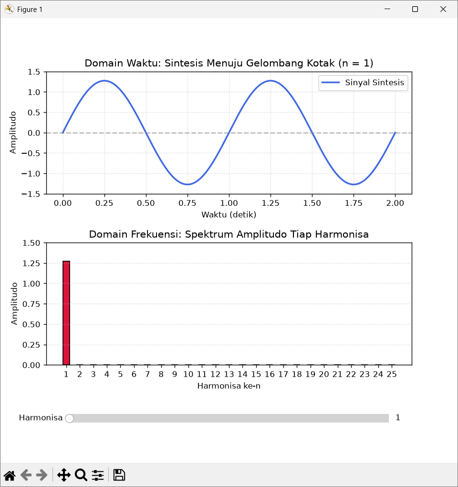
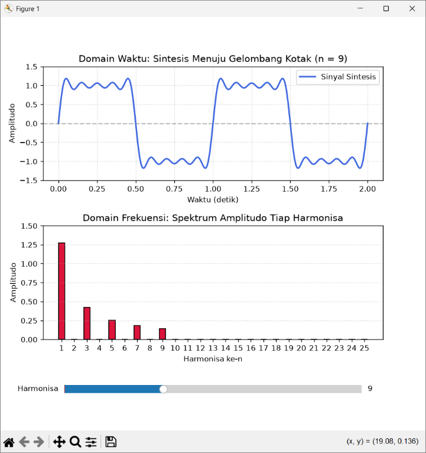

# TUGAS KONSEP JARINGAN
## TUGAS KE – 3: Visualisasi Sinyal Harmonisa Fourier dan Analisis Alamat IP

| Informasi | Keterangan |
| :--- | :--- |
| **Nama** | Shevanka Bagus Dwiyudi Kurniawan |
| **NRP** | 3125600044 |
| **Dosen Pengajar** | Dr. Ferry Astika Saputra, ST, M.Sc |
| **Program Studi** | D4 Teknik Informatika |
| **Institusi** | Politeknik Elektronika Negeri Surabaya (PENS) |
| **Tahun** | 2026 |

---

## Daftar Isi
1. [Deskripsi Soal](#deskripsi-soal)
2. [Landasan Teori: Sintesis Harmonisa Deret Fourier](#landasan-teori-sintesis-harmonisa-deret-fourier)
3. [Implementasi Kode Python Visualisasi](#implementasi-kode-python-visualisasi)
4. [Hasil Output dan Analisis Visual](#hasil-output-dan-analisis-visual)
5. [Landasan Teori: Pengalamatan IP Berkelas (Classful Addressing)](#landasan-teori-pengalamatan-ip-berkelas-classful-addressing)
6. [Analisis Detail Alamat IP Soal](#analisis-detail-alamat-ip-soal)
7. [Tabel Rekapitulasi Analisis IP](#tabel-rekapitulasi-analisis-ip)

---

## Deskripsi Soal

1. **Visualisasi Harmonisa Spektrum Sinyal:**  
   Buat program Python untuk memvisualisasikan harmonisa spektrum dari gelombang sinus (*sine wave*) dengan kendali penggeser interaktif (*interactive slider*) pada nilai harmonisa $1, 3, 5, 7, 9, \dots$ hingga mendekati gelombang kotak (*square wave*).
2. **Analisis Alamat IP:**  
   Analisis deretan alamat IP berikut ke dalam format: **Kelas**, **Network Address**, **Host Address**, **IP Host Pertama**, **IP Host Terakhir**, dan **IP Broadcast**:
   - a. `21.26.8.5`
   - b. `212.68.3` *(diasumsikan `212.68.3.0`)*
   - c. `103.24.56.32`
   - d. `1.1.1.1`
   - e. `172.31.16.8`

---

## Landasan Teori: Sintesis Harmonisa Deret Fourier

Dalam analisis sinyal dan telekomunikasi, **Teorema Fourier** menyatakan bahwa setiap sinyal periodik apa pun dapat dibentuk atau didekomposisi menjadi penjumlahan tak hingga dari gelombang-gelombang sinus dan kosinus dengan frekuensi dan amplitudo yang berbeda.

Sebuah **gelombang kotak periodik (*square wave*)** dengan frekuensi fundamental $f_0$ dan amplitudo puncak $\pm 1$ memiliki simetri setengah-gelombang ganjil (*odd half-wave symmetry*), sehingga deret Fourier-nya hanya mengandung komponen harmonisa bernomor ganjil ($n = 1, 3, 5, 7, 9, \dots$).

### Formulasi Matematis

$$x(t) = \frac{4}{\pi} \sum_{k=1}^{\infty} \frac{1}{2k-1} \sin\big(2\pi (2k-1) f_0 t\big)$$

Atau jika dituliskan per komponen harmonisa:

$$x(t) = \frac{4}{\pi} \left( \sin(2\pi f_0 t) + \frac{1}{3}\sin(2\pi \cdot 3 f_0 t) + \frac{1}{5}\sin(2\pi \cdot 5 f_0 t) + \frac{1}{7}\sin(2\pi \cdot 7 f_0 t) + \dots \right)$$

### Karakteristik Penting:
1. **Frekuensi Tiap Harmonisa ($f_n$):** Frekuensi harmonisa ke-$n$ adalah kelipatan bilangan bulat ganjil dari frekuensi dasar:
   $$f_n = n \cdot f_0 \quad (n = 1, 3, 5, 7, \dots)$$
2. **Amplitudo Tiap Harmonisa ($A_n$):** Amplitudo berbanding terbalik secara linier dengan orde harmonisa:
   $$A_n = \frac{4}{n\pi}$$
   Semakin tinggi orde harmonisa, kontribusi amplitudonya terhadap gelombang total semakin mengecil.
3. **Domain Waktu vs Domain Frekuensi:**
   - **Domain Waktu (*Time Domain*):** Menampilkan bentuk gelombang resultante seiring berjalannya waktu. Penambahan harmonisa ganjil yang semakin banyak membuat lereng gelombang semakin tegak dan bagian atasnya semakin mendatar (menyerupai kotak).
   - **Domain Frekuensi (*Frequency Domain*):** Menampilkan spektrum diskrit berupa garis/batang yang menunjukkan amplitudo pada setiap frekuensi harmonisa $n$.
4. **Fenomena Gibbs (*Gibbs Phenomenon*):** Pada pemotongan deret berhingga (*finite series*), terdapat lonjakan riak (*overshoot*) sebesar kurang lebih 9% di dekat titik diskontinuitas transisi gelombang, yang secara perlahan menyempit mendekati sudut tegak saat $n \to \infty$.

---

## Implementasi Kode Python Visualisasi

Berikut adalah implementasi skrip program Python menggunakan pustaka `numpy` dan `matplotlib` dengan memanfaatkan `matplotlib.widgets.Slider` untuk interaksi dinamis:

```python
import matplotlib.pyplot as plt
from matplotlib.widgets import Slider
import numpy as np

# ==========================================================
# Parameter Sinyal Dasar
# ==========================================================
f0 = 1.0  # Frekuensi fundamental dalam Hz
t = np.linspace(0, 2, 1000)  # Rentang observasi waktu 2 detik (1000 titik sampel)
allowed_harmonics = list(range(1, 26, 2))  # Harmonisa ganjil: 1, 3, 5, ..., 25

fig, (ax_time, ax_freq) = plt.subplots(2, 1, figsize=(9, 7))
plt.subplots_adjust(left=0.1, bottom=0.22, hspace=0.4)


def compute_fourier_series(max_h):
  """Menghitung sintesis gelombang kotak dari deret Fourier harmonisa ganjil:

  wave(t) = sum_{n=ganjil}^{max_h} (4 / (pi * n)) * sin(2 * pi * n * f0 * t)
  """
  wave = np.zeros_like(t)
  all_n = np.arange(1, 26)
  amplitudes = np.zeros(25)

  for n in range(1, max_h + 1):
    if n % 2 != 0:
      amp = 4 / (np.pi * n)
      wave += amp * np.sin(2 * np.pi * n * f0 * t)
      amplitudes[n - 1] = amp
    else:
      amplitudes[n - 1] = 0.0

  return wave, all_n, amplitudes


# ==========================================================
# Inisialisasi Tampilan Awal (Harmonisa Fundamental n = 1)
# ==========================================================
initial_h = 1
wave, harms, amps = compute_fourier_series(initial_h)

# Plot Domain Waktu
(line_time,) = ax_time.plot(
    t, wave, color='royalblue', lw=2, label='Sinyal Sintesis'
)
ax_time.axhline(0, color='gray', linestyle='--', alpha=0.5)
ax_time.set_ylim(-1.5, 1.5)
ax_time.set_title(
    f'Domain Waktu: Sintesis Menuju Gelombang Kotak (n = {initial_h})'
)
ax_time.set_xlabel('Waktu (detik)')
ax_time.set_ylabel('Amplitudo')
ax_time.grid(True, linestyle=':', alpha=0.6)
ax_time.legend(loc='upper right')

# Plot Domain Frekuensi (Spektrum Batang)
bars = ax_freq.bar(harms, amps, color='crimson', width=0.5, edgecolor='black')
ax_freq.set_ylim(0, 1.5)
ax_freq.set_xticks(harms)
ax_freq.set_title('Domain Frekuensi: Spektrum Amplitudo Tiap Harmonisa')
ax_freq.set_xlabel('Harmonisa ke-n')
ax_freq.set_ylabel('Amplitudo')
ax_freq.grid(True, axis='y', linestyle=':', alpha=0.6)

# ==========================================================
# Kontrol Slider Interaktif
# ==========================================================
slider_ax = plt.axes([0.15, 0.08, 0.7, 0.04])
slider = Slider(
    slider_ax,
    'Harmonisa',
    valmin=1,
    valmax=25,
    valinit=initial_h,
    valstep=allowed_harmonics,
)


def update(val):
  current_h = int(slider.val)
  new_wave, _, new_amps = compute_fourier_series(current_h)

  # Perbarui kurva domain waktu
  line_time.set_ydata(new_wave)
  ax_time.set_title(
    f'Domain Waktu: Sintesis Menuju Gelombang Kotak (n = {current_h})'
  )

  # Perbarui tinggi batang spektrum frekuensi
  for bar, amp in zip(bars, new_amps):
    bar.set_height(amp)

  fig.canvas.draw_idle()


slider.on_changed(update)
plt.show()
```

---

## Hasil Output dan Analisis Visual

### 1. Tampilan pada Harmonisa Fundamental ($n = 1$)
Ketika slider berada pada nilai $n = 1$, hanya komponen frekuensi dasar $f_0$ yang dibangkitkan dengan amplitudo $A_1 = \frac{4}{\pi} \approx 1,273$. Sinyal yang terbentuk masih berupa gelombang sinusoidal murni:



*Karakteristik:*
- **Domain Waktu:** Gelombang berupa fungsi sinus halus sempurna $\frac{4}{\pi}\sin(2\pi t)$.
- **Domain Frekuensi:** Hanya terdapat satu batang spektrum pada $n = 1$ dengan amplitudo $\approx 1,273$. Seluruh nilai harmonisa lainnya bernilai 0.

---

### 2. Tampilan pada Harmonisa Lebih Tinggi ($n = 9$)
Ketika slider digeser ke $n = 9$, sinyal tersusun atas penjumlahan harmonisa $n = 1, 3, 5, 7,$ dan $9$:



*Karakteristik:*
- **Domain Waktu:** Sinyal mulai mengalami transisi tepi yang curam (*steep edges*) dan bagian puncak yang mendatar (*flattened peak*) dengan 4 puncak riak kecil (*ripples*), mendekati bentuk gelombang kotak.
- **Domain Frekuensi:** Terlihat 5 batang spektrum pada frekuensi ganjil $n = 1, 3, 5, 7, 9$, di mana amplitudo semakin mengecil secara bertahap sebanding dengan $1/n$ ($A_1 \approx 1,273$; $A_3 \approx 0,424$; $A_5 \approx 0,255$; $A_7 \approx 0,182$; $A_9 \approx 0,141$).

---

## Landasan Teori: Pengalamatan IP Berkelas (Classful Addressing)

Sebelum standardisasi CIDR (*Classless Inter-Domain Routing*, RFC 1519), arsitektur IPv4 (RFC 791) dibagi ke dalam kelas-kelas berbasis rentang nilai numerik oktet pertama (*first octet*):

| Kelas IP | Pola Bit Awal | Rentang Oktet Pertama | Default Subnet Mask | Porsi Net ID / Host ID | Jumlah Host Maksimum |
| :---: | :---: | :---: | :---: | :---: | :---: |
| **Kelas A** | `0...` | `1 – 126` | `255.0.0.0` (/8) | 8 bit Net / 24 bit Host | $2^{24} - 2 = 16.777.214$ |
| *Loopback* | `01111111` | `127` | *Direservasi untuk Loopback internal perangkat (`127.0.0.1`)* | — | — |
| **Kelas B** | `10...` | `128 – 191` | `255.255.0.0` (/16) | 16 bit Net / 16 bit Host | $2^{16} - 2 = 65.534$ |
| **Kelas C** | `110...` | `192 – 223` | `255.255.255.0` (/24) | 24 bit Net / 8 bit Host | $2^8 - 2 = 254$ |
| **Kelas D** | `1110...` | `224 – 239` | *Direservasi untuk Multicast (tidak memiliki Host ID terpisah)* | — | — |
| **Kelas E** | `1111...` | `240 – 255` | *Direservasi untuk Riset dan Eksperimen* | — | — |

### Aturan Perhitungan Alamat Jaringan:
1. **Network Address:** Seluruh bit pada porsi *Host ID* bernilai biner `0`.
2. **IP Broadcast Address:** Seluruh bit pada porsi *Host ID* bernilai biner `1`.
3. **IP Host Pertama (*First Usable Host*):** $\text{Network Address} + 1$.
4. **IP Host Terakhir (*Last Usable Host*):** $\text{Broadcast Address} - 1$.
5. **Host Address:** Nilai numerik pada porsi oktet host di luar network prefix.

---

## Analisis Detail Alamat IP Soal

### a. Alamat IP: `21.26.8.5`
- **Oktet Pertama:** $21$ (Biner: `00010101`, dimulai bit `0`).
- **Kelas:** **Kelas A** (karena $1 \le 21 \le 126$).
- **Default Mask:** `255.0.0.0` (Prefix `/8`), artinya 1 oktet pertama adalah *Network ID* dan 3 oktet sisanya adalah *Host ID*.
- **Network Address:** `21.0.0.0`
- **Host Address (Host ID):** `26.8.5`
- **IP Host Pertama:** `21.0.0.1`
- **IP Host Terakhir:** `21.255.255.254`
- **IP Broadcast:** `21.255.255.255`

---

### b. Alamat IP: `212.68.3` *(Diasumsikan `212.68.3.0`)*
- **Oktet Pertama:** $212$ (Biner: `11010100`, dimulai bit `110`).
- **Kelas:** **Kelas C** (karena $192 \le 212 \le 223$).
- **Default Mask:** `255.255.255.0` (Prefix `/24`), artinya 3 oktet pertama adalah *Network ID* dan 1 oktet terakhir adalah *Host ID*.
- **Network Address:** `212.68.3.0`
- **Host Address (Host ID):** `0`
- **IP Host Pertama:** `212.68.3.1`
- **IP Host Terakhir:** `212.68.3.254`
- **IP Broadcast:** `212.68.3.255`

---

### c. Alamat IP: `103.24.56.32`
- **Oktet Pertama:** $103$ (Biner: `01100111`, dimulai bit `0`).
- **Kelas:** **Kelas A** (karena $1 \le 103 \le 126$).
- **Default Mask:** `255.0.0.0` (Prefix `/8`), porsi Network: oktet 1, porsi Host: oktet 2, 3, 4.
- **Network Address:** `103.0.0.0`
- **Host Address (Host ID):** `24.56.32`
- **IP Host Pertama:** `103.0.0.1`
- **IP Host Terakhir:** `103.255.255.254`
- **IP Broadcast:** `103.255.255.255`
*(Catatan: Dalam perutean Internet modern, blok 103.0.0.0/8 dikelola oleh APNIC untuk alokasi regional Asia Pasifik dengan pembagian subnet classless CIDR).*

---

### d. Alamat IP: `1.1.1.1`
- **Oktet Pertama:** $1$ (Biner: `00000001`, dimulai bit `0`).
- **Kelas:** **Kelas A** (karena $1 \le 1 \le 126$).
- **Default Mask:** `255.0.0.0` (Prefix `/8`).
- **Network Address:** `1.0.0.0`
- **Host Address (Host ID):** `1.1.1`
- **IP Host Pertama:** `1.0.0.1`
- **IP Host Terakhir:** `1.255.255.254`
- **IP Broadcast:** `1.255.255.255`
*(Catatan: Alamat ini saat ini populer digunakan secara publik oleh Cloudflare sebagai anycast public DNS resolver).*

---

### e. Alamat IP: `172.31.16.8`
- **Oktet Pertama:** $172$ (Biner: `10101100`, dimulai bit `10`).
- **Kelas:** **Kelas B** (karena $128 \le 172 \le 191$).
- **Default Mask:** `255.255.0.0` (Prefix `/16`), artinya 2 oktet pertama adalah *Network ID* dan 2 oktet terakhir adalah *Host ID*.
- **Network Address:** `172.31.0.0`
- **Host Address (Host ID):** `16.8`
- **IP Host Pertama:** `172.31.0.1`
- **IP Host Terakhir:** `172.31.255.254`
- **IP Broadcast:** `172.31.255.255`
*(Catatan: Alamat ini termasuk ke dalam blok IP Privat RFC 1918 Kelas B yaitu 172.16.0.0 – 172.31.255.255).*

---

## Tabel Rekapitulasi Analisis IP

Berikut adalah tabel rekapitulasi lengkap hasil analisis kelima alamat IP sesuai format tugas:

| Alamat IP Input | Kelas | Network Address | Host Address | IP Host Pertama | IP Host Terakhir | IP Broadcast |
| :--- | :---: | :--- | :--- | :--- | :--- | :--- |
| `21.26.8.5` | **A** | `21.0.0.0` | `26.8.5` | `21.0.0.1` | `21.255.255.254` | `21.255.255.255` |
| `212.68.3.0`* | **C** | `212.68.3.0` | `0` | `212.68.3.1` | `212.68.3.254` | `212.68.3.255` |
| `103.24.56.32` | **A** | `103.0.0.0` | `24.56.32` | `103.0.0.1` | `103.255.255.254` | `103.255.255.255` |
| `1.1.1.1` | **A** | `1.0.0.0` | `1.1.1` | `1.0.0.1` | `1.255.255.254` | `1.255.255.255` |
| `172.31.16.8` | **B** | `172.31.0.0` | `16.8` | `172.31.0.1` | `172.31.255.254` | `172.31.255.255` |

*\*Keterangan: Alamat input `212.68.3` diasumsikan sebagai alamat jaringan dasar `212.68.3.0` pada subnet mask standar kelas C.*
