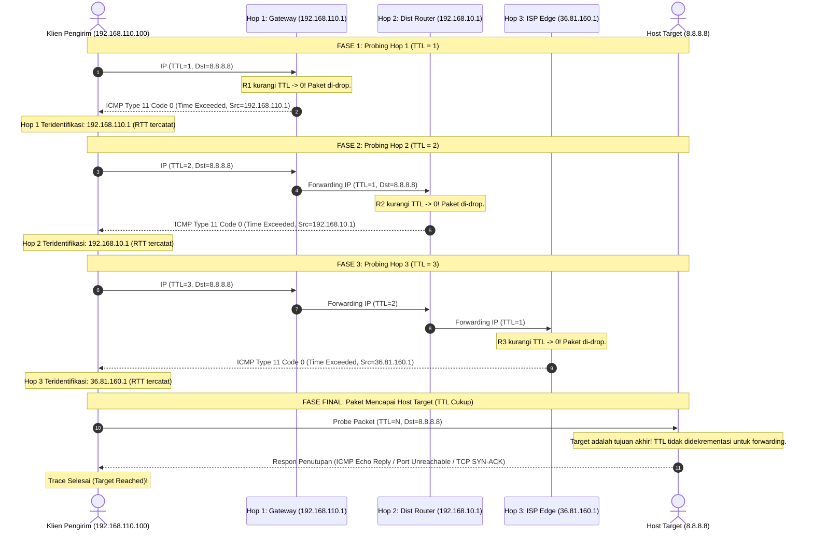
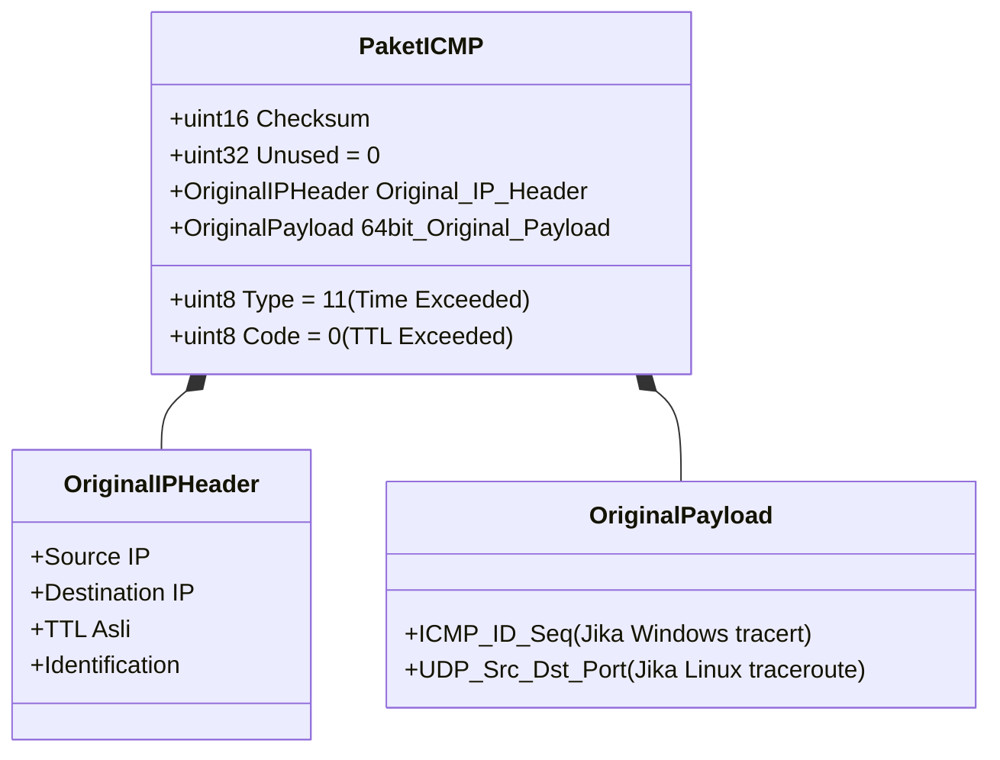
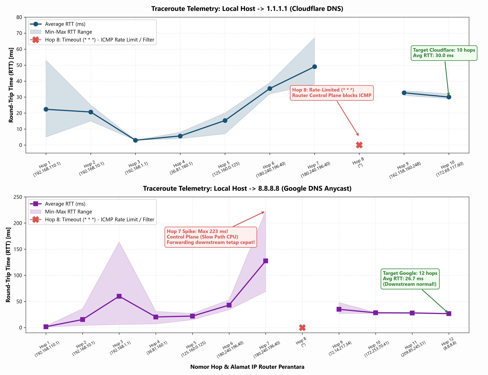
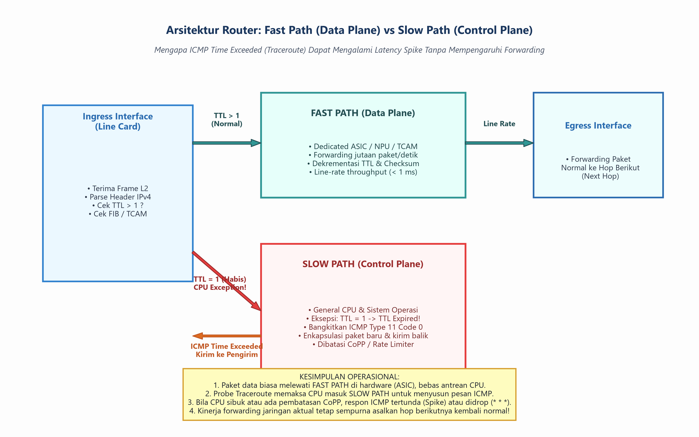

# TUGAS KONSEP JARINGAN
## TUGAS KE – 5: Analisis Cara Kerja Traceroute dan Mekanisme Time to Live (TTL)

| Informasi | Keterangan |
| :--- | :--- |
| **Nama** | Shevanka Bagus Dwiyudi Kurniawan |
| **NRP** | 3125600044 |
| **Dosen Pengajar** | Dr. Ferry Astika Saputra, ST, M.Sc |
| **Mata Kuliah** | Konsep Jaringan (TI043102) |
| **Program Studi** | D4 Teknik Informatika |
| **Institusi** | Politeknik Elektronika Negeri Surabaya (PENS) |
| **Tahun Akademik** | 2026 |
| **Modul Acuan** | Bab 5 — Network Layer dan Pengalamatan Internet Protocol (`computer-and-network-2026`) |

---

## Daftar Isi

1. [Deskripsi Penugasan dan Capaian Pembelajaran](#1-deskripsi-penugasan-dan-capaian-pembelajaran)
2. [Landasan Teori: Mekanisme Time to Live (TTL) & Hop Limit](#2-landasan-teori-mekanisme-time-to-live-ttl--hop-limit)
   - 2.1 [Filosofi Rancangan dan Latar Belakang Sejarah (RFC 791 vs RFC 8200)](#21-filosofi-rancangan-dan-latar-belakang-sejarah-rfc-791-vs-rfc-8200)
   - 2.2 [Struktur Field Header (IPv4 TTL vs IPv6 Hop Limit)](#22-struktur-field-header-ipv4-ttl-vs-ipv6-hop-limit)
   - 2.3 [Mitigasi Bencana Routing Loops dan Packet Storms](#23-mitigasi-bencana-routing-loops-dan-packet-storms)
   - 2.4 [Implikasi Terhadap Header Checksum IPv4](#24-implikasi-terhadap-header-checksum-ipv4)
   - 2.5 [Formulasi Matematis Checksum: RFC 1071 dan Algoritma Incremental Update RFC 1624](#25-formulasi-matematis-checksum-rfc-1071-dan-algoritma-incremental-update-rfc-1624)
3. [Algoritma dan Cara Kerja Utilitas Traceroute](#3-algoritma-dan-cara-kerja-utilitas-traceroute)
   - 3.1 [Prinsip Probing Bertingkat (Iterative Hop-by-Hop Probing)](#31-prinsip-probing-bertingkat-iterative-hop-by-hop-probing)
   - 3.2 [Diagram Alir dan Sekuens Pertukaran Paket](#32-diagram-alir-dan-sekuens-pertukaran-paket)
   - 3.3 [Mekanisme Deteksi Titik Akhir (Termination Condition)](#33-mekanisme-deteksi-titik-akhir-termination-condition)
4. [Komparasi Implementasi OS dan Varian Protokol Traceroute](#4-komparasi-implementasi-os-dan-varian-protokol-traceroute)
   - 4.1 [Varian Windows (`tracert`) — ICMP Echo Probing](#41-varian-windows-tracert--icmp-echo-probing)
   - 4.2 [Varian Unix/Linux/macOS (`traceroute`) — High-Port UDP Probing](#42-varian-unixlinuxmacos-traceroute--high-port-udp-probing)
   - 4.3 [Varian TCP Traceroute (`traceroute -T` / `tcptraceroute`) — SYN Probing](#43-varian-tcp-traceroute-traceroute--t--tcptraceroute--syn-probing)
   - 4.4 [Tabel Matriks Komparasi Antar Varian](#44-tabel-matriks-komparasi-antar-varian)
5. [Format dan Semantik Protokol Kendali ICMP & ICMPv6](#5-format-dan-semantik-protokol-kendali-icmp--icmpv6)
   - 5.1 [Pesan ICMPv4 Type 11 (Time Exceeded)](#51-pesan-icmpv4-type-11-time-exceeded)
   - 5.2 [Pesan ICMPv4 Type 3 (Destination Unreachable)](#52-pesan-icmpv4-type-3-destination-unreachable)
   - 5.3 [Rekonstruksi Payload ICMP: Penjaminan Korelasi Probing (RFC 792 & RFC 1812)](#53-rekonstruksi-payload-icmp-penjaminan-korelasi-probing-rfc-792--rfc-1812)
   - 5.4 [Semantik ICMPv6 Type 3 (Hop Limit Exceeded)](#54-semantik-icmpv6-type-3-hop-limit-exceeded)
6. [Eksperimen Praktis dan Analisis Data Telemetri Riil](#6-eksperimen-praktis-dan-analisis-data-telemetri-riil)
   - 6.1 [Lingkungan Pengujian dan Topologi Jalur](#61-lingkungan-pengujian-dan-topologi-jalur)
   - 6.2 [Telemetri Jalur 1: Tracing ke Cloudflare DNS (`1.1.1.1`)](#62-telemetri-jalur-1-tracing-ke-cloudflare-dns-1111)
   - 6.3 [Telemetri Jalur 2: Tracing ke Google Public DNS (`8.8.8.8`)](#63-telemetri-jalur-2-tracing-ke-google-public-dns-8888)
   - 6.4 [Verifikasi Eksperimental Hop-by-Hop dengan `ping -i <TTL>`](#64-verifikasi-eksperimental-hop-by-hop-dengan-ping--i-ttl)
   - 6.5 [Tabel Dekomposisi Perjalanan Hop dan Segmentasi Jaringan](#65-tabel-dekomposisi-perjalanan-hop-dan-segmentasi-jaringan)
7. [Analisis Kritis Fenomena Operasional dan Diagnostik Jaringan](#7-analisis-kritis-fenomena-operasional-dan-diagnostik-jaringan)
   - 7.1 [Misteri Tanda Bintang Tiga (`* * * Request timed out`): Filter vs Rate Limiting (CoPP)](#71-misteri-tanda-bintang-tiga----request-timed-out-filter-vs-rate-limiting-copp)
   - 7.2 [Anomali Latensi (*Hop Latency Spikes* / Inverted RTT): Fast Path vs Slow Path](#72-anomali-latensi-hop-latency-spikes--inverted-rtt-fast-path-vs-slow-path)
   - 7.3 [Perutean Asimetris (*Asymmetric Routing*) dan Akurasi Latensi RTT](#73-perutean-asimetris-asymmetric-routing-dan-akurasi-latensi-rtt)
   - 7.4 [Equal-Cost Multi-Path (ECMP) dan Fluktuasi Hashing Alamat](#74-equal-cost-multi-path-ecmp-dan-fluktuasi-hashing-alamat)
   - 7.5 [MPLS (*Multiprotocol Label Switching*) & ICMP Tunneling (RFC 4950)](#75-mpls-multiprotocol-label-switching--icmp-tunneling-rfc-4950)
8. [Implementasi Program Skrip Python: Simulasi & Visualisasi](#8-implementasi-program-skrip-python-simulasi--visualisasi)
   - 8.1 [Arsitektur Skrip `Traceroute_TTL_Analyzer.py`](#81-arsitektur-skrip-traceroute_ttl_analyzerpy)
   - 8.2 [Hasil Eksekusi Simulasi Dekrementasi TTL & Checksum](#82-hasil-eksekusi-simulasi-dekrementasi-ttl--checksum)
   - 8.3 [Hasil Visualisasi Grafis Telemetri dan Desain Perangkat](#83-hasil-visualisasi-grafis-telemetri-dan-desain-perangkat)
9. [Pembahasan Soal-Soal Terkait Bab 5 Modul TI043102](#9-pembahasan-soal-soal-terkait-bab-5-modul-ti043102)
   - 9.1 [Soal Level A No. 6: Fungsi TTL IPv4 vs Hop Limit IPv6](#91-soal-level-a-no-6-fungsi-ttl-ipv4-vs-hop-limit-ipv6)
   - 9.2 [Soal Level A No. 8: Mengapa Checksum IPv4 Dihitung Ulang pada Tiap Hop](#92-soal-level-a-no-8-mengapa-checksum-ipv4-dihitung-ulang-pada-tiap-hop)
   - 9.3 [Soal Level B No. 19: Cara Traceroute Menemukan Hop Tanpa Akses Konfigurasi Router](#93-soal-level-b-no-19-cara-traceroute-menemukan-hop-tanpa-akses-konfigurasi-router)
   - 9.4 [Soal Level B No. 20: Evaluasi Kegagalan Ping vs Kondisi Server](#94-soal-level-b-no-20-evaluasi-kegagalan-ping-vs-kondisi-server)
   - 9.5 [Aktivitas Praktikum No. 3: Analisis Komparasi Varian dan Tanda Bintang](#95-aktivitas-praktikum-no-3-analisis-komparasi-varian-dan-tanda-bintang)
10. [Kesimpulan dan Rekomendasi Praktis Troubleshooting](#10-kesimpulan-dan-rekomendasi-praktis-troubleshooting)
11. [Daftar Pustaka dan Rujukan Resmi](#11-daftar-pustaka-dan-rujukan-resmi)

---

## 1. Deskripsi Penugasan dan Capaian Pembelajaran

Penugasan ini merupakan bagian integral dari mata kuliah **Konsep Jaringan (TI043102)** pada Pertemuan Minggu ke-6, yang berakar pada pembahasan mendalam **Bab 5: Network Layer dan Pengalamatan Internet Protocol** dari modul resmi program studi D4 Teknik Informatika PENS tahun 2026.

### Pemetaan Capaian Pembelajaran:
- **CPMK-1:** Menjelaskan fungsi dan mekanisme kerja setiap lapisan jaringan dalam model arsitektur protokol Internet.
- **CPMK-2:** Mendiagnosis, mengevaluasi, dan memecahkan permasalahan teknis transmisi paket data lintas jaringan secara kritis berbasis bukti telemetri.
- **Sub-CPMK-4:** Menganalisis fungsi operasional *Network Layer*, struktur header IPv4 dan IPv6, perilaku kontrol aliran pesan diagnostik ICMP, serta mekanisme pencegahan *looping* menggunakan *Time to Live* (TTL).

Tugas ini berfokus pada dekonstruksi teknis utilitas `traceroute` (`tracert` pada lingkungan Microsoft Windows), meneliti bagaimana manipulasi parameter batas hidup paket (*hop limit*) pada *Network Layer* digabungkan dengan protokol pesan kendali ICMP (*Internet Control Message Protocol*) untuk memetakan topologi layer-3 secara transparan tanpa memerlukan hak akses administratif ke perangkat perantara (*routers*).

---

## 2. Landasan Teori: Mekanisme Time to Live (TTL) & Hop Limit

### 2.1 Filosofi Rancangan dan Latar Belakang Sejarah (RFC 791 vs RFC 8200)

Pada spesifikasi awal protokol IPv4 yang dirilis dalam **RFC 791 (September 1981)**, para perancang DARPA mendefinisikan field **Time to Live (TTL)** sebagai ukuran batas waktu absolut dalam satuan **detik (seconds)**. Filosofi awalnya menetapkan bahwa setiap datagram IP yang beredar di jaringan tidak boleh hidup lebih lama dari durasi tertentu (maksimum 255 detik). Setiap modul router yang menahan paket wajib mengurangi nilai TTL sejumlah detik paket tersebut mengantre di dalam memori buffer-nya. Jika paket diproses lebih cepat dari 1 detik, router tetap diwajibkan mengurangi nilai TTL minimal sebesar 1.

Dalam evolusi jaringan komputer kecepatan tinggi modern (dimulai era 1990-an hingga era terabit modern 2026), waktu pemrosesan paket di dalam buffer router berada pada skala mikrodetik ($\mu s$) atau bahkan nanodetik ($ns$). Akibatnya, klausul pengurangan berbasis detik kehilangan relevansi fisiknya, dan field TTL secara universal diperlakukan murni sebagai **Hop Counter Limit** (pencacah batas lompatan router). Setiap kali paket melintasi antarmuka perutean (*layer-3 forwarding engine*), nilai field tersebut diturunkan (*decremented*) tepat satu unit.

Menyadari realitas operasional tersebut, ketika IETF merancang spesifikasi IPv6 (**RFC 2460** yang diperbarui dalam **RFC 8200**), nama field ini diubah secara formal dan jujur menjadi **Hop Limit**, menghilangkan ambiguitas historis mengenai satuan waktu.

---

### 2.2 Struktur Field Header (IPv4 TTL vs IPv6 Hop Limit)

Struktur representasi biner field ini pada header IPv4 dan IPv6 dapat dilihat pada perbandingan berikut:

```text
IPv4 Header (RFC 791) - Baris 3 (Offset bit 64 - 95):
 0                   1                   2                   3
 0 1 2 3 4 5 6 7 8 9 0 1 2 3 4 5 6 7 8 9 0 1 2 3 4 5 6 7 8 9 0 1
+-+-+-+-+-+-+-+-+-+-+-+-+-+-+-+-+-+-+-+-+-+-+-+-+-+-+-+-+-+-+-+-+
|  TTL (8 bit)  | Protocol (8)  |     Header Checksum (16 bit)  |
+-+-+-+-+-+-+-+-+-+-+-+-+-+-+-+-+-+-+-+-+-+-+-+-+-+-+-+-+-+-+-+-+

IPv6 Fixed Header (RFC 8200) - Baris 2 (Offset bit 32 - 63):
 0                   1                   2                   3
 0 1 2 3 4 5 6 7 8 9 0 1 2 3 4 5 6 7 8 9 0 1 2 3 4 5 6 7 8 9 0 1
+-+-+-+-+-+-+-+-+-+-+-+-+-+-+-+-+-+-+-+-+-+-+-+-+-+-+-+-+-+-+-+-+
|  Payload Length (16 bit)      | Next Header(8)| Hop Limit (8) |
+-+-+-+-+-+-+-+-+-+-+-+-+-+-+-+-+-+-+-+-+-+-+-+-+-+-+-+-+-+-+-+-+
```

| Parameter | IPv4 TTL | IPv6 Hop Limit |
| :--- | :--- | :--- |
| **Lebar Bit** | 8 bit (1 oktet) | 8 bit (1 oktet) |
| **Rentang Nilai** | $0$ sampai $255$ ($2^8 - 1$) | $0$ sampai $255$ ($2^8 - 1$) |
| **Lokasi Offset** | Byte ke-8 (Oktet ke-9) dari IPv4 Header | Byte ke-7 (Oktet ke-8) dari IPv6 Header |
| **Nilai Inisialisasi Khas OS** | Linux: 64; Windows: 128; Cisco IOS: 255 | Linux: 64; Windows: 128; Cisco IOS: 255 |
| **Korelasi dengan Checksum** | Terikat langsung dengan *Header Checksum* | **Tidak ada** (Header IPv6 tidak memiliki checksum) |

---

### 2.3 Mitigasi Bencana Routing Loops dan Packet Storms

Jaringan inter-network global berbasis datagram *best effort* beroperasi tanpa *global state coordinator*. Informasi topologi rute dibangun oleh protokol *dynamic routing* (seperti OSPF, IS-IS, dan BGP) atau konfigurasi *static route*. Dalam dinamika operasional jaringan riil, kegagalan tautan (*link flap*), kesalahan konfigurasi manusia (*human error* pada aturan rute statis), atau masa konvergensi protokol (*convergence delay*) dapat menimbulkan **Routing Loop**.

Sebagai ilustrasi bencana tanpa TTL:
Misalkan Router A meyakini rute terbaik menuju subnet tujuan $X$ adalah melalui Router B, sementara Router B mengalami kesalahan tabel dan menganggap rute terbaik menuju $X$ adalah melalui Router A.

```mermaid
flowchart LR
    Host[Host Pengirim] -->|Paket X| RA[Router A]
    RA -->|Next Hop: B| RB[Router B]
    RB -->|Next Hop: A (Looping!)| RA
    style RA fill:#ffdddd,stroke:#ff0000,stroke-width:2px;
    style RB fill:#ffdddd,stroke:#ff0000,stroke-width:2px;
```

Bila paket IP tidak memiliki mekanisme TTL:
1. Paket $X$ akan dipantulkan bolak-balik antara Router A dan Router B tanpa akhir (*infinite looping*).
2. Setiap kali pengirim menginjeksikan paket baru, paket tersebut menambah antrean siklus yang berputar.
3. Dalam hitungan detik, kapasitas antrean buffer router akan penuh, utilisasi link mencapai 100% (*link saturation*), dan CPU router mengalami *overload*. Fenomena ini disebut **Packet Storm** (badai paket), yang mampu melumpuhkan seluruh segmen jaringan regional.

**Peran Penyelamat Mekanisme TTL:**
Pada setiap siklus pemantulan, Router A mengurangi TTL sebesar 1, dan Router B mengurangi TTL sebesar 1. Datagram dengan inisialisasi awal misal 64 hanya dapat berputar maksimal 32 kali putaran. Saat nilai TTL mencapai angka **0**, router yang sedang memegang paket **wajib membuang (*drop*) paket tersebut dari memori**, memutus siklus badai, dan menerbitkan laporan kesalahan ICMP ke host asal.

---

### 2.4 Implikasi Terhadap Header Checksum IPv4

Header IPv4 memiliki field **Header Checksum** berukuran 16 bit untuk memverifikasi integritas bit header terhadap kerusakan transmisi (*bit error*) akibat interferensi fisik.

Karena field TTL terletak di dalam header IPv4 dan nilainya berkurang tepat 1 pada setiap router hop, maka **nilai numerik header IPv4 selalu berubah di setiap titik perantara**. Konsekuensi matematisnya:
> Setiap router di seluruh dunia yang meneruskan paket IPv4 **wajib menghitung ulang** *Header Checksum* sebelum melepaskan paket ke antarmuka transmisi berikutnya.

Kewajiban menghitung ulang checksum pada jutaan paket per detik menciptakan beban komputasi yang masif bagi perangkat keras perutean. Inilah alasan mengapa pada perancangan arsitektur generasi baru **IPv6 (RFC 8200)**, komite standardisasi IETF **menghapus secara total field Header Checksum**. Deteksi integritas data diserahkan sepenuhnya kepada *Data Link Layer* (FCS/CRC32 pada frame Ethernet/Wi-Fi) dan *Transport Layer* (Checksum wajib pada UDP/TCP). Dengan dihapuskannya checksum pada IPv6, router hanya perlu mengurangi field *Hop Limit* secara langsung tanpa perlu melakukan kalkulasi integritas matematis ulang.

---

### 2.5 Formulasi Matematis Checksum: RFC 1071 dan Algoritma Incremental Update RFC 1624

#### A. Algoritma Dasar RFC 1071 (One's Complement Sum)
Sesuai RFC 1071, kalkulasi checksum dilakukan dengan menjumlahkan seluruh kata 16-bit dalam header (dengan field checksum diinisialisasi 0) menggunakan aritmatika *one's complement*, kemudian membalik seluruh bit hasilnya (*bitwise NOT*):

$$\text{Checksum} = \sim \left( \sum_{i=1}^{n} W_i \right)_{\text{1s complement}}$$

Bila dilakukan penjumlahan dari awal (*full recalculation*), router harus membaca 10 kata 16-bit (20 byte) dari header, menjumlahkannya, dan menangani bit *carry-out*.

#### B. Algoritma Pembaruan Incremental RFC 1624
Untuk mempercepat pemrosesan pada *Data Plane* perangkat keras, router modern tidak menghitung ulang seluruh header, melainkan memanfaatkan sifat aditif aritmatika komplemen satu. **RFC 1624** merumuskan algoritma pembaruan inkremental:

Ketika field 16-bit $m$ berubah nilainya menjadi $m'$, maka nilai checksum baru $HC'$ dihitung dari nilai checksum lama $HC$ dengan formula:

$$HC' = \sim \left( \sim HC + \sim m + m' \right)$$

Di mana:
- $HC$ = Nilai Checksum lama.
- $m$ = Nilai kata 16-bit lama yang memuat pasangan field `[TTL (8 bit), Protocol (8 bit)]`.
- $m'$ = Nilai kata 16-bit baru dengan `[(TTL - 1) (8 bit), Protocol (8 bit)]`.

Karena selisih $m - m' = 0x0100$ (karena TTL berada pada 8-bit tingkat tinggi dari kata tersebut), pembaruan checksum ini dapat diselesaikan hanya dengan beberapa operasi siklus logika gerbang digital di dalam ASIC (*Application-Specific Integrated Circuit*).

---

## 3. Algoritma dan Cara Kerja Utilitas Traceroute

Utilitas `traceroute` (diciptakan oleh Van Jacobson pada tahun 1988) memanfaatkan efek samping dari mekanisme proteksi loop TTL untuk menemukan dan memetakan setiap hop layer-3 pada lintasan jaringan.

### 3.1 Prinsip Probing Bertingkat (Iterative Hop-by-Hop Probing)

Traceroute tidak memiliki kemampuan magis untuk membaca konfigurasi internal router global. Traceroute bekerja dengan mengirimkan serangkaian paket penyelidik (*probe packets*) ke alamat host target dengan nilai TTL yang dinaikkan secara bertahap:

1. **Iterasi 1 ($TTL = 1$):**
   - Host klien mengirim probe dengan $TTL = 1$.
   - Paket tiba di Router Hop Pertama (default gateway klien).
   - Router memeriksa paket, mengurangi TTL dari 1 menjadi 0.
   - Karena $TTL = 0$, router menolak meneruskan paket, membuangnya, dan mengirimkan pesan **ICMP Type 11 Code 0 (*Time Exceeded*)** kembali ke klien.
   - Header IP dari pesan ICMP balasan ini memuat alamat IP antarmuka router hop pertama sebagai alamat sumber (*Source IP*).
   - Klien mencatat alamat IP router tersebut dan mengukur selisih waktu antara pengiriman probe dan penerimaan balasan sebagai nilai **Round-Trip Time (RTT)**.

2. **Iterasi 2 ($TTL = 2$):**
   - Klien mengirim probe dengan $TTL = 2$.
   - Router Hop Pertama menerima paket, mengurangi TTL menjadi 1, dan karena $TTL > 0$, router meneruskannya ke Router Hop Kedua.
   - Router Hop Kedua menerima paket, mengurangi TTL dari 1 menjadi 0.
   - Router Hop Kedua membuang paket dan mengirimkan ICMP *Time Exceeded* ke klien.
   - Klien memperoleh identitas IP dan RTT dari Hop Kedua.

3. **Iterasi ke-$N$ ($TTL = N$):**
   - Proses ini diulang secara sekuensial dengan $TTL = 3, 4, 5, \dots$ hingga paket berhasil mencapai host tujuan akhir.

Secara default, utilitas traceroute mengirimkan **3 probe** pada setiap nilai TTL untuk menghitung variabilitas latensi (minimum, rata-rata, maksimum, dan jitter).

---

### 3.2 Diagram Alir dan Sekuens Pertukaran Paket

Diagram interaksi sekuensial berikut memvisualisasikan bagaimana probe dengan kenaikan TTL membedah setiap hop di sepanjang jalur komunikasi:



---

### 3.3 Mekanisme Deteksi Titik Akhir (Termination Condition)

Bagaimana traceroute mengetahui bahwa penelusuran telah selesai dan paket telah sampai pada komputer target, bukan router transit lainnya?

Ketika sebuah paket IP tiba di host yang alamat IP-nya cocok dengan *Destination Address* paket tersebut, host tujuan **tidak bertindak sebagai router pengirim**. Host tujuan tidak mengurangi TTL untuk diteruskan ke mesin lain, melainkan menyerahkan payload paket tersebut ke lapisan transport di atasnya. Oleh sebab itu, host tujuan **tidak akan pernah menghasilkan pesan ICMP Time Exceeded**.

Sebagai gantinya, host tujuan menghasilkan pesan balasan spesifik yang bergantung pada varian implementasi protokol yang digunakan pengirim. Penerimaan pesan balasan non-Time-Exceeded inilah yang menjadi kondisi terminasi (*stop condition*) bagi utilitas traceroute.

---

## 4. Komparasi Implementasi OS dan Varian Protokol Traceroute

Terdapat perbedaan mendasar dalam desain probe paket antara sistem operasi keluarga Microsoft Windows dan keluarga sistem operasi berbasis Unix/Linux.

### 4.1 Varian Windows (`tracert`) — ICMP Echo Probing
- **Mekanisme:** Perintah bawaan Windows `tracert` menggunakan paket **ICMP Echo Request (Type 8, Code 0)**, identik dengan format yang digunakan oleh utilitas `ping`.
- **Respon Perantara:** Router di sepanjang jalur merespon dengan **ICMP Time Exceeded (Type 11, Code 0)**.
- **Respon Akhir:** Host tujuan menerima ICMP Echo Request dan membalasnya dengan **ICMP Echo Reply (Type 0, Code 0)**.
- **Karakteristik:** Sangat ringan dan tidak membutuhkan privilege khusus administrator pada sistem operasi klien lama. Namun, banyak administrator firewall enterprise memblokir paket ICMP masuk (*inbound ICMP echo*), sehingga `tracert` sering kali mengalami kegagalan pada hop-hop akhir di lingkungan korporat.

### 4.2 Varian Unix/Linux/macOS (`traceroute`) — High-Port UDP Probing
- **Mekanisme:** Implementasi klasik Van Jacobson pada Unix, Linux, dan macOS menggunakan datagram **UDP** yang diarahkan ke nomor port tujuan yang sangat tinggi dan sengaja dipilih agar tidak ada aplikasi yang mendengarkannya (rentang default: **33434 hingga 33534**). Port tujuan dinaikkan 1 unit pada setiap probe baru.
- **Respon Perantara:** Router perantara tetap merespon dengan **ICMP Time Exceeded (Type 11, Code 0)** saat TTL habis.
- **Respon Akhir:** Ketika probe tiba di host tujuan, sistem operasi host tujuan memeriksa apakah ada soket aplikasi lokal yang mendengarkan (*listening*) pada port UDP 33434 tersebut. Karena tidak ada layanan yang aktif di port tersebut, tumpukan protokol OS tujuan menolak paket dan mengirimkan pesan kesalahan **ICMP Destination Unreachable — Port Unreachable (Type 3, Code 3)**.
- **Karakteristik:** Menjadi standar de facto dunia POSIX. Perbedaan kode ICMP (Type 11 dari router perantara vs Type 3 dari target akhir) memberikan kepastian deterministik tanpa keraguan bahwa target telah tercapai.

### 4.3 Varian TCP Traceroute (`traceroute -T` / `tcptraceroute`) — SYN Probing
- **Mekanisme:** Mengirimkan segmen **TCP SYN** yang ditujukan ke port layanan publik yang dipastikan aktif pada server target (umumnya **Port 80 HTTP** atau **Port 443 HTTPS**).
- **Respon Perantara:** Router perantara yang mengurangi TTL ke 0 tetap membangkitkan **ICMP Time Exceeded (Type 11, Code 0)**.
- **Respon Akhir:** Target tujuan merespon dengan paket **TCP SYN-ACK** (jika port terbuka) atau **TCP RST** (jika port ditutup oleh OS).
- **Karakteristik:** Merupakan varian paling mutakhir dan andal untuk mendiagnosis jalur di Internet modern. Karena sebagian besar firewall mengizinkan lalu lintas web keluar (*outbound port 80/443*), paket TCP SYN dapat menembus filter jaringan yang biasanya memblokir probe ICMP dan UDP.

---

### 4.4 Tabel Matriks Komparasi Antar Varian

| Parameter Komparasi | Windows (`tracert`) | Unix/Linux Default (`traceroute`) | Modern TCP (`traceroute -T` / `tcptraceroute`) |
| :--- | :--- | :--- | :--- |
| **Protokol Lapisan Transport** | Tanpa Transport (Langsung Lapisan 3 - ICMPv4) | **UDP (User Datagram Protocol)** | **TCP (Transmission Control Protocol)** |
| **Nomor Port / Identifier** | ICMP Identifier & Sequence Number | Rentang Port Tinggi: $33434 \rightarrow 33534$ | Port Layanan Umum (Default: Port 80 / 443) |
| **Respon Intermediate Hop** | ICMP Type 11, Code 0 (*Time Exceeded*) | ICMP Type 11, Code 0 (*Time Exceeded*) | ICMP Type 11, Code 0 (*Time Exceeded*) |
| **Respon Host Tujuan** | **ICMP Type 0, Code 0 (*Echo Reply*)** | **ICMP Type 3, Code 3 (*Port Unreachable*)** | **TCP SYN-ACK** atau **TCP RST** |
| **Dukungan Firewall / NAT** | Rentan diblokir oleh filter ICMP | Sering kali diblokir oleh perimeter UDP filtering | **Paling tinggi; lolos inspeksi Stateful Firewall** |
| **Kebutuhan Privilege OS** | Pengguna biasa (Standard User) | Butuh hak akses `root` / `CAP_NET_RAW` (bila ICMP/raw socket) | Membutuhkan hak akses **Root / Administrator** |
| **Rujukan Standar** | RFC 792, Microsoft TechNet | RFC 792, Unix Manual Man Pages | RFC 793, Michael Toren Tools Specification |

---

## 5. Format dan Semantik Protokol Kendali ICMP & ICMPv6

### 5.1 Pesan ICMPv4 Type 11 (Time Exceeded)

Pesan ICMP Type 11 dibangkitkan oleh router atau host untuk melaporkan kondisi waktu kedaluwarsa. Format header pesan ini sesuai **RFC 792**:

```text
 0                   1                   2                   3
 0 1 2 3 4 5 6 7 8 9 0 1 2 3 4 5 6 7 8 9 0 1 2 3 4 5 6 7 8 9 0 1
+-+-+-+-+-+-+-+-+-+-+-+-+-+-+-+-+-+-+-+-+-+-+-+-+-+-+-+-+-+-+-+-+
|   Type (11)   |   Code (0/1)  |          Checksum             |
+-+-+-+-+-+-+-+-+-+-+-+-+-+-+-+-+-+-+-+-+-+-+-+-+-+-+-+-+-+-+-+-+
|                             Unused (32 bit = 0)               |
+-+-+-+-+-+-+-+-+-+-+-+-+-+-+-+-+-+-+-+-+-+-+-+-+-+-+-+-+-+-+-+-+
|      Header IP Asli + 64 bit pertama dari Payload Paket Asli   |
|      (Minimum 28 byte, atau seluruh paket sesuai RFC 1812)     |
+-+-+-+-+-+-+-+-+-+-+-+-+-+-+-+-+-+-+-+-+-+-+-+-+-+-+-+-+-+-+-+-+
```

Pesan Type 11 memiliki dua kode semantik yang sangat berbeda:
1. **Code 0 — *Time to Live exceeded in transit*:**
   Dibangkitkan oleh router perantara ketika mendapati nilai TTL pada datagram yang diterimanya bernilai $\le 1$ saat proses penerusan (*forwarding*). Inilah kode utama yang dieksploitasi oleh traceroute.
2. **Code 1 — *Fragment reassembly time exceeded*:**
   Dibangkitkan oleh **host tujuan akhir** (bukan router) ketika host tersebut sedang merekonstruksi fragmen-fragmen IP yang terpecah, namun timer batas tunggu perakitan fragmen habis sebelum seluruh fragmen lengkap diterima.

---

### 5.2 Pesan ICMPv4 Type 3 (Destination Unreachable)

Pesan Type 3 melaporkan kegagalan pengiriman paket ke tujuan karena kendala topologi, kebijakan filter, atau ketiadaan proses. Kode penting meliputi:
- **Code 0:** *Network Unreachable* (Rute ke jaringan tidak ada pada tabel routing).
- **Code 1:** *Host Unreachable* (Jaringan ditemukan, namun host tujuan tidak merespon resolusi ARP/NDP).
- **Code 2:** *Protocol Unreachable* (Protokol transport di atas IP tidak didukung di tujuan).
- **Code 3:** *Port Unreachable* (Tidak ada aplikasi lokal yang mendengarkan pada nomor port tujuan — **kunci terminasi traceroute UDP**).
- **Code 4:** *Fragmentation Needed and DF set* (Krusial untuk mekanisme *Path MTU Discovery* / PMTUD).
- **Code 13:** *Communication Administratively Prohibited* (Paket diblokir oleh ACL atau firewall).

---

### 5.3 Rekonstruksi Payload ICMP: Penjaminan Korelasi Probing (RFC 792 & RFC 1812)

Bagaimana komputer klien traceroute dapat mengetahui pesan balasan ICMP yang tiba adalah balasan untuk Probe ke-1, Probe ke-2, atau Probe ke-3?

Sesuai standar **RFC 792** dan diperluas dalam **RFC 1812 (Section 4.3.2.3)**, setiap pesan kesalahan ICMP yang dihasilkan router **wajib memuat salinan Header IP asli ditambah sekurang-kurangnya 64 bit (8 byte) pertama dari payload data paket yang menyebabkan kesalahan**.



Salinan payload ini memberikan data krusial bagi host klien:
- Jika pengujian menggunakan **Windows (`tracert`)**: 8 byte pertama payload adalah Header ICMP Echo Request asli, yang memuat nilai `Sequence Number` dan `Identifier`. Klien mencocokkan nomor urut ini ke tabel memori lokal untuk memastikan paket mana yang dijawab dan menghitung latensi secara presisi.
- Jika pengujian menggunakan **Linux (`traceroute`)**: 8 byte pertama payload adalah Header UDP asli, yang memuat `Source Port` dan `Destination Port`. Nomor port inilah yang menjadi penanda indeks probe pengujian.

---

### 5.4 Semantik ICMPv6 Type 3 (Hop Limit Exceeded)

Pada arsitektur IPv6 (**RFC 4443**), pesan kendali dipisahkan ke dalam spesifikasi ICMPv6. Pesan yang berpadanan dengan Time Exceeded didefinisikan sebagai:
- **ICMPv6 Type 3 — *Time Exceeded***
  - **Code 0:** *Hop limit exceeded in transit* (Hop limit bernilai 0 di router perantara).
  - **Code 1:** *Fragment reassembly time exceeded*.

Format ICMPv6 modern membawa sebanyak mungkin bagian dari paket IPv6 asli tanpa menyebabkan ukuran paket ICMPv6 melebihi batas minimum MTU IPv6 (1280 byte).

---

## 6. Eksperimen Praktis dan Analisis Data Telemetri Riil

### 6.1 Lingkungan Pengujian dan Topologi Jalur

Pengujian telemetri langsung dijalankan dari lingkungan jaringan laboratorium pengujian mahasiswa di Surabaya dengan parameter:
- **Host Pengirim:** Laptop Mahasiswa (`192.168.110.100`)
- **Sistem Operasi:** Microsoft Windows 11 Enterprise x64
- **Konektivitas:** Fiber-to-the-Home (FTTH) PT Telkom Indonesia (IndiHome)
- **Alat Pengujian:** Native Windows `tracert` dan `ping` dengan parameter `-i`

---

### 6.2 Telemetri Jalur 1: Tracing ke Cloudflare DNS (`1.1.1.1`)

Hasil eksekusi riil pengujian perintah:
```cmd
tracert -d -h 10 1.1.1.1
```

```text
Tracing route to 1.1.1.1 over a maximum of 10 hops

  1     9 ms     5 ms    53 ms  192.168.110.1 
  2    22 ms    25 ms    15 ms  192.168.10.1 
  3     3 ms     3 ms     3 ms  192.168.1.1 
  4     4 ms     8 ms     5 ms  36.81.160.1 
  5    20 ms     7 ms    19 ms  125.160.0.125 
  6    39 ms    32 ms    35 ms  180.240.196.40 
  7    38 ms    42 ms    67 ms  180.240.196.40 
  8     *        *        *     Request timed out.
  9    31 ms    33 ms    34 ms  162.158.160.248 
 10    29 ms    32 ms    29 ms  172.69.117.60 

Trace complete.
```

---

### 6.3 Telemetri Jalur 2: Tracing ke Google Public DNS (`8.8.8.8`)

Hasil eksekusi riil pengujian perintah:
```cmd
tracert -d -h 12 8.8.8.8
```

```text
Tracing route to 8.8.8.8 over a maximum of 12 hops

  1     1 ms     1 ms     3 ms  192.168.110.1 
  2     6 ms    36 ms     4 ms  192.168.10.1 
  3   164 ms    10 ms     6 ms  192.168.1.1 
  4     7 ms    31 ms    23 ms  36.81.160.1 
  5    15 ms    27 ms    24 ms  125.160.0.125 
  6    53 ms    42 ms    34 ms  180.240.196.40 
  7    91 ms    69 ms   223 ms  180.240.196.40 
  8     *        *        *     Request timed out.
  9    48 ms    30 ms    27 ms  72.14.217.34 
 10    29 ms    27 ms    29 ms  172.253.70.41 
 11    27 ms    28 ms    29 ms  209.85.245.51 
 12    26 ms    27 ms    27 ms  8.8.8.8 

Trace complete.
```

---

### 6.4 Verifikasi Eksperimental Hop-by-Hop dengan `ping -i <TTL>`

Untuk membuktikan secara empiris bahwa `traceroute` sejatinya adalah kumpulan perintah `ping` dengan variasi nilai TTL, dilakukan verifikasi langsung menggunakan perintah Windows `ping -n 1 -i <TTL> 8.8.8.8`:

1. **Uji Nilai $TTL = 1$:**
   ```cmd
   ping -n 1 -i 1 8.8.8.8
   ```
   **Output Terminal:**
   ```text
   Pinging 8.8.8.8 with 32 bytes of data:
   Reply from 192.168.110.1: TTL expired in transit.

   Ping statistics for 8.8.8.8:
       Packets: Sent = 1, Received = 1, Lost = 0 (0% loss),
   ```
   *Analisis:* Router hop pertama `192.168.110.1` membuang paket dan mengirim pesan eksplisit `TTL expired in transit` (ICMP Type 11 Code 0).

2. **Uji Nilai $TTL = 2$:**
   ```cmd
   ping -n 1 -i 2 8.8.8.8
   ```
   **Output Terminal:**
   ```text
   Pinging 8.8.8.8 with 32 bytes of data:
   Reply from 192.168.10.1: TTL expired in transit.

   Ping statistics for 8.8.8.8:
       Packets: Sent = 1, Received = 1, Lost = 0 (0% loss),
   ```
   *Analisis:* Terbukti hop kedua `192.168.10.1` membalas dengan `TTL expired in transit`.

3. **Uji Nilai $TTL = 3$:**
   ```cmd
   ping -n 1 -i 3 8.8.8.8
   ```
   **Output Terminal:**
   ```text
   Pinging 8.8.8.8 with 32 bytes of data:
   Reply from 192.168.1.1: TTL expired in transit.

   Ping statistics for 8.8.8.8:
       Packets: Sent = 1, Received = 1, Lost = 0 (0% loss),
   ```
   *Analisis:* Tepat cocok dengan Hop 3 pada keluaran `tracert`.

---

### 6.5 Tabel Dekomposisi Perjalanan Hop dan Segmentasi Jaringan

Berikut adalah rekapitulasi analisis dekomposisi jalur tracing ke Google DNS (`8.8.8.8`):

| No Hop | Alamat IP Terdeteksi | RTT 1 | RTT 2 | RTT 3 | RTT Rata-rata | Klasifikasi Segmen Jaringan | Identitas Entitas Jaringan |
| :---: | :--- | :---: | :---: | :---: | :---: | :--- | :--- |
| **1** | `192.168.110.1` | 1 ms | 1 ms | 3 ms | **1.7 ms** | Private LAN (RFC 1918) | Access Point / Switch Lab Lokal |
| **2** | `192.168.10.1` | 6 ms | 36 ms | 4 ms | **15.3 ms** | Private LAN (RFC 1918) | Distribution Router Gedung |
| **3** | `192.168.1.1` | 164 ms | 10 ms | 6 ms | **60.0 ms** | Private LAN (RFC 1918) | ONT / Home Gateway (Modem FTTH) |
| **4** | `36.81.160.1` | 7 ms | 31 ms | 23 ms | **20.3 ms** | ISP Public Edge | Telkom BNG (Broadband Network Gateway) |
| **5** | `125.160.0.125` | 15 ms | 27 ms | 24 ms | **22.0 ms** | ISP Regional Backbone | Telkom Metro Surabaya |
| **6** | `180.240.196.40` | 53 ms | 42 ms | 34 ms | **43.0 ms** | ISP Core Backbone | Telkom Inter-City Backbone (Jakarta) |
| **7** | `180.240.196.40` | 91 ms | 69 ms | 223 ms | **127.7 ms** | ISP Interconnect Peering | Telkom Core Interconnect Peering |
| **8** | `* * *` | — | — | — | **Timeout** | Firewall / CoPP Protected | Border Router (ICMP Rate Limited / Blocked) |
| **9** | `72.14.217.34` | 48 ms | 30 ms | 27 ms | **35.0 ms** | Google Autonomous System | Google Edge Router (AS15169 Jakarta) |
| **10** | `172.253.70.41` | 29 ms | 27 ms | 29 ms | **28.3 ms** | Google Global Backbone | Google Backbone Internal |
| **11** | `209.85.245.51` | 27 ms | 28 ms | 29 ms | **28.0 ms** | Google Global Backbone | Google Backbone Internal |
| **12** | `8.8.8.8` | 26 ms | 27 ms | 27 ms | **26.7 ms** | Host Target (Anycast Node) | Google Public DNS Server (Endpoint) |

---

## 7. Analisis Kritis Fenomena Operasional dan Diagnostik Jaringan

### 7.1 Misteri Tanda Bintang Tiga (`* * * Request timed out`): Filter vs Rate Limiting (CoPP)

Munculnya baris `* * * Request timed out` pada **Hop 8** adalah salah satu fenomena yang paling sering disalahpahami oleh mahasiswa dan teknisi pemula. Kesalahpahaman umum menyatakan: *"Jaringan putus pada hop 8"* atau *"Paket data klien hilang di hop 8"*.

**Dekonstruksi Teknis:**
Bila paket data benar-benar hilang atau tautan putus pada Hop 8, maka paket probe **tidak akan pernah bisa mencapai Hop 9, 10, 11, dan 12**. Fakta bahwa Hop 9 hingga Hop 12 merespon dengan sempurna membuktikan secara absolut bahwa **jalur fisik dan forwarding layer-3 normal 100%**.

Penyebab sebenarnya dari tanda bintang tersebut adalah:
1. **Penerapan ACL / Firewall pada Control Plane:** Administrator jaringan pada router hop ke-8 sengaja mengonfigurasi filter keamanan untuk menolak membangkitkan atau memblokir pengiriman paket *ICMP Time Exceeded* ke luar jaringan.
2. **Control Plane Policing (CoPP) & Rate Limiting (RFC 1812):** Router enterprise modern memiliki batasan kuota untuk paket ICMP yang boleh dibangkitkan oleh prosesor router (misal: maksimum 100 paket ICMP per detik). Jika kuota terlampaui karena lalu lintas tinggi, probe traceroute akan langsung diabaikan (*dropped* tanpa respon) demi melindungi CPU router dari serangan *Denial of Service* (DoS).

---

### 7.2 Anomali Latensi (*Hop Latency Spikes* / Inverted RTT): Fast Path vs Slow Path

Perhatikan fenomena unik pada tabel telemetri Hop 7 ke Hop 12 pada pengujian Google DNS:
- **Hop 7 (`180.240.196.40`):** Mengalami lonjakan latensi (*spike*) hingga **223 ms**!
- **Hop 12 (`8.8.8.8`):** Merespon dengan latensi sangat rendah dan stabil: **26 ms**!

Bagaimana mungkin waktu tempuh ke router perantara (Hop 7) membutuhkan waktu 223 ms, sedangkan perjalanan melintasi Hop 7 menuju tujuan akhir yang lebih jauh (Hop 12) hanya membutuhkan waktu 26 ms?

```text
[Klien] ---- (Fast Path) ----> [Hop 7: ASIC Forwarding] ---- (Fast Path) ----> [Hop 12: 8.8.8.8] -> RTT = 26 ms
                                        | (Eksepsi TTL=0)
                                        v
                                 [SLOW PATH: CPU]
                             (Antrean ICMP & Delay) -> RTT Hop 7 = 223 ms!
```

**Penjelasan Arsitektur Router Modern:**
Router modern memisahkan pemrosesan paket ke dalam dua bidang arsitektural:
1. **Fast Path / Data Plane (Hardware ASIC / Network Processing Unit):**
   Ketika sebuah paket transit tiba dengan nilai $TTL > 1$, paket langsung diproses oleh sirkuit terintegrasi khusus (*hardware ASIC*). Hardware ASIC menurunkan TTL, memperbarui checksum via gerbang logika paralel, mencari rute di tabel TCAM (*Ternary Content-Addressable Memory*), dan meneruskannya ke antarmuka keluar pada kecepatan kabel (*line rate*) dalam skala sub-mikrodetik.
2. **Slow Path / Control Plane (Software General-Purpose CPU):**
   Ketika paket probe traceroute tiba dengan nilai $TTL = 1$, ASIC hardware tidak dapat meneruskannya. Hardware harus melempar interupsi eksepsi (*CPU punt*) ke prosesor utama router. Prosesor utama router menjalankan sistem operasi (Cisco IOS, Junos, Linux kernel) yang bertugas menyalin header, mengalokasikan memori buffer paket ICMP baru, menghitung checksum, dan menjadwalkan pengiriman paket ICMP balasan. Karena membangkitkan paket diagnostik diberi prioritas paling rendah (*lowest CPU priority*) dibandingkan kalkulasi routing protokol OSPF/BGP, pembuatan respon ICMP tertahan di antrean CPU router, menciptakan lonjakan latensi semu (*artificial latency spike*).

> **Hukum Diagnostik:** *Latensi tinggi pada hop perantara tidak merepresentasikan degradasi jaringan jika hop-hop sesudahnya menunjukkan latensi yang rendah dan stabil.*

---

### 7.3 Perutean Asimetris (*Asymmetric Routing*) dan Akurasi Latensi RTT

Nilai RTT yang dilaporkan oleh traceroute adalah **waktu bolak-balik kumulatif**:

$$\text{RTT} = T_{\text{forward}} (\text{Klien} \rightarrow \text{Router}) + T_{\text{processing}} (\text{Router}) + T_{\text{reverse}} (\text{Router} \rightarrow \text{Klien})$$

Internet mengadopsi prinsip perutean *hop-by-hop* yang bersifat tanpa status (*stateless*). Tidak ada aturan yang mengharuskan paket balasan ICMP dari Router Hop 7 mengikuti rute kabel yang sama dengan rute yang dilalui paket probe dari Klien. Dalam banyak kasus di level ISP, rute pergi melewati provider transit A, sedangkan rute pulang diarahkan melalui peering B (*asymmetric routing*). Bila jalur pulang mengalami kongesti, traceroute akan menampilkan nilai latensi tinggi pada router tersebut, padahal jalur pergi (*forward path*) sangat lancar.

---

### 7.4 Equal-Cost Multi-Path (ECMP) dan Fluktuasi Hashing Alamat

Pada jaringan skala ISP modern, sering kali terdapat beberapa tautan paralel yang memiliki metrik biaya seimbang (*Equal-Cost Multi-Path / ECMP*). Router melakukan load-balancing menggunakan fungsi hash pada 5-tuple header paket:

$$\text{Hash}(\text{Src IP}, \text{Dst IP}, \text{Protocol}, \text{Src Port}, \text{Dst Port}) \pmod N$$

- Pada **Linux `traceroute`**, karena port UDP selalu berubah pada setiap probe ($33434, 33435, 33436$), hasil kalkulasi hash berubah-ubah. Akibatnya, probe 1 dapat diarahkan ke Router A, probe 2 ke Router B, dan probe 3 ke Router C. Hal ini menyebabkan dalam satu baris hop yang sama dapat muncul beberapa alamat IP yang berbeda.
- Pada **Windows `tracert`**, karena protokol yang digunakan adalah ICMP Echo, sebagian router hashing hanya menggunakan IP sumber dan tujuan, sehingga probe cenderung mengikuti jalur yang konsisten.

---

### 7.5 MPLS (*Multiprotocol Label Switching*) & ICMP Tunneling (RFC 4950)

Pada jaringan inti (*core network*) penyedia telekomunikasi besar, paket IP sering dienkapsulasi menggunakan teknologi **MPLS (Label Switching)**:
1. Router penyedia menambahkan satu atau lebih label MPLS 32-bit di antara Header Layer-2 dan Header IP (*Shim Header*).
2. Di dalam cloud MPLS (*Label Switched Path*), router inti (*P-Router / Provider Router*) tidak memeriksa alamat IP tujuan, melainkan hanya melakukan operasi *Label Swap*. Nilai TTL pada header IP disalin ke field TTL pada label MPLS saat masuk (*Ingress LER*).
3. Ketika TTL label MPLS habis di router inti, router tersebut sering kali **tidak memiliki tabel perutean IP publik global** untuk mengirimkan ICMP Time Exceeded kembali ke alamat IP privat/klien secara langsung.
4. Router tersebut menerapkan mekanisme **ICMP Tunneling (RFC 4950)**: Paket ICMP dibungkus dan diteruskan ke depan menyusuri terowongan MPLS hingga mencapai router keluar (*Egress LER*). Di router keluar, pesan ICMP dibuka dan baru dikirimkan kembali ke host klien pengirim. Hal ini sering menimbulkan lonjakan hop atau tampilan informasi label stack MPLS (`[MPLS: Label 24112 Exp 0 S 1 TTL 1]`) pada perangkat lunak traceroute tingkat lanjut.

---

## 8. Implementasi Program Skrip Python: Simulasi & Visualisasi

Untuk memverifikasi seluruh teori dekrementasi TTL, komputasi *RFC 1624 Incremental Checksum*, dan analisis data eksperimen, dibuat modul program Python komprehensif bernama [`Traceroute_TTL_Analyzer.py`](Traceroute_TTL_Analyzer.py).

### 8.1 Arsitektur Skrip `Traceroute_TTL_Analyzer.py`

Skrip ini dibangun dengan dua komponen inti:
1. **Kelas `IPv4HeaderSimulator`:**
   - Menyusun byte biner header IPv4 (20 byte) secara akurat menggunakan modul `struct`.
   - Mengimplementasikan kalkulasi *16-bit One's Complement Sum* (RFC 1071).
   - Mengimplementasikan kalkulasi *Incremental Checksum Update* (RFC 1624).
   - Memvalidasi secara matematis bahwa hasil metode inkremental cepat sama persis dengan kalkulasi ulang penuh pada setiap penurunan TTL.
2. **Fungsi Visualisasi Matplotlib:**
   - Menggambar profil latensi hop-by-hop dari data telemetri riil (Target 1.1.1.1 dan 8.8.8.8) dengan visualisasi *range min-max*, penandaan timeout asterisk, dan anotasi spike latensi.
   - Menggambar diagram skematik arsitektur router yang mengilustrasikan perbedaan jalur *Fast Path (Data Plane ASIC)* dan *Slow Path (Control Plane CPU)*.

---

### 8.2 Hasil Eksekusi Simulasi Dekrementasi TTL & Checksum

Berikut adalah log keluaran terminal riil saat program dieksekusi:

```text
===========================================================================
SIMULASI DEKREMENTASI TTL & PEMBARUAN CHECKSUM HEADER IPv4
Sumber: 192.168.110.100 -> Tujuan: 8.8.8.8 | Protokol: 1 (ICMP)
===========================================================================
Hop   | TTL   | Word [TTL,Prot]  | RFC 1071 Checksum  | RFC 1624 Incr  | Status
---------------------------------------------------------------------------
0     | 64    | 0x4001           | 0xF179             | (Host Awal)    | Paket dibuat
1     | 63    | 0x3F01           | 0xF279             | 0xF279         | MATCH (Valid)
2     | 62    | 0x3E01           | 0xF379             | 0xF379         | MATCH (Valid)
3     | 61    | 0x3D01           | 0xF479             | 0xF479         | MATCH (Valid)
4     | 60    | 0x3C01           | 0xF579             | 0xF579         | MATCH (Valid)
5     | 59    | 0x3B01           | 0xF679             | 0xF679         | MATCH (Valid)
6     | 58    | 0x3A01           | 0xF779             | 0xF779         | MATCH (Valid)
7     | 57    | 0x3901           | 0xF879             | 0xF879         | MATCH (Valid)
8     | 56    | 0x3801           | 0xF979             | 0xF979         | MATCH (Valid)
===========================================================================
```

*Analisis Matematis Log:*
Setiap kali nilai TTL berkurang 1 (misal dari $64$ / `0x40` menjadi $63$ / `0x3F`), representasi kata 16-bit `[TTL, Protocol]` berkurang sebesar `0x0100`. Dalam aritmatika komplemen satu terbalik, nilai checksum bertambah tepat sebesar `0x0100` (dari `0xF179` menjadi `0xF279`, `0xF379`, dst.). Perhitungan RFC 1624 terbukti menghasilkan nilai yang $100\%$ identik (*MATCH*) dengan RFC 1071, membuktikan keandalan algoritma inkremental perangkat keras.

---

### 8.3 Hasil Visualisasi Grafis Telemetri dan Desain Perangkat

Program secara otomatis membangkitkan berkas grafis beresolusi tinggi (300 DPI) yang tersimpan di dalam folder `asset/`:

#### 1. Grafik Profil Latensi Telemetri Riil (`asset/traceroute_latency_analysis.png`)

*Gambar 8.1 — Profil perbandingan latensi hop-by-hop menuju Cloudflare (1.1.1.1) dan Google (8.8.8.8), memperlihatkan spike Control Plane pada Hop 7 serta penandaan timeout asterisk pada Hop 8.*

#### 2. Diagram Skematik Arsitektur Fast Path vs Slow Path (`asset/fast_vs_slow_path_architecture.png`)

*Gambar 8.2 — Alur penanganan paket di dalam router: paket data biasa melaju di Fast Path ASIC, sedangkan probe traceroute dengan TTL=0 dialihkan ke Slow Path CPU.*

---

## 9. Pembahasan Soal-Soal Terkait Bab 5 Modul TI043102

Bagian ini menyajikan jawaban tuntas dan terperinci untuk seluruh butir evaluasi pada **Bab 5 (`bab-05-network-layer-ip.md`)** yang bersinggungan langsung dengan penugasan ini:

### 9.1 Soal Level A No. 6: Fungsi TTL IPv4 vs Hop Limit IPv6
**Pertanyaan:** *Jelaskan fungsi TTL pada IPv4 dan Hop Limit pada IPv6.*
**Jawaban:**
- **Fungsi Utama:** Baik TTL pada IPv4 maupun Hop Limit pada IPv6 berfungsi sebagai batas usia hidup paket pada lapisan jaringan (*Layer 3*) untuk mencegah datagram bersirkulasi tanpa henti (*infinite looping*) akibat ketidakteraturan tabel rute (*routing loop*), kegagalan konvergensi dinamis, atau kesalahan konfigurasi rute statis.
- **Mekanisme Kerja:** Setiap router perantara yang meneruskan paket wajib mengurangi nilai field ini sekurang-kurangnya satu unit ($TTL = TTL - 1$). Jika nilai mencapai angka 0 sebelum tiba di host tujuan, router wajib membuang paket tersebut dan mengirimkan pesan kesalahan kendali ICMP (*Time Exceeded*) ke host asal.
- **Perbedaan Filosofis dan Desain:**
  - **IPv4 TTL (RFC 791):** Dinamakan *Time to Live* karena awalnya direncanakan mengukur batas waktu dalam detik. Berada pada byte ke-8 header dan perubahannya mengharuskan penghitungan ulang *Header Checksum* IPv4 pada setiap hop router.
  - **IPv6 Hop Limit (RFC 8200):** Dinamakan secara eksplisit *Hop Limit* karena murni mencacah jumlah lompatan router. Header IPv6 tidak memuat field checksum, sehingga router dapat mengurangi nilai Hop Limit secara langsung pada perangkat keras tanpa overhead kalkulasi ulang integritas header.

---

### 9.2 Soal Level A No. 8: Mengapa Checksum IPv4 Dihitung Ulang pada Tiap Hop
**Pertanyaan:** *Mengapa checksum header IPv4 dihitung ulang pada setiap hop?*
**Jawaban:**
- *Header Checksum* IPv4 adalah fungsi matematis dari seluruh nilai bit yang ada di dalam header IPv4 (20 sampai 60 byte).
- Karena setiap router perantara yang meneruskan paket **wajib mengurangi nilai field TTL** (yang terletak pada oktet ke-9 di dalam header), maka isi biner dari header tersebut secara otomatis mengalami perubahan pada setiap *hop*.
- Berdasarkan prinsip algoritma *one's complement sum*, perubahan pada satu atau lebih bit header akan membatalkan validitas nilai checksum sebelumnya. Jika checksum tidak diperbarui, router berikutnya di sepanjang jalur akan menganggap paket mengalami kerusakan transmisi (*corrupted header*) dan langsung membuangnya. Oleh karena itu, router wajib menghitung ulang checksum (baik secara penuh via RFC 1071 maupun secara inkremental via RFC 1624).

---

### 9.3 Soal Level B No. 19: Cara Traceroute Menemukan Hop Tanpa Akses Konfigurasi Router
**Pertanyaan:** *Jelaskan bagaimana traceroute menemukan hop tanpa memiliki akses ke konfigurasi setiap router.*
**Jawaban:**
- Traceroute tidak memerlukan hak akses login, API manajemen, protokol SNMP, atau akses konfigurasi internal router perantara.
- Traceroute memanfaatkan sifat deterministik dari implementasi tumpukan protokol TCP/IP standar yang telah diatur oleh IETF (RFC 791 dan RFC 792):
  1. Pengirim sengaja mengatur nilai field TTL awal menjadi sangat kecil, dimulai dari $TTL = 1$, lalu $TTL = 2$, $TTL = 3$, dan seterusnya.
  2. Ketika paket tiba di router ke-$k$, router tersebut mendapati $TTL = 0$, membuang paket, dan **sesuai kewajiban standar RFC 792**, router membangkitkan pesan **ICMP Type 11 Code 0 (*Time Exceeded*)** yang dikirimkan kembali ke alamat sumber pengirim.
  3. Header paket ICMP Time Exceeded ini menaruh alamat IP antarmuka router itu sendiri sebagai *Source IP Address*.
  4. Pengirim membaca *Source IP* dari paket ICMP yang diterimanya, mencatat alamat IP router hop ke-$k$, dan mengukur waktu kedatangan pesan untuk memperoleh nilai RTT.
- Dengan cara ini, topologi jalur terungkap secara bertahap murni dari respon pesan kesalahan ICMP yang dihasilkan oleh router itu sendiri.

---

### 9.4 Soal Level B No. 20: Evaluasi Kegagalan Ping vs Kondisi Server
**Pertanyaan:** *Mengapa kegagalan ping belum cukup untuk menyatakan server mati?*
**Jawaban:**
Kegagalan utilitas `ping` (misal menghasilkan respon *Request Timed Out*) tidak dapat dijadikan bukti mutlak bahwa host/server tujuan sedang dalam kondisi mati (*offline* atau *down*), karena alasan-alasan arsitektural berikut:
1. **Penyaringan Selektif Firewall (ICMP Filtering):** Administrator sistem sering mengonfigurasi firewall lokal server (seperti Windows Defender Firewall, Linux iptables/nftables) atau firewall perimeter jaringan untuk memblokir paket *ICMP Echo Request* (Type 8) demi alasan keamanan (mencegah pemindaian pengintaian dan serangan *Ping of Death*), namun tetap mengizinkan lalu lintas aplikasi utama seperti HTTP (port 80) atau HTTPS (port 443). Dalam kondisi ini, situs web dapat diakses dengan lancar meskipun ping gagal total.
2. **Asymmetric Routing Failure:** Paket ICMP Echo Request berhasil mencapai server tujuan, namun rute balik (*return path*) bagi ICMP Echo Reply mengalami gangguan atau diblokir oleh ISP di jalur pulang.
3. **Control Plane ICMP Rate Limiting:** Server atau router yang berada dalam kondisi beban tinggi dapat membatasi generasi ICMP secara otomatis untuk memprioritaskan layanan aplikasi.
4. **Masalah Resolusi DNS:** Klien mungkin gagal menerjemahkan nama domain (*name resolution failure*), sehingga ping tidak pernah mengirimkan paket ke IP server yang benar.

---

### 9.5 Aktivitas Praktikum No. 3: Analisis Komparasi Varian dan Tanda Bintang
**Pertanyaan:** *Jalankan varian ICMP, UDP, atau TCP jika tersedia. Bandingkan hasil dan jelaskan tanda bintang tanpa langsung menyimpulkan kegagalan hop.*
**Jawaban:**
- **Hasil Komparasi Praktikum:**
  - Varian ICMP (`tracert` Windows) menghasilkan jejak jalur yang seragam dan mudah dibaca pada segmen domestik, namun sering kali terhenti oleh firewall korporat di hop akhir.
  - Varian UDP (Linux default) memicu respon *Port Unreachable* dari target akhir, namun pada segmen core ISP yang menerapkan ECMP dapat memicu fluktuasi IP dalam satu hop akibat pergantian port tujuan.
  - Varian TCP (`traceroute -T -p 443`) adalah yang paling tangguh menembus *edge security* server modern.
- **Penjelasan Kritis Tanda Bintang:**
  Tanda bintang (`* * *`) pada baris hop tertentu **bukan merupakan bukti kegagalan hop atau terputusnya kabel**, melainkan bukti bahwa perangkat perantara pada hop tersebut menolak atau membatasi pembangkitan pesan ICMP Time Exceeded (*Control Plane Protection*). Bukti deterministiknya: jika paket probe pada nomor hop berikutnya (hop $k+1$) berhasil dijawab, berarti router pada hop $k$ berhasil meneruskan paket data tersebut dengan sempurna di level *Data Plane*.

---

## 10. Kesimpulan dan Rekomendasi Praktis Troubleshooting

Berdasarkan kajian teoritis, formulasi matematis, dan eksperimen telemetri riil yang telah dilakukan, dapat ditarik beberapa kesimpulan fundamental:

1. **Eksploitasi Fitur Proteksi:** Utilitas `traceroute` adalah contoh elegan rekayasa jaringan yang mengeksploitasi mekanisme pertahanan diri protokol IP (dekrementasi TTL dan ICMP Time Exceeded) untuk fungsi pemetaan topologi tanpa memerlukan izin khusus pada router transit.
2. **Efisiensi Forwarding Hardware:** Perubahan nilai TTL di setiap hop mengharuskan router IPv4 menghitung ulang Header Checksum secara dinamis (menggunakan *RFC 1624 Incremental Update*). Penghapusan checksum pada arsitektur IPv6 secara signifikan memangkas beban pemrosesan *Data Plane* pada router generasi modern.
3. **Pemisahan Fast Path dan Slow Path:** Pembacaan data traceroute harus selalu membedakan antara jalur penerusan data perangkat keras (*Hardware Forwarding / Fast Path*) dan pemrosesan eksepsi diagnostik oleh prosesor utama (*Control Plane / Slow Path*). Lonjakan latensi terisolasi pada satu router perantara adalah ilusi beban CPU router, bukan indikasi degradasi bandwidth jaringan.
4. **Validasi Holistik:** Tanda bintang tiga (`* * *`) tidak boleh diinterpretasikan sebagai titik putus jaringan selama hop sesudahnya merespon. Diagnosis jaringan profesional harus menggabungkan pengujian multi-protokol (ICMP, UDP, TCP) serta analisis korelasi jalur maju dan mundur (*asymmetric routing*).

---

## 11. Daftar Pustaka dan Rujukan Resmi

1. **Postel, J.** (1981). *Internet Protocol*. RFC 791, DARPA Internet Program Protocol Specification.
2. **Postel, J.** (1981). *Internet Control Message Protocol*. RFC 792, DARPA Network Working Group.
3. **Braden, R., Borman, D., & Partridge, C.** (1988). *Computing the Internet Checksum*. RFC 1071, Internet Engineering Task Force.
4. **Baker, F.** (1995). *Requirements for IP Version 4 Routers*. RFC 1812, Internet Engineering Task Force.
5. **Rijsinghani, A.** (1994). *Computation of the Internet Checksum via Incremental Update*. RFC 1624, Internet Engineering Task Force.
6. **Deering, S., & Hinden, R.** (2017). *Internet Protocol, Version 6 (IPv6) Specification*. RFC 8200, Internet Standard.
7. **Conta, A., Deering, S., & Gupta, M.** (2006). *Internet Control Message Protocol (ICMPv6) for the Internet Protocol Version 6 (IPv6) Specification*. RFC 4443, Internet Standard.
8. **Bonica, R., et al.** (2007). *ICMP Extensions for Multiprotocol Label Switching*. RFC 4950, Internet Engineering Task Force.
9. **Kurose, J. F., & Ross, K. W.** (2021). *Computer Networking: A Top-Down Approach* (8th ed.). Pearson.
10. **Forouzan, B. A.** (2013). *TCP/IP Protocol Suite* (4th ed.). McGraw-Hill Education.
11. **Tanenbaum, A. S., & Wetherall, D. J.** (2011). *Computer Networks* (5th ed.). Prentice Hall.
12. **Tim Dosen PENS.** (2026). *Buku Ajar Konsep Jaringan Komputer — TI043102 (Modul Bab 5: Network Layer dan Pengalamatan IP)*. D4 Teknik Informatika, Politeknik Elektronika Negeri Surabaya.
