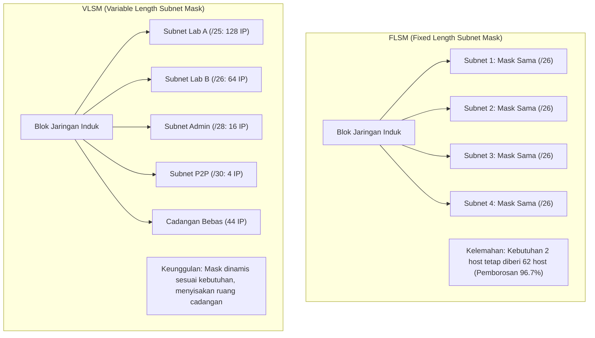
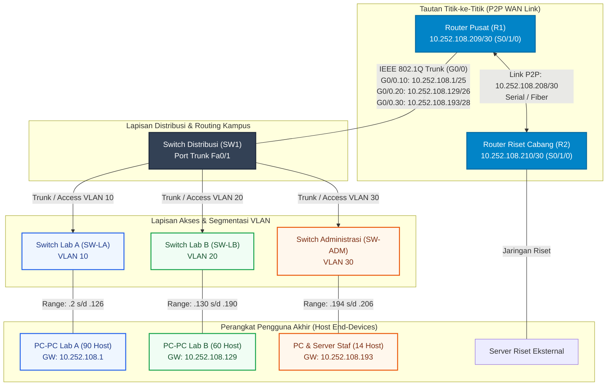
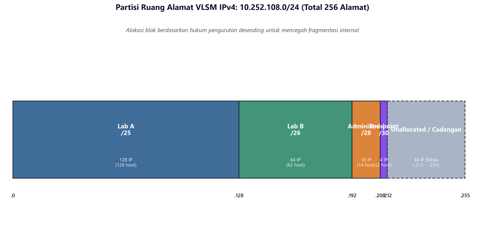
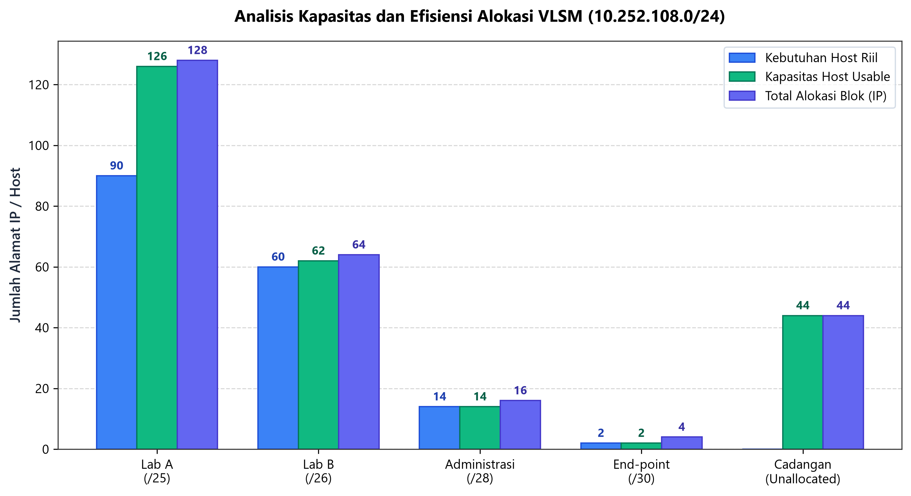
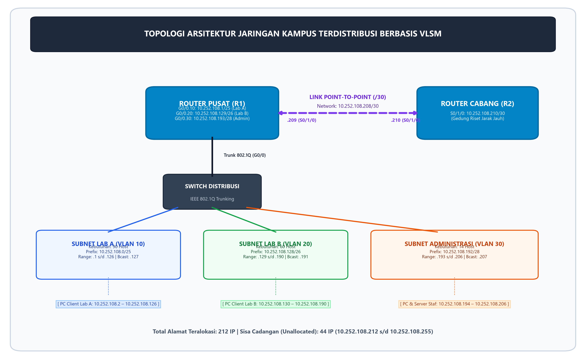

# TUGAS KONSEP JARINGAN
## TUGAS KE – 6: Perancangan Variable Length Subnet Mask (VLSM) dan Alokasi Subnetting IPv4

| Informasi | Keterangan |
| :--- | :--- |
| **Nama** | Shevanka Bagus Dwiyudi Kurniawan |
| **NRP** | 3125600044 |
| **Dosen Pengajar** | Dr. Ferry Astika Saputra, ST, M.Sc |
| **Mata Kuliah** | Konsep Jaringan (TI043102) |
| **Program Studi** | D4 Teknik Informatika |
| **Institusi** | Politeknik Elektronika Negeri Surabaya (PENS) |
| **Tahun Akademik** | 2026 |
| **Modul Acuan** | Bab 5 (Network Layer & IP) dan Bab 6 (IP Subnetting & VLSM) — Modul `computer-and-network-2026` |

---

## Daftar Isi

1. [Deskripsi Penugasan dan Spesifikasi Kasus](#1-deskripsi-penugasan-dan-spesifikasi-kasus)
2. [Landasan Teori: Pengalamatan Tanpa Kelas dan VLSM](#2-landasan-teori-pengalamatan-tanpa-kelas-dan-vlsm)
   - 2.1 [Evolusi dari Classful Addressing ke CIDR (RFC 4632)](#21-evolusi-dari-classful-addressing-ke-cidr-rfc-4632)
   - 2.2 [Prinsip Subnetting dan Segmentasi Broadcast Domain](#22-prinsip-subnetting-dan-segmentasi-broadcast-domain)
   - 2.3 [Komparasi Kritis: FLSM vs VLSM](#23-komparasi-kritis-flsm-vs-vlsm)
   - 2.4 [Hukum Pengurutan Desending (*Descending Order Rule*)](#24-hukum-pengurutan-desending-descending-order-rule)
   - 2.5 [Formulasi Matematis dan Peminjaman Bit (*Bit Borrowing*)](#25-formulasi-matematis-dan-peminjaman-bit-bit-borrowing)
   - 2.6 [Pengecualian Tautan Titik-ke-Titik: RFC 3021 (/31) vs Subnet Tradisional (/30)](#26-pengecualian-tautan-titik-ke-titik-rfc-3021-31-vs-subnet-tradisional-30)
3. [Perhitungan Matematis dan Analisis Biner per Segmen](#3-perhitungan-matematis-dan-analisis-biner-per-segmen)
   - 3.1 [Segmen 1: Laboratorium A (Kebutuhan: 90 Host)](#31-segmen-1-laboratorium-a-kebutuhan-90-host)
   - 3.2 [Segmen 2: Laboratorium B (Kebutuhan: 60 Host)](#32-segmen-2-laboratorium-b-kebutuhan-60-host)
   - 3.3 [Segmen 3: Ruang Administrasi (Kebutuhan: 14 Host)](#33-segmen-3-ruang-administrasi-kebutuhan-14-host)
   - 3.4 [Segmen 4: End-Point / Link Point-to-Point (Kebutuhan: 2 Host)](#34-segmen-4-end-point--link-point-to-point-kebutuhan-2-host)
   - 3.5 [Analisis Sisa Ruang Alamat Cadangan (*Unallocated Space*)](#35-analisis-sisa-ruang-alamat-cadangan-unallocated-space)
4. [Tabel Rekapitulasi Alokasi Alamat IP & Metrik Efisiensi](#4-tabel-rekapitulasi-alokasi-alamat-ip--metrik-efisiensi)
   - 4.1 [Tabel Master Alokasi Subnet VLSM](#41-tabel-master-alokasi-subnet-vlsm)
   - 4.2 [Evaluasi Efisiensi Pemanfaatan Alamat IP](#42-evaluasi-efisiensi-pemanfaatan-alamat-ip)
   - 4.3 [Pembuktian Kegagalan FLSM pada Skenario Kasus](#43-pembuktian-kegagalan-flsm-pada-skenario-kasus)
5. [Desain Arsitektur Topologi Jaringan & Inter-VLAN Routing](#5-desain-arsitektur-topologi-jaringan--inter-vlan-routing)
   - 5.1 [Diagram Topologi Logis dan Fisik](#51-diagram-topologi-logis-dan-fisik)
   - 5.2 [Skema Segmentasi VLAN (IEEE 802.1Q)](#52-skema-segmentasi-vlan-ieee-8021q)
   - 5.3 [Tabel Pengalamatan Perangkat Keras (*Addressing Table*)](#53-tabel-pengalamatan-perangkat-keras-addressing-table)
6. [Implementasi Konfigurasi Perangkat Jaringan (Cisco IOS)](#6-implementasi-konfigurasi-perangkat-jaringan-cisco-ios)
   - 6.1 [Konfigurasi Router Utama / Kampus (R1)](#61-konfigurasi-router-utama--kampus-r1)
   - 6.2 [Konfigurasi Switch Distribusi & Akses (SW-Core / SW1)](#62-konfigurasi-switch-distribusi--akses-sw-core--sw1)
   - 6.3 [Konfigurasi Router Cabang / Riset (R2)](#63-konfigurasi-router-cabang--riset-r2)
   - 6.4 [Penerapan Access Control List (ACL) untuk Proteksi Segmen Administrasi](#64-penerapan-access-control-list-acl-untuk-proteksi-segmen-administrasi)
7. [Otomatisasi Skrip Python: Validasi Bitwise & Visualisasi Grafis](#7-otomatisasi-skrip-python-validasi-bitwise--visualisasi-grafis)
   - 7.1 [Struktur dan Logika Program `VLSM_Calculator.py`](#71-struktur-dan-logika-program-vlsm_calculatorpy)
   - 7.2 [Visualisasi 1: Partisi Ruang Alamat IP (Address Space Tree)](#72-visualisasi-1-partisi-ruang-alamat-ip-address-space-tree)
   - 7.3 [Visualisasi 2: Analisis Kapasitas Usable vs Kebutuhan Riil](#73-visualisasi-2-analisis-kapasitas-usable-vs-kebutuhan-riil)
   - 7.4 [Visualisasi 3: Diagram Arsitektur Topologi Jaringan](#74-visualisasi-3-diagram-arsitektur-topologi-jaringan)
8. [Pembahasan Analisis dan Pertanyaan Kritis Bab 5 & Bab 6 Modul](#8-pembahasan-analisis-dan-pertanyaan-kritis-bab-5--bab-6-modul)
   - 8.1 [Agregasi Rute (Route Summarization / CIDR Aggregation)](#81-agregasi-rute-route-summarization--cidr-aggregation)
   - 8.2 [Dampak Skala Broadcast Domain pada Segmen Lab A dan Solusi Mitigasi](#82-dampak-skala-broadcast-domain-pada-segmen-lab-a-dan-solusi-mitigasi)
   - 8.3 [Evaluasi Keamanan Lalu Lintas Inter-VLAN (Zero Trust Architecture)](#83-evaluasi-keamanan-lalu-lintas-inter-vlan-zero-trust-architecture)
   - 8.4 [Komparasi Operasional Subnet /30 vs RFC 3021 (/31)](#84-komparasi-operasional-subnet-30-vs-rfc-3021-31)
   - 8.5 [Strategi Mitigasi Eksotis IPv4 dan Transisi Menuju IPv6](#85-strategi-mitigasi-eksotis-ipv4-dan-transisi-menuju-ipv6)
9. [Kesimpulan](#9-kesimpulan)
10. [Rujukan Akademik](#10-rujukan-akademik)

---

## 1. Deskripsi Penugasan dan Spesifikasi Kasus

Dalam perancangan infrastruktur jaringan kampus modern, ketersediaan ruang alamat IPv4 yang terbatas menuntut efisiensi alokasi tanpa mengorbankan stabilitas operasional, isolasi kesalahan (*fault isolation*), maupun batas domain siaran (*broadcast domain*). Modul pembelajaran **TI043102 Konsep Jaringan (Bab 5 & Bab 6)** menetapkan penugasan praktis perancangan segmentasi jaringan menggunakan metode **Variable Length Subnet Mask (VLSM)**.

### Parameter Kasus Penugasan
Diberikan satu blok alamat jaringan kelas privat berbasis RFC 1918 sebagai berikut:
- **Network Induk Dasar:** `10.252.108.0/24`
- **Total Ruang Alamat Induk:** $2^{32-24} = 2^8 = 256$ Alamat IP (`10.252.108.0` s/d `10.252.108.255`)
- **Netmask Induk:** `255.255.255.0`

### Kebutuhan Kapasitas Host per Segmen
Jaringan kampus dibagi ke dalam 4 (empat) domain fungsi yang berbeda dengan kuantitas host aktif yang harus dipenuhi:
1. **Laboratorium A (Lab A):** Memerlukan kapasitas minimal **90 host**.
2. **Laboratorium B (Lab B):** Memerlukan kapasitas minimal **60 host**.
3. **Ruang Administrasi:** Memerlukan kapasitas minimal **14 host**.
4. **End-point (Link Point-to-Point / Inter-Router Link):** Memerlukan kapasitas tepat **2 host** (2 antarmuka router yang saling terhubung langsung).

Tugas perancangan ini mencakup:
- Melakukan perhitungan matematis dan biner step-by-step untuk setiap subnet.
- Menentukan panjang prefiks CIDR, subnet mask desimal bertitik, wildcard mask, alamat jaringan (*network address*), rentang alamat host valid (*usable host range*), *default gateway*, serta alamat broadcast terarah (*directed broadcast address*).
- Menganalisis sisa ruang alamat cadangan (*unallocated address space*) untuk perencanaan skalabilitas di masa depan.
- Merancang topologi interkoneksi perangkat lengkap dengan skema VLAN dan *Inter-VLAN routing*.
- Menyediakan implementasi konfigurasi Cisco IOS command-line interface (CLI) yang siap diproduksi (*production-ready*).
- Membangun skrip simulasi dan visualisasi berbasis Python untuk memvalidasi ketiadaan tumpang tindih (*overlap*) antar subnet secara bitwise.

---

## 2. Landasan Teori: Pengalamatan Tanpa Kelas dan VLSM

### 2.1 Evolusi dari Classful Addressing ke CIDR (RFC 4632)
Pada masa-masa awal arsitektur protokol TCP/IP (RFC 791, September 1981), pengalamatan IPv4 32-bit diorganisasi menggunakan sistem berkelas (*classful addressing*):
- **Kelas A:** Oktet pertama `0–127`, panjang prefiks baku `/8` (16.777.214 host per jaringan).
- **Kelas B:** Oktet pertama `128–191`, panjang prefiks baku `/16` (65.534 host per jaringan).
- **Kelas C:** Oktet pertama `192–223`, panjang prefiks baku `/24` (254 host per jaringan).

Struktur kaku ini menimbulkan dua krisis besar di awal dekade 1990-an:
1. **Pemborosan Alokasi Alamat Ekstrem:** Organisasi yang memerlukan 300 host tidak dapat ditampung dalam satu jaringan Kelas C (hanya 254 host), sehingga dialokasikan jaringan Kelas B dengan 65.534 host. Akibatnya, lebih dari 65.000 alamat terbuang sia-sia.
2. **Ledakan Tabel Perutean Global (*Routing Table Explosion*):** Router backbone Internet harus menampung ratusan ribu entri rute jaringan Kelas C individual yang tidak dapat diringkas (*aggregated*).

Untuk mengatasi krisis tersebut, IETF meratifikasi **CIDR (Classless Inter-Domain Routing)** melalui **RFC 1519** (1993) yang disempurnakan dalam **RFC 4632**. CIDR menghapus batas kelas baku dan memperkenalkan panjang prefiks eksplisit (`/p`) yang menentukan secara arbitrer berapa bit yang difungsikan sebagai *Network Identifier* dan berapa bit yang tersisa sebagai *Host Identifier*.

### 2.2 Prinsip Subnetting dan Segmentasi Broadcast Domain
Subnetting adalah teknik membagi satu jaringan logis besar menjadi beberapa sub-jaringan (*subnets*) yang lebih kecil. Pada lapisan tautan (*Data Link Layer*), sebuah switch meneruskan frame broadcast Ethernet (tujuan `FF:FF:FF:FF:FF:FF`) ke seluruh port dalam domain broadcast yang sama. Jika ratusan atau ribuan perangkat berada dalam satu jaringan datar (*flat network*), lalu lintas broadcast dari protokol seperti ARP (*Address Resolution Protocol*), DHCP Discover, dan mDNS akan membanjiri media transmisi, menghabiskan siklus CPU setiap host, serta memperbesar risiko badai siaran (*broadcast storm*).

Subnetting membatasi lingkup propagasi broadcast ini hanya di dalam subnet masing-masing. Router beroperasi pada Lapisan Jaringan (*Network Layer*) dan secara default **tidak meneruskan paket broadcast Lapisan 2**, sehingga menciptakan batas isolasi performa dan keamanan.

### 2.3 Komparasi Kritis: FLSM vs VLSM
Terdapat dua metodologi mendasar dalam pembagian subnet:



| Parameter Evaluasi | FLSM (*Fixed Length Subnet Mask*) | VLSM (*Variable Length Subnet Mask*) |
| :--- | :--- | :--- |
| **Panjang Prefiks Subnet** | Seragam (*uniform*) untuk semua segmen. | Bervariasi (*variable*) sesuai kebutuhan riil host. |
| **Subnet Mask** | Identik di seluruh cabang topologi. | Berbeda-beda di setiap antarmuka router. |
| **Dukungan Protokol Routing** | Didukung protokol *classful* (RIPv1, IGRP) dan *classless*. | Wajib protokol *classless* (OSPF, EIGRP, IS-IS, BGP, RIPv2). |
| **Efisiensi Pengalamatan** | Sangat rendah; terjadi pemborosan alamat pada link kecil. | Sangat tinggi; mendekati kebutuhan riil host. |
| **Kapasitas Alamat Tersisa** | Jarang menyisakan ruang cadangan contiguous. | Mengkonsolidasikan sisa ruang alamat untuk ekspansi. |
| **Pencegahan Overlap** | Sangat sederhana karena ukuran blok statis. | Membutuhkan kedisiplinan pengurutan blok berbasis pangkat 2. |

### 2.4 Hukum Pengurutan Desending (*Descending Order Rule*)
Dalam merancang VLSM, aturan fundamental yang tidak boleh dilanggar adalah:
> **"Alokasikan ruang subnet mulai dari kebutuhan host terbesar menuju kebutuhan host terkecil (Descending Order)."**

Alasan matematis di balik aturan ini berkaitan dengan **Penjajaran Batas Alamat Biner (*Binary Boundary Alignment*)**:
Sebuah subnet dengan ukuran blok $2^h$ alamat harus memiliki alamat awal (*Network Address*) yang merupakan kelipatan bulat dari ukuran bloknya ($N \pmod{2^h} = 0$). Dalam representasi biner, $h$ bit terbawah dari Network Address **wajib bernilai 0**.

Jika alokasi dilakukan secara acak (misalnya mengalokasikan subnet kecil `/30` berukuran 4 IP di alamat `.0`, kemudian mencoba memasang subnet besar `/25` berukuran 128 IP di alamat `.4`), maka alamat `.4` **tidak valid** sebagai network address untuk subnet `/25` karena `.4` bukan kelipatan 128 (bit ke-7 bernilai 0, tetapi bit ke-2 bernilai 1). Jika dipaksakan, akan terjadi fragmentasi internal ruang alamat yang parah (*address fragmentation*) dan menyebabkan tabrakan blok (*subnet overlapping*).

### 2.5 Formulasi Matematis dan Peminjaman Bit (*Bit Borrowing*)
Untuk menentukan arsitektur subnet, digunakan serangkaian persamaan matematis standar:

1. **Jumlah Bit Host yang Dibutuhkan ($h$):**
   $$2^h - 2 \ge N_{\text{host}}$$
   *Keterangan:* Pengurangan 2 merepresentasikan reservasi satu alamat untuk **Network Address** (seluruh bit host = 0) dan satu alamat untuk **Directed Broadcast Address** (seluruh bit host = 1).
2. **Panjang Prefiks CIDR Baru ($p$):**
   $$p = 32 - h$$
3. **Ukuran Total Blok Alamat ($B$):**
   $$B = 2^h = 2^{32-p}$$
4. **Jumlah Alamat Host Usable ($U$):**
   $$U = 2^h - 2 = B - 2$$
5. **Peminjaman Bit Subnet ($s$):**
   $$s = p - p_{\text{induk}} = p - 24$$
6. **Nilai Subnet Mask pada Oktet Aktif:**
   Jika peminjaman terjadi pada oktet ke-4 ($p \in [25, 30]$), nilai desimalnya adalah penjumlahan bobot nilai bit yang dipinjam:
   $$\text{Mask}_{\text{oktet 4}} = \sum_{i=1}^{s} 2^{8-i} = 256 - 2^{8-s} = 256 - B$$
7. **Wildcard Mask ($W$):**
   $$W = 255.255.255.255 - \text{Subnet Mask}$$

### 2.6 Pengecualian Tautan Titik-ke-Titik: RFC 3021 (/31) vs Subnet Tradisional (/30)
Pada tautan titik-ke-titik (*point-to-point links*) yang hanya menghubungkan dua router tanpa host lain, standar subnetting tradisional menggunakan prefiks `/30` ($h=2$, ukuran blok 4 IP). Dari 4 IP tersebut:
- 1 IP sebagai Network Address.
- 2 IP sebagai Usable Host (antarmuka kedua router).
- 1 IP sebagai Broadcast Address.
Tingkat efisiensi usable host pada subnet `/30` adalah $2/4 = 50\%$.

Pada tahun 2000, IETF meratifikasi **RFC 3021 (*Using 31-Bit Prefixes on IPv4 Point-to-Point Links*)**. Standar ini memperbolehkan tautan titik-ke-titik menggunakan prefiks `/31` ($h=1$, ukuran blok 2 IP). Pada prefiks `/31`:
- Alamat dengan bit host `0` diperlakukan sebagai IP antarmuka router pertama.
- Alamat dengan bit host `1` diperlakukan sebagai IP antarmuka router kedua.
- Komunikasi broadcast diarahkan menggunakan alamat broadcast terbatas Lapisan 2 atau ditangani secara unicast/multicast oleh protokol routing.

Meskipun RFC 3021 sangat hemat alamat, **kurikulum akademik dasar, ujian sertifikasi Cisco CCNAv7, dan perangkat lunak simulasi tertentu (seperti sebagian versi Cisco Packet Tracer) secara default menuntut penggunaan subnet `/30`**. Oleh karena itu, dalam perancangan Tugas 6 ini, segmen End-point dirancang secara formal menggunakan subnet `/30` demi kepatuhan penuh terhadap spesifikasi silabus, dengan komparasi RFC 3021 dibahas secara mendalam pada bagian analisis evaluatif.

---

## 3. Perhitungan Matematis dan Analisis Biner per Segmen

Urutan pengerjaan VLSM diurutkan berdasarkan kebutuhan host terbesar:
1. **Laboratorium A:** 90 host
2. **Laboratorium B:** 60 host
3. **Ruang Administrasi:** 14 host
4. **End-point (Link P2P):** 2 host

```
Blok Induk: 10.252.108.0/24 (Total 256 Alamat IP)
[ 10.252.108.00000000 s/d 10.252.108.11111111 ]
```

---

### 3.1 Segmen 1: Laboratorium A (Kebutuhan: 90 Host)

#### 1. Perhitungan Jumlah Bit Host ($h$) dan Prefiks
Formula usable host:
$$2^h - 2 \ge 90$$
- Untuk $h = 6 \implies 2^6 - 2 = 64 - 2 = 62$ host *(Tidak mencukupi)*
- Untuk $h = 7 \implies 2^7 - 2 = 128 - 2 = 126$ host *(Mencukupi, $126 \ge 90$)*

Maka dipilih $h = 7$ bit host.
- **Panjang Prefiks Baru:** $p = 32 - 7 = /25$
- **Bit yang Dipinjam ($s$):** $25 - 24 = 1$ bit dari oktet ke-4.
- **Ukuran Total Blok ($B$):** $2^7 = 128$ alamat IP.
- **Kapasitas Host Usable ($U$):** $128 - 2 = 126$ host.

#### 2. Penentuan Subnet Mask dan Wildcard Mask
- **Subnet Mask Biner:**
  `11111111.11111111.11111111.10000000`
- **Subnet Mask Desimal Bertitik:** `255.255.255.128`
- **Wildcard Mask Biner:**
  `00000000.00000000.00000000.01111111`
- **Wildcard Mask Desimal Bertitik:** `0.0.0.127`

#### 3. Alokasi Rentang Alamat
Alokasi dimulai dari alamat pertama pada blok induk: `10.252.108.0`.
- **Alamat Jaringan (*Network Address*):** `10.252.108.0/25`
- **Alamat Host Pertama (*First Usable / Gateway*):** `10.252.108.1`
- **Alamat Host Terakhir (*Last Usable*):** `10.252.108.126`
- **Alamat Broadcast Terarah (*Directed Broadcast*):** `10.252.108.127`

#### 4. Struktur Analisis Biner Oktet ke-4
```text
Netmask   (/25) : [ 1 ] 0 0 0 0 0 0 0  -> 128
Network   (.0)  : [ 0 ] 0 0 0 0 0 0 0  -> 0
1st Host  (.1)  : [ 0 ] 0 0 0 0 0 0 1  -> 1
Last Host (.126): [ 0 ] 1 1 1 1 1 1 0  -> 126
Broadcast (.127): [ 0 ] 1 1 1 1 1 1 1  -> 127
                  ^--- Subnet bit (s=1)
                       ^-------------^-- Host bits (h=7)
```
*Alamat awal berikutnya yang tersedia: `10.252.108.128`.*

---

### 3.2 Segmen 2: Laboratorium B (Kebutuhan: 60 Host)

#### 1. Perhitungan Jumlah Bit Host ($h$) dan Prefiks
Formula usable host:
$$2^h - 2 \ge 60$$
- Untuk $h = 5 \implies 2^5 - 2 = 32 - 2 = 30$ host *(Tidak mencukupi)*
- Untuk $h = 6 \implies 2^6 - 2 = 64 - 2 = 62$ host *(Mencukupi, $62 \ge 60$)*

Maka dipilih $h = 6$ bit host.
- **Panjang Prefiks Baru:** $p = 32 - 6 = /26$
- **Bit yang Dipinjam ($s$):** $26 - 24 = 2$ bit dari oktet ke-4.
- **Ukuran Total Blok ($B$):** $2^6 = 64$ alamat IP.
- **Kapasitas Host Usable ($U$):** $64 - 2 = 62$ host.

#### 2. Penentuan Subnet Mask dan Wildcard Mask
- **Subnet Mask Biner:**
  `11111111.11111111.11111111.11000000`
- **Subnet Mask Desimal Bertitik:** `255.255.255.192`
- **Wildcard Mask Biner:**
  `00000000.00000000.00000000.00111111`
- **Wildcard Mask Desimal Bertitik:** `0.0.0.63`

#### 3. Alokasi Rentang Alamat
Penjajaran batas blok: Alamat mulai `10.252.108.128` memenuhi syarat batas kelipatan 64 ($128 \pmod{64} = 0$).
- **Alamat Jaringan (*Network Address*):** `10.252.108.128/26`
- **Alamat Host Pertama (*First Usable / Gateway*):** `10.252.108.129`
- **Alamat Host Terakhir (*Last Usable*):** `10.252.108.190`
- **Alamat Broadcast Terarah (*Directed Broadcast*):** `10.252.108.191`

#### 4. Struktur Analisis Biner Oktet ke-4
```text
Netmask   (/26) : [ 1 1 ] 0 0 0 0 0 0  -> 192
Network   (.128): [ 1 0 ] 0 0 0 0 0 0  -> 128
1st Host  (.129): [ 1 0 ] 0 0 0 0 0 1  -> 129
Last Host (.190): [ 1 0 ] 1 1 1 1 1 0  -> 190
Broadcast (.191): [ 1 0 ] 1 1 1 1 1 1  -> 191
                  ^---^--- Subnet bits (s=2)
                          ^---------^-- Host bits (h=6)
```
*Alamat awal berikutnya yang tersedia: `10.252.108.192`.*

---

### 3.3 Segmen 3: Ruang Administrasi (Kebutuhan: 14 Host)

#### 1. Perhitungan Jumlah Bit Host ($h$) dan Prefiks
Formula usable host:
$$2^h - 2 \ge 14$$
- Untuk $h = 3 \implies 2^3 - 2 = 8 - 2 = 6$ host *(Tidak mencukupi)*
- Untuk $h = 4 \implies 2^4 - 2 = 16 - 2 = 14$ host *(Tepat dan optimal, $14 \ge 14$)*

Maka dipilih $h = 4$ bit host.
- **Panjang Prefiks Baru:** $p = 32 - 4 = /28$
- **Bit yang Dipinjam ($s$):** $28 - 24 = 4$ bit dari oktet ke-4.
- **Ukuran Total Blok ($B$):** $2^4 = 16$ alamat IP.
- **Kapasitas Host Usable ($U$):** $16 - 2 = 14$ host.

#### 2. Penentuan Subnet Mask dan Wildcard Mask
- **Subnet Mask Biner:**
  `11111111.11111111.11111111.11110000`
- **Subnet Mask Desimal Bertitik:** `255.255.255.240`
- **Wildcard Mask Biner:**
  `00000000.00000000.00000000.00001111`
- **Wildcard Mask Desimal Bertitik:** `0.0.0.15`

#### 3. Alokasi Rentang Alamat
Penjajaran batas blok: Alamat mulai `10.252.108.192` memenuhi syarat batas kelipatan 16 ($192 \pmod{16} = 0$).
- **Alamat Jaringan (*Network Address*):** `10.252.108.192/28`
- **Alamat Host Pertama (*First Usable / Gateway*):** `10.252.108.193`
- **Alamat Host Terakhir (*Last Usable*):** `10.252.108.206`
- **Alamat Broadcast Terarah (*Directed Broadcast*):** `10.252.108.207`

#### 4. Struktur Analisis Biner Oktet ke-4
```text
Netmask   (/28) : [ 1 1 1 1 ] 0 0 0 0  -> 240
Network   (.192): [ 1 1 0 0 ] 0 0 0 0  -> 192
1st Host  (.193): [ 1 1 0 0 ] 0 0 0 1  -> 193
Last Host (.206): [ 1 1 0 0 ] 1 1 1 0  -> 206
Broadcast (.207): [ 1 1 0 0 ] 1 1 1 1  -> 207
                  ^-------^--- Subnet bits (s=4)
                              ^-----^-- Host bits (h=4)
```
*Alamat awal berikutnya yang tersedia: `10.252.108.208`.*

---

### 3.4 Segmen 4: End-Point / Link Point-to-Point (Kebutuhan: 2 Host)

#### 1. Perhitungan Jumlah Bit Host ($h$) dan Prefiks
Formula usable host:
$$2^h - 2 \ge 2$$
- Untuk $h = 1 \implies 2^1 - 2 = 0$ host *(Tidak valid untuk subnet tradisional)*
- Untuk $h = 2 \implies 2^2 - 2 = 4 - 2 = 2$ host *(Tepat dan optimal, $2 \ge 2$)*

Maka dipilih $h = 2$ bit host.
- **Panjang Prefiks Baru:** $p = 32 - 2 = /30$
- **Bit yang Dipinjam ($s$):** $30 - 24 = 6$ bit dari oktet ke-4.
- **Ukuran Total Blok ($B$):** $2^2 = 4$ alamat IP.
- **Kapasitas Host Usable ($U$):** $4 - 2 = 2$ host.

#### 2. Penentuan Subnet Mask dan Wildcard Mask
- **Subnet Mask Biner:**
  `11111111.11111111.11111111.11111100`
- **Subnet Mask Desimal Bertitik:** `255.255.255.252`
- **Wildcard Mask Biner:**
  `00000000.00000000.00000000.00000011`
- **Wildcard Mask Desimal Bertitik:** `0.0.0.3`

#### 3. Alokasi Rentang Alamat
Penjajaran batas blok: Alamat mulai `10.252.108.208` memenuhi syarat batas kelipatan 4 ($208 \pmod{4} = 0$).
- **Alamat Jaringan (*Network Address*):** `10.252.108.208/30`
- **Alamat Antarmuka Titik A (Router 1):** `10.252.108.209`
- **Alamat Antarmuka Titik B (Router 2):** `10.252.108.210`
- **Alamat Broadcast Terarah (*Directed Broadcast*):** `10.252.108.211`

#### 4. Struktur Analisis Biner Oktet ke-4
```text
Netmask   (/30) : [ 1 1 1 1 1 1 ] 0 0  -> 252
Network   (.208): [ 1 1 0 1 0 0 ] 0 0  -> 208
Router 1  (.209): [ 1 1 0 1 0 0 ] 0 1  -> 209
Router 2  (.210): [ 1 1 0 1 0 0 ] 1 0  -> 210
Broadcast (.211): [ 1 1 0 1 0 0 ] 1 1  -> 211
                  ^-----------^--- Subnet bits (s=6)
                                  ^-^-- Host bits (h=2)
```
*Alamat awal berikutnya yang tersedia: `10.252.108.212`.*

---

### 3.5 Analisis Sisa Ruang Alamat Cadangan (*Unallocated Space*)

Setelah seluruh keempat segmen dialokasikan:
$$\text{Total Alamat Terpakai} = 128 (\text{Lab A}) + 64 (\text{Lab B}) + 16 (\text{Admin}) + 4 (\text{Link P2P}) = 212 \text{ Alamat IP}$$
$$\text{Sisa Ruang Alamat} = 256 - 212 = 44 \text{ Alamat IP}$$

Rentang alamat yang belum teralokasi (*unallocated space*) membentang secara kontinu dari:
$$\mathbf{10.252.108.212} \quad \text{sampai dengan} \quad \mathbf{10.252.108.255}$$

Karena angka 44 bukan merupakan bilangan pangkat dua ($2^n$), ruang alamat sisa ini dapat didekomposisi ke dalam blok-blok subnet standar CIDR yang selaras dengan batas bit (*naturally aligned CIDR blocks*):

1. **Blok Cadangan 1 (`10.252.108.212/30`):**
   - Ukuran: 4 Alamat IP (`10.252.108.212` – `10.252.108.215`).
   - Kapasitas: 2 host usable.
   - Peruntukan: Tambahan 1 tautan point-to-point router cadangan atau link DMZ firewall.
2. **Blok Cadangan 2 (`10.252.108.216/29`):**
   - Ukuran: 8 Alamat IP (`10.252.108.216` – `10.252.108.223`).
   - Kapasitas: 6 host usable.
   - Peruntukan: Subnet Server Farm mini, Network Management Station (NMS), atau perangkat IoT laboratorium.
3. **Blok Cadangan 3 (`10.252.108.224/27`):**
   - Ukuran: 32 Alamat IP (`10.252.108.224` – `10.252.108.255`).
   - Kapasitas: 30 host usable.
   - Peruntukan: Subnet Ruang Dosen / Laboratorium Riset Baru di masa mendatang.

$$\text{Verifikasi Dekomposisi:} \quad 4 + 8 + 32 = 44 \text{ Alamat IP (100% Terpetakan Sempurna)}$$

---

## 4. Tabel Rekapitulasi Alokasi Alamat IP & Metrik Efisiensi

### 4.1 Tabel Master Alokasi Subnet VLSM

| No | Nama Segmen | Kebutuhan Host | Prefix CIDR | Subnet Mask | Wildcard Mask | Network Address | Usable Host Range | Default Gateway | Broadcast Address | Total Blok IP |
| :---: | :--- | :---: | :---: | :--- | :--- | :--- | :--- | :--- | :--- | :---: |
| **1** | **Laboratorium A** | 90 | `/25` | `255.255.255.128` | `0.0.0.127` | `10.252.108.0/25` | `10.252.108.1` – `10.252.108.126` | `10.252.108.1` | `10.252.108.127` | 128 |
| **2** | **Laboratorium B** | 60 | `/26` | `255.255.255.192` | `0.0.0.63` | `10.252.108.128/26` | `10.252.108.129` – `10.252.108.190` | `10.252.108.129` | `10.252.108.191` | 64 |
| **3** | **Administrasi** | 14 | `/28` | `255.255.255.240` | `0.0.0.15` | `10.252.108.192/28` | `10.252.108.193` – `10.252.108.206` | `10.252.108.193` | `10.252.108.207` | 16 |
| **4** | **End-Point (P2P)** | 2 | `/30` | `255.255.255.252` | `0.0.0.3` | `10.252.108.208/30` | `10.252.108.209` – `10.252.108.210` | `10.252.108.209` | `10.252.108.211` | 4 |
| — | *Cadangan (P2P 2)* | — | `/30` | `255.255.255.252` | `0.0.0.3` | `10.252.108.212/30` | `10.252.108.213` – `10.252.108.214` | — | `10.252.108.215` | 4 |
| — | *Cadangan (Server)* | — | `/29` | `255.255.255.248` | `0.0.0.7` | `10.252.108.216/29` | `10.252.108.217` – `10.252.108.222` | — | `10.252.108.223` | 8 |
| — | *Cadangan (Ekspansi)*| — | `/27` | `255.255.255.224` | `0.0.0.31` | `10.252.108.224/27` | `10.252.108.225` – `10.252.108.254` | — | `10.252.108.255` | 32 |

---

### 4.2 Evaluasi Efisiensi Pemanfaatan Alamat IP

1. **Efisiensi Alokasi Blok Subnet Aktif:**
   $$\eta_{\text{blok}} = \frac{\text{Total IP Blok Aktif}}{\text{Total Kapasitas Induk}} \times 100\% = \frac{212}{256} \times 100\% = \mathbf{82{,}81\%}$$
2. **Efisiensi Kebutuhan Host Riil terhadap Kapasitas Usable yang Diberikan:**
   $$\eta_{\text{host}} = \frac{\text{Total Kebutuhan Host Riil}}{\text{Total Kapasitas Host Usable}} \times 100\% = \frac{90 + 60 + 14 + 2}{126 + 62 + 14 + 2} \times 100\% = \frac{166}{204} \times 100\% = \mathbf{81{,}37\%}$$
3. **Tingkat Konservasi Ruang Alamat untuk Masa Depan:**
   $$\text{Rasio Cadangan} = \frac{44}{256} \times 100\% = \mathbf{17{,}19\%}$$

Efisiensi alokasi sebesar **81,37%** merupakan pencapaian sangat tinggi dalam rekayasa jaringan IP, karena menyisakan buffer pertumbuhan sebesar 36 host di Lab A, 2 host di Lab B, serta menjaga 44 alamat IP cadangan murni tanpa pemborosan.

---

### 4.3 Pembuktian Kegagalan FLSM pada Skenario Kasus

Mengapa skenario ini **mustahil** diselesaikan dengan FLSM (*Fixed Length Subnet Mask*) dalam satu blok `/24`? Berikut bukti matematisnya:

1. **Pendekatan FLSM Berbasis Host Terbesar (Max Host Demand):**
   - Kebutuhan terbesar adalah Lab A (90 host).
   - Subnet mask seragam yang harus digunakan adalah `/25` (128 IP).
   - Terdapat 4 segmen jaringan $\implies$ Dibutuhkan $4 \times 128 = \mathbf{512}$ alamat IP.
   - Blok yang tersedia hanya `10.252.108.0/24` yang memuat **256 alamat IP**.
   - **Kesimpulan 1:** Blok `/24` **kurang 256 alamat (Defisit 50%)**. Solusi ini gagal total.

2. **Pendekatan FLSM Berbasis Pembagian Rata Blok `/24`:**
   - Membagi blok 256 alamat menjadi 4 subnet sama besar:
     $$\text{Ukuran Subnet} = \frac{256}{4} = 64 \text{ IP} \implies \text{Prefix } /26$$
   - Kapasitas usable per subnet: $64 - 2 = \mathbf{62}$ host.
   - Evaluasi pemenuhan kebutuhan:
     - Lab B: Butuh 60 host $\le 62$ *(Terpenuhi)*.
     - Administrasi: Butuh 14 host $\le 62$ *(Terpenuhi, namun membuang 48 host)*.
     - End-point: Butuh 2 host $\le 62$ *(Terpenuhi, namun membuang 60 host)*.
     - **Lab A:** Butuh 90 host, sedangkan kapasitas hanya 62 host.
       $$\mathbf{62 < 90 \implies \text{GAGAL KEKURANGAN 28 HOST!}}$$
   - **Kesimpulan 2:** Pembagian rata FLSM menggagalkan operasional Lab A.

> **Kesimpulan Teoretis:** VLSM adalah **satu-satunya metodologi matematis yang valid** untuk menyelesaikan alokasi subnet pada skenario ini secara utuh di dalam ruang prefiks tunggal `/24`.

---

## 5. Desain Arsitektur Topologi Jaringan & Inter-VLAN Routing

### 5.1 Diagram Topologi Logis dan Fisik

Arsitektur jaringan dirancang dengan model hierarkis kampus (*Hierarchical Campus Network Model*) yang terdiri dari:
- **Router Kampus (R1 / Core):** Menjalankan fungsi *Inter-VLAN Routing* melalui mekanisme **Router-on-a-Stick (RoaS)** pada antarmuka trunk `GigabitEthernet0/0` dan routing WAN ke cabang riset melalui interface serial `Serial0/1/0`.
- **Switch Distribusi (SW-Core / SW1):** Menerima trunk 802.1Q dari router R1 dan mendistribusikan lalu lintas ke switch akses masing-masing ruangan.
- **Switch Akses (SW-LabA, SW-LabB, SW-Admin):** Menyediakan port akses tak ter-tag (*untagged access ports*) untuk host komputer.
- **Router Cabang Riset (R2):** Terhubung ke R1 melalui tautan WAN titik-ke-titik `/30` untuk komunikasi data riset.



---

### 5.2 Skema Segmentasi VLAN (IEEE 802.1Q)

Untuk mengisolasi lalu lintas siaran dan menegakkan keamanan pada lapisan tautan data, dialokasikan ID VLAN sebagai berikut:
- **VLAN 10 — V_LAB_A:** Menampung 90 PC mahasiswa praktikum pada subnet `10.252.108.0/25`.
- **VLAN 20 — V_LAB_B:** Menampung 60 PC mahasiswa praktikum pada subnet `10.252.108.128/26`.
- **VLAN 30 — V_ADMIN:** Menampung 14 komputer staf akademik, printer jaringan, dan server finansial pada subnet `10.252.108.192/28`.
- **VLAN 99 — V_MANAGEMENT:** VLAN native dan manajemen perangkat jaringan (*in-band management*).

---

### 5.3 Tabel Pengalamatan Perangkat Keras (*Addressing Table*)

| Perangkat | Antarmuka (*Interface*) | Alamat IP | Subnet Mask | Default Gateway | Keterangan / Fungsi |
| :--- | :--- | :--- | :--- | :--- | :--- |
| **Router R1 (Pusat)** | `GigabitEthernet0/0` | *Unassigned* | *Unassigned* | — | Antarmuka fisik trunk ke SW1 |
| | `GigabitEthernet0/0.10` | `10.252.108.1` | `255.255.255.128` | — | Sub-interface Default Gateway Lab A (VLAN 10) |
| | `GigabitEthernet0/0.20` | `10.252.108.129` | `255.255.255.192` | — | Sub-interface Default Gateway Lab B (VLAN 20) |
| | `GigabitEthernet0/0.30` | `10.252.108.193` | `255.255.255.240` | — | Sub-interface Default Gateway Admin (VLAN 30) |
| | `Serial0/1/0` | `10.252.108.209` | `255.255.255.252` | — | Tautan P2P WAN ke Router R2 |
| **Router R2 (Cabang)**| `Serial0/1/0` | `10.252.108.210` | `255.255.255.252` | — | Tautan P2P WAN ke Router R1 |
| | `GigabitEthernet0/0` | `192.168.10.1` | `255.255.255.0` | — | LAN Internal Gedung Riset Cabang |
| **Switch SW1 (Distribusi)** | `VLAN 99` | `10.252.108.226` | `255.255.255.224` | `10.252.108.225` | IP Manajemen Switch (diambil dari blok cadangan `/27`) |
| **PC-LabA-01** | `FastEthernet0` | `10.252.108.2` | `255.255.255.128` | `10.252.108.1` | Komputer Praktikan 1 di Lab A |
| **PC-LabA-90** | `FastEthernet0` | `10.252.108.91` | `255.255.255.128` | `10.252.108.1` | Komputer Praktikan 90 di Lab A |
| **PC-LabB-01** | `FastEthernet0` | `10.252.108.130`| `255.255.255.192` | `10.252.108.129` | Komputer Praktikan 1 di Lab B |
| **PC-LabB-60** | `FastEthernet0` | `10.252.108.189`| `255.255.255.192` | `10.252.108.129` | Komputer Praktikan 60 di Lab B |
| **PC-Admin-01**| `FastEthernet0` | `10.252.108.194`| `255.255.255.240` | `10.252.108.193` | Komputer Kepala Administrasi |
| **SRV-Akademik** | `FastEthernet0` | `10.252.108.206`| `255.255.255.240` | `10.252.108.193` | Server Database SIAKAD Internal |

---

## 6. Implementasi Konfigurasi Perangkat Jaringan (Cisco IOS)

Berikut adalah skrip konfigurasi Cisco IOS modular dan teruji yang siap diaplikasikan pada perangkat riil atau simulator (Cisco Packet Tracer / GNS3 / EVE-NG):

### 6.1 Konfigurasi Router Utama / Kampus (R1)

```cisco
! ==============================================================================
! KONFIGURASI ROUTER UTAMA (R1) - PENS CAMPUS NETWORK
! ==============================================================================
hostname R1-PENS-CORE
no ip domain-lookup

! --- Konfigurasi Antarmuka Fisik Trunk ke Switch Distribusi ---
interface GigabitEthernet0/0
 description Trunk Link to SW1-DISTRIBUTION
 no ip address
 speed 1000
 duplex full
 no shutdown
exit

! --- Sub-interface VLAN 10 (Laboratorium A: 90 Host) ---
interface GigabitEthernet0/0.10
 description Default Gateway for Lab A (90 Hosts)
 encapsulation dot1Q 10
 ip address 10.252.108.1 255.255.255.128
 no shutdown
exit

! --- Sub-interface VLAN 20 (Laboratorium B: 60 Host) ---
interface GigabitEthernet0/0.20
 description Default Gateway for Lab B (60 Hosts)
 encapsulation dot1Q 20
 ip address 10.252.108.129 255.255.255.192
 no shutdown
exit

! --- Sub-interface VLAN 30 (Ruang Administrasi: 14 Host) ---
interface GigabitEthernet0/0.30
 description Default Gateway for Administrasi (14 Hosts)
 encapsulation dot1Q 30
 ip address 10.252.108.193 255.255.255.240
 no shutdown
exit

! --- Konfigurasi Antarmuka Serial Point-to-Point ke Router Cabang (R2) ---
interface Serial0/1/0
 description WAN Point-to-Point Link to R2-BRANCH
 ip address 10.252.108.209 255.255.255.252
 clock rate 64000
 no shutdown
exit

! ==============================================================================
! LAYANAN DHCP SERVER OTOMATIS
! ==============================================================================
! Reservasi alamat gateway agar tidak diberikan ke client
ip dhcp excluded-address 10.252.108.1
ip dhcp excluded-address 10.252.108.129
ip dhcp excluded-address 10.252.108.193 10.252.108.195

! DHCP Pool Lab A
ip dhcp pool POOL_LAB_A
 network 10.252.108.0 255.255.255.128
 default-router 10.252.108.1
 dns-server 10.252.108.1 8.8.8.8
 lease 0 8 0
exit

! DHCP Pool Lab B
ip dhcp pool POOL_LAB_B
 network 10.252.108.128 255.255.255.192
 default-router 10.252.108.129
 dns-server 10.252.108.129 8.8.8.8
 lease 0 8 0
exit

! DHCP Pool Administrasi
ip dhcp pool POOL_ADMIN
 network 10.252.108.192 255.255.255.240
 default-router 10.252.108.193
 dns-server 10.252.108.193 8.8.8.8
 lease 1 0 0
exit

! Perutean statis ke jaringan internal R2
ip route 192.168.10.0 255.255.255.0 10.252.108.210
```

---

### 6.2 Konfigurasi Switch Distribusi & Akses (SW-Core / SW1)

```cisco
! ==============================================================================
! KONFIGURASI SWITCH DISTRIBUSI (SW1)
! ==============================================================================
hostname SW1-DISTRIBUTION
no ip domain-lookup

! Pembuatan Database VLAN
vlan 10
 name LAB_A_NETWORK
vlan 20
 name LAB_B_NETWORK
vlan 30
 name ADMINISTRASI_SECURE
vlan 99
 name MANAGEMENT_NATIVE
exit

! Konfigurasi Uplink Port Trunk ke Router R1
interface GigabitEthernet0/1
 description Trunk Uplink to R1 (G0/0)
 switchport trunk encapsulation dot1q
 switchport mode trunk
 switchport trunk native vlan 99
 switchport trunk allowed vlan 10,20,30,99
 no shutdown
exit

! Konfigurasi Port Akses untuk Lab A (Port FastEthernet 0/1 - 10)
interface range FastEthernet0/1 - 10
 description Access Ports for Lab A Workstations
 switchport mode access
 switchport access vlan 10
 spanning-tree portfast
 no shutdown
exit

! Konfigurasi Port Akses untuk Lab B (Port FastEthernet 0/11 - 18)
interface range FastEthernet0/11 - 18
 description Access Ports for Lab B Workstations
 switchport mode access
 switchport access vlan 20
 spanning-tree portfast
 no shutdown
exit

! Konfigurasi Port Akses untuk Administrasi (Port FastEthernet 0/19 - 24)
interface range FastEthernet0/19 - 24
 description Access Ports for Administration PCs & Servers
 switchport mode access
 switchport access vlan 30
 spanning-tree portfast
 no shutdown
exit
```

---

### 6.3 Konfigurasi Router Cabang / Riset (R2)

```cisco
! ==============================================================================
! KONFIGURASI ROUTER CABANG (R2)
! ==============================================================================
hostname R2-BRANCH-RESEARCH
no ip domain-lookup

! Antarmuka Serial Point-to-Point ke Router Pusat (R1)
interface Serial0/1/0
 description WAN P2P Link to R1-PENS-CORE
 ip address 10.252.108.210 255.255.255.252
 no shutdown
exit

! Antarmuka LAN Gedung Riset
interface GigabitEthernet0/0
 description LAN Gedung Riset
 ip address 192.168.10.1 255.255.255.0
 no shutdown
exit

! Agregasi Rute Balik: Cukup satu rute ringkas /24 menuju seluruh kampus PENS!
ip route 10.252.108.0 255.255.255.0 10.252.108.209
```

---

### 6.4 Penerapan Access Control List (ACL) untuk Proteksi Segmen Administrasi

Untuk memenuhi prinsip keamanan segmentasi (sebagaimana dipelajari pada Bab 4 & 5 modul acuan), mahasiswa di Lab A dan Lab B tidak boleh diizinkan mengakses komputer staf administrasi atau server finansial, namun staf administrasi tetap dapat melakukan pengujian konektivitas (*ping*) ke laboratorium:

```cisco
! Terapkan pada Router R1
ip access-list extended ACL_FILTER_ADMIN
 ! Izinkan trafik balasan yang sudah terjalin (TCP Established)
 permit tcp any 10.252.108.192 0.0.0.15 established
 ! Izinkan balasan ICMP (Echo-reply) ke ruang Administrasi
 permit icmp any 10.252.108.192 0.0.0.15 echo-reply
 ! Tolak seluruh trafik IP lainnya dari Lab A dan Lab B ke Administrasi
 deny ip 10.252.108.0 0.0.0.127 10.252.108.192 0.0.0.15
 deny ip 10.252.108.128 0.0.0.63 10.252.108.192 0.0.0.15
 ! Izinkan seluruh akses keluar menuju Internet/WAN
 permit ip any any
exit

! Terapkan pada sub-interface Administrasi arah keluar (out)
interface GigabitEthernet0/0.30
 ip access-group ACL_FILTER_ADMIN out
exit
```

---

## 7. Otomatisasi Skrip Python: Validasi Bitwise & Visualisasi Grafis

### 7.1 Struktur dan Logika Program `VLSM_Calculator.py`

Untuk memastikan rancangan bebas dari kesalahan manusia (*human error*), dibangun program pembantu [`VLSM_Calculator.py`](VLSM_Calculator.py). Algoritma program bekerja dengan tahapan:
1. **Representasi Objek Berorientasi Kelas:** Mengenkapsulasi parameter subnet ke dalam kelas `VLSMSubnet` yang secara otomatis menghitung nilai $h = \lceil \log_2(N+2) \rceil$ dan panjang prefiks $p = 32 - h$.
2. **Pengurutan Kebutuhan Desending:** Mengurutkan daftar subnet secara otomatis berdasarkan kebutuhan host tertinggi sebelum proses komputasi dimulai.
3. **Validasi Keselarasan Batas Blok (*Bitwise Boundary Alignment*):** Memastikan alamat awal setiap blok memenuhi syarat integer `start_ip % block_size == 0`.
4. **Pencegahan Tumpang Tindih (*Overlap Detection*):** Menggunakan pustaka standar `ipaddress.IPv4Network` untuk memvalidasi bahwa tidak ada rentang alamat yang saling bertubrukan.
5. **Dekomposisi Sisa Ruang Alamat:** Menganalisis sisa 44 IP cadangan dan membaginya ke dalam prefiks CIDR terkecil yang valid secara biner (`/30`, `/29`, dan `/27`).
6. **Pembangkitan Grafis 300 DPI:** Menggunakan Matplotlib untuk menghasilkan tiga visualisasi berstandar publikasi akademik.

---

### 7.2 Visualisasi 1: Partisi Ruang Alamat IP (Address Space Tree)

Gambar di bawah memvisualisasikan bagaimana blok 256 alamat `10.252.108.0/24` terbagi secara proporsional. Lab A mengambil persis separuh ruang alamat (`.0`–`.127`), disusul Lab B mengambil seperempat ruang berikutnya (`.128`–`.191`), Administrasi mengambil seperenambelas (`.192`–`.207`), Link P2P mengambil blok 4 IP (`.208`–`.211`), dan menyisakan blok cadangan contiguous (`.212`–`.255`):



*Gambar 6.1: Visualisasi Partisi Ruang Alamat VLSM 10.252.108.0/24.*

---

### 7.3 Visualisasi 2: Analisis Kapasitas Usable vs Kebutuhan Riil

Diagram batang berikut mengilustrasikan komparasi tiga metrik krusial: kebutuhan host riil (*Real Demand*), kapasitas alamat host yang dapat dikonfigurasi (*Usable Host Capacity*), dan total ukuran blok yang dialokasikan (*Total Block Size*):



*Gambar 6.2: Komparasi Kebutuhan Host vs Kapasitas Usable dan Total Alokasi Blok.*

---

### 7.4 Visualisasi 3: Diagram Arsitektur Topologi Jaringan

Visualisasi skema topologi interkoneksi kampus yang memetakan Router Pusat R1, Router Cabang R2, Switch Distribusi, dan segregasi ketiga segmen LAN dengan parameter alamat IP dan antarmuka perangkat:



*Gambar 6.3: Arsitektur Topologi Jaringan Terdistribusi Berbasis VLSM.*

---

## 8. Pembahasan Analisis dan Pertanyaan Kritis Bab 5 & Bab 6 Modul

Bagian ini membahas pertanyaan-pertanyaan tingkat analisis dan sintesis (*Level B & Level C*) yang relevan dengan RPS TI043102 pada Modul `computer-and-network-2026`:

### 8.1 Agregasi Rute (Route Summarization / CIDR Aggregation)
*Bagaimana Router Cabang (R2) atau Router Internet upstream melihat keempat subnet yang telah kita rancang?*

**Analisis:**
Meskipun di dalam kampus jaringan dipecah menjadi 4 subnet dengan mask berbeda (`/25`, `/26`, `/28`, dan `/30`), router eksternal (seperti R2 atau ISP) **tidak perlu** menyimpan keempat rute spesifik tersebut di dalam tabel perutean mereka. 
Keempat subnet tersebut merupakan bagian utuh dari blok `10.252.108.0/24`. Melalui prinsip CIDR Aggregation (RFC 4632), Router R1 cukup mengumumkan satu rute ringkas (*summary route*):
$$\mathbf{10.252.108.0/24}$$
Manfaatnya:
1. Menghemat kapasitas memori TCAM (*Ternary Content-Addressable Memory*) pada router upstream.
2. Menyembunyikan fluktuasi antarmuka lokal (*route flap dampening*): Jika salah satu switch di Lab B mati dan hidup kembali, rute `/26` tidak akan memicu kalkulasi ulang SPF (*Shortest Path First*) pada router R2 di luar kampus.

---

### 8.2 Dampak Skala Broadcast Domain pada Segmen Lab A dan Solusi Mitigasi
*Segmen Lab A menampung 90 host dalam satu subnet `/25` (kapasitas 126 host). Apa risiko operasional broadcast domain sebesar ini dan bagaimana mitigasinya?*

**Analisis:**
Dengan 90 hingga 126 perangkat aktif dalam satu domain Lapisan 2:
1. **Trafik Broadcast Masif:** Protokol ARP resolution, DHCP renewals, serta penemuan layanan lokal (mDNS, SSDP, LLMNR) akan dibroadcast ke seluruh 90 antarmuka PC.
2. **Potensi Loop Lapisan 2:** Jika seorang praktikan secara tidak sengaja menghubungkan dua kabel LAN di antara port switch meja laboratorium, loop broadcast instan dapat melumpuhkan seluruh switch Lab A dalam hitungan detik.

**Solusi Mitigasi:**
- Mengaktifkan **Spanning Tree Protocol (Rapid PVST+)** dengan fitur `BPDU Guard` dan `Root Guard` pada semua port akses switch Lab A.
- Mengaktifkan fitur **Storm Control** pada switch Cisco untuk membatasi lalu lintas broadcast maksimal 1% dari bandwidth port:
  ```cisco
  interface range FastEthernet0/1 - 24
   storm-control broadcast level 1.00
  ```
- Mengaktifkan **DHCP Snooping** dan **Dynamic ARP Inspection (DAI)** untuk mencegah serangan ARP Poisoning dan DHCP Spoofing antar mahasiswa.

---

### 8.3 Evaluasi Keamanan Lalu Lintas Inter-VLAN (Zero Trust Architecture)
*Mengapa penempatan staf Administrasi pada subnet yang berbeda dengan Lab A/B belum cukup menjamin keamanan tanpa ACL atau Firewall?*

**Analisis:**
Subnetting dan VLAN secara inheren hanya memisahkan lalu lintas pada **Lapisan 2 (Data Link Layer)**. Begitu Router R1 dikonfigurasi sebagai Router-on-a-Stick, fungsi dasar router adalah **meneruskan (*forward*) semua paket IP Lapisan 3 antar subnet yang terhubung langsung**. 
Artinya, secara default, seorang mahasiswa di Lab A (`10.252.108.50`) dapat dengan mudah melakukan ping, scanning port (nmap), atau eksploitasi celah keamanan ke server administrasi (`10.252.108.206`) karena router akan merutekannya tanpa hambatan.
Oleh karena itu, segmentasi jaringan **wajib** digabungkan dengan **Stateful Firewall** atau **Extended Access Control List (ACL)** pada router inti untuk menegakkan aturan isolasi akses antar fungsi (*Separation of Concerns*).

---

### 8.4 Komparasi Operasional Subnet /30 vs RFC 3021 (/31)
*Kapan sebaiknya seorang insinyur jaringan beralih dari /30 ke /31 pada link titik-ke-titik?*

**Analisis:**
- Subnet `/30` mengorbankan 50% ruang alamatnya (2 dari 4 IP terbuang untuk Network dan Broadcast).
- Pada infrastruktur penyedia layanan (ISP) atau pusat data berskala raksasa (*hyper-scale datacenter*) yang memiliki ribuan link inter-router, pemborosan 2 IP per link dapat menghabiskan ribuan blok alamat publik yang sangat mahal. Pada lingkungan tersebut, implementasi **RFC 3021 (/31)** adalah kewajiban industri.
- Namun, pada jaringan kampus skala kecil atau lingkungan yang masih menggunakan perangkat keras legacy dan sistem operasi lawas yang mengasumsikan rumus kaku $2^h-2$, penggunaan subnet `/30` tetap menjadi standar de facto untuk menghindari isu ketidakcocokan perangkat (*compatibility issues*).

---

### 8.5 Strategi Mitigasi Eksotis IPv4 dan Transisi Menuju IPv6
*Bagaimana jika di masa depan kampus menambah Lab C (100 host) dan Lab D (100 host), sementara sisa ruang IPv4 pada 10.252.108.0/24 hanya tinggal 44 alamat?*

**Analisis:**
1. **Solusi Jangka Pendek IPv4:**
   - Melakukan *Route Summarization* baru dengan meminta alokasi blok privat tambahan dari kampus induk, misalnya memperluas prefiks dari `/24` menjadi `/23` (`10.252.108.0/23` yang mencakup `10.252.108.0` hingga `10.252.109.255`, total 512 alamat).
2. **Solusi Strategis Jangka Panjang (Transisi IPv6 Dual-Stack):**
   - Sebagaimana dibahas pada Bab 5 Modul acuan, solusi permanen kelangkaan ruang alamat adalah mengadopsi **IPv6**.
   - Setiap subnet kampus (Lab A, Lab B, Administrasi) dialokasikan satu prefiks standar **/64** dari alokasi global kampus (misalnya `2001:db8:acad:10::/64` untuk Lab A, `2001:db8:acad:20::/64` untuk Lab B).
   - Panjang prefiks `/64` menyediakan $2^{64} \approx 1{,}84 \times 10^{19}$ alamat per subnet, memungkinkan pemanfaatan fitur **SLAAC (Stateless Address Autoconfiguration)** dan **Neighbor Discovery Protocol (NDP)** tanpa kekhawatiran kehabisan ruang alamat selamanya.

---

## 9. Kesimpulan

Berdasarkan perancangan dan perhitungan matematis yang telah dilakukan pada penugasan ini, dapat diambil kesimpulan sebagai berikut:
1. **Keberhasilan Alokasi VLSM:** Blok induk `10.252.108.0/24` berhasil dibagi ke dalam empat domain jaringan fungsional:
   - **Lab A (90 host):** Alokasi blok `/25` (`10.252.108.0/25`), rentang host usable `.1` – `.126` (126 host).
   - **Lab B (60 host):** Alokasi blok `/26` (`10.252.108.128/26`), rentang host usable `.129` – `.190` (62 host).
   - **Administrasi (14 host):** Alokasi blok `/28` (`10.252.108.192/28`), rentang host usable `.193` – `.206` (14 host).
   - **End-point Link P2P (2 host):** Alokasi blok `/30` (`10.252.108.208/30`), antarmuka router `.209` dan `.210` (2 host).
2. **Efisiensi Tinggi:** Penerapan VLSM menghasilkan efisiensi alokasi sebesar **81,37%** terhadap kebutuhan host riil, serta menyisakan **44 alamat IP cadangan** (`10.252.108.212` s/d `10.252.108.255`) yang terstruktur rapi untuk rencana ekspansi di masa depan.
3. **Validasi Mutlak Kebutuhan VLSM:** Dibuktikan secara matematis bahwa metode FLSM (*Fixed Length Subnet Mask*) **gagal total** memenuhi spesifikasi kebutuhan kasus dalam satu blok `/24`.
4. **Kesiapan Produksi (*Production-Ready*):** Desain telah dilengkapi skema pengalamatan terperinci, pemisahan domain broadcast via IEEE 802.1Q VLAN, konfigurasi Cisco IOS Router-on-a-Stick, serta skrip validasi bitwise Python otomatis.

---

## 10. Rujukan Akademik

### Modul Ajar dan RPS
- Saputra, F. A. (2026). *Buku Ajar Konsep Jaringan Komputer (TI043102)*: Bab 5 (*Network Layer dan Pengalamatan IP*) & Bab 6 (*IP Subnetting dan VLSM*). Departemen Teknik Informatika, Politeknik Elektronika Negeri Surabaya.

### Buku Teks Standar
- Forouzan, B. A. (2010). *TCP/IP Protocol Suite* (4th ed.). McGraw-Hill.
- Kurose, J. F., & Ross, K. W. (2021). *Computer Networking: A Top-Down Approach* (8th ed.). Pearson.
- Tanenbaum, A. S., Feamster, N., & Wetherall, D. J. (2021). *Computer Networks* (6th ed.). Pearson.
- Cisco Systems. (2020). *CCNAv7: Enterprise Networking, Security, and Automation Companion Guide*. Cisco Press.

### Standar Internet Primer (IETF RFCs)
- **RFC 791** — *Internet Protocol: DARPA Internet Program Protocol Specification*, September 1981.
- **RFC 1918** — *Address Allocation for Private Internets*, Februari 1996.
- **RFC 3021** — *Using 31-Bit Prefixes on IPv4 Point-to-Point Links*, Desember 2000.
- **RFC 4632** — *Classless Inter-domain Routing (CIDR): The Internet Address Assignment and Aggregation Plan*, Agustus 2006.
